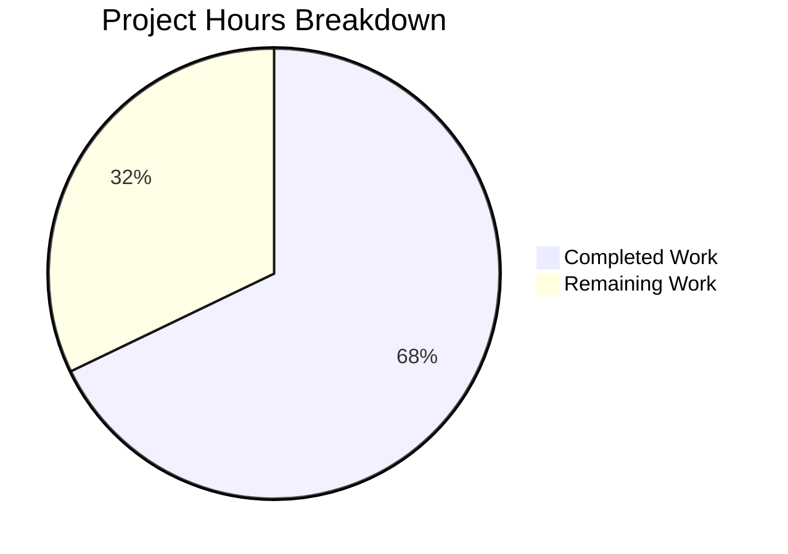

# 1. Executive Summary

## 1.1 Project Overview

`hello_world` is a single-file Node.js HTTP service that answers every request with status 200 and the plain-text body `Hello, World!` — a test scaffold for integration tooling that starts instantly, needs nothing installed and returns something predictable. This project delivered its documentation: a five-line README carrying the project name, the no-install statement and the run command, plus one consolidated JSDoc block above the listener declaration in `server.js` stating the handler's behaviour and typing the binding as `http.Server`, marked by a single `// Refinement:` note. No executable line, manifest, dependency or tool changed.

## 1.2 Completion Status

Completion is measured in hours across the specification's scoped work and the path-to-production work outstanding.



Completed is Blitzy dark blue (`#5B39F3`), remaining white (`#FFFFFF`).

| Metric | Hours |
|---|---|
| Total Hours | 28 |
| Completed Hours (AI + Manual) | 19 |
| Remaining Hours | 9 |
| Percent Complete | 68% |

Calculation: 19 completed ÷ 28 total = 67.9%, reported as **68%**. All 28 requirements are delivered and verified; the 9 remaining hours are release work outside that set (Section 2.2).

## 1.3 Key Accomplishments

- Handler documentation consolidated into one JSDoc block above the declaration, `@const {http.Server}` attached, with one `// Refinement:` note above it.
- `README.md` at five lines: project name, no-install statement, run command.
- Every README claim traced to its source in the repository.
- Served contract verified: 200, `text/plain`, byte-exact 14-byte body for every request tried.
- Lifecycle verified: one startup line, clean stop, port released, `EADDRINUSE` on a second start.
- Dependency-free bootstrap proven: it serves with nothing installed.
- Browser rendering verified: plain text, no scripts, no console output.
- Change surface held to two paths across the branch, one in this change; manifests byte-identical.

## 1.4 Critical Unresolved Issues

Of the 28 requirements this work was scoped against, **0 remain open**. Four items outside that set account for all 9 remaining hours in Section 2.2; three are accepted with a caveat and need no work.

| Issue | Impact | Owner | ETA |
|---|---|---|---|
| Package entry point unresolved: `package.json`'s `main` names `index.js`, which does not exist, and `scripts.test` is the npm-init placeholder that exits 1 | Any consumer resolving the package entry point, `npm start`, `npm pack` or a CI job invoking `npm test` fails on an otherwise green tree | Repository owner | 1.5 h |
| Tracked platform documents (`blitzy/documentation/Project Guide.md`, `Technical Specifications.md`) still describe a 72-line `server.js`, the earlier two-block documentation shape and Mermaid diagrams | A reader comparing them with the delivered README and code cannot tell which scope is authoritative | Repository owner | 1.5 h |
| No automated gate: no test suite, linter, type check or CI, and `npm test` fails by design | A future edit to the handler or to the documented command can drift undetected | Repository owner | 4 h |
| Listener bind fixed at `127.0.0.1:3000` with no environment or CLI override | The documented command collides with anything else using port 3000, and the README is specified to carry no remedy | Repository owner | 2 h |
| The `@callback RequestHandler` block at `server.js:40-48` is declared but referenced by no `@param`, and now sits beside a consolidated block that describes behaviour | Two documentation conventions sit adjacent to one declaration; no runtime effect | Repository owner | 0 h |
| The mandated description quotes the body as `"Hello, World!"` while the wire body is 14 bytes ending in a newline, and "every HTTP request" excludes requests Node's parser rejects | A reader comparing documentation with bytes sees a one-byte difference; inherent to the fixed wording | Repository owner | 0 h |
| The `// Refinement:` note explains a merge that only the history shows | Once the branch is history the note reads as context-free narration | Repository owner | 0 h |

## 1.5 Access Issues

No access issues identified. The repository, the Node.js runtime and loopback networking were reachable and exercised end to end; no credentials, environment variables or third-party services are involved.

## 1.6 Recommended Next Steps

1. **[High]** Resolve the package entry point and the test script (1.5 h).
2. **[Medium]** Add a contract gate asserting `200`, `text/plain` and a 14-byte body (4 h).
3. **[Medium]** Reconcile the tracked documents that still describe a 72-line file and the earlier block shape (1.5 h).
4. **[Low]** Make host and port overridable, keeping the current literals as defaults (2 h).
5. **[Low]** Decide whether the unreferenced `@callback RequestHandler` block is kept or retired.

# 2. Project Hours Breakdown

## 2.1 Completed Work Detail

Each component below traces to a requirement the work was scoped against.

| Component | Hours | Description |
|---|---|---|
| Inline handler documentation (R1) | 3 | Establishing the request handler's contract from the code, writing the summary to the specified text, and placing it in the file's own `/** ... */` form immediately above the declaration. |
| Root project documentation (R2, R3, R4, R5) | 4 | Sourcing the project name, the no-install statement and the run command from `package.json`, `package-lock.json` and `server.js`; resolving the run target away from the manifest's stale `main`; writing the five-line README and holding it to the 15-line ceiling, the single-H1 form and the no-forbidden-section rule. |
| Change-surface discipline (R6) | 2.5 | Proving no executable line moved, both manifests are byte-identical, exactly two paths differ across the branch and one in this change, and no other file, dependency, tool or configuration appeared. |
| Served-contract and lifecycle validation | 4 | Exercising the delivered listener end to end: startup line, first response, the 200 / `text/plain` / 14-byte contract across paths and methods, byte-exact body, bind address, HTTP/1.0 and keep-alive behaviour, clean termination with port release, `EADDRINUSE` on a second start, and the dependency-free bootstrap. |
| Cross-client and adversarial validation | 4.5 | Driving the endpoint from `curl` and a real browser; the injection, path-traversal, malformed-request, aborted-client and concurrency batteries; and the byte-equivalence comparison against the revision before the documentation change. |
| JSDoc consolidation and refinement note | 1 | Replacing the two stacked JSDoc blocks above the declaration with one block carrying the summary sentence as its description and `@const {http.Server}` as its sole tag, adding the single `// Refinement:` note above it, and proving the region shape, the byte-identity of everything outside it, the syntax parse and the live contract on a derived copy. |
| **Total** | **19** | |

## 2.2 Remaining Work Detail

| Category | Hours | Priority |
|---|---|---|
| Package manifest coherence — resolve the `main` entry point and replace the placeholder test script (path-to-production) | 1.5 | High |
| Automated contract gate for the served contract and the documented run command (path-to-production) | 4 | Medium |
| Documentation reconciliation — the tracked documents that describe a 72-line file and the earlier block shape (path-to-production) | 1.5 | Medium |
| Listener configuration override for host and port (path-to-production) | 2 | Low |
| **Total** | **9** | |

## 2.3 Hours Reconciliation

Completed hours (Section 2.1) 19 + remaining hours (Section 2.2) 9 = 28 total project hours. Completion is 19 ÷ 28 = 67.9%, reported as 68% in Section 1.2 and shown in the Section 7 chart. The remaining 9 hours equal the sum of Section 2.2's rows, the estimate attached to each open item in Section 1.4, and the four tasks in Section 1.6 that carry hours.

# 3. Test Results

The repository carries no test framework, so every case below was executed directly against the delivered revision: the syntax parse, live HTTP requests from `curl` and from raw Node sockets, a real browser, and byte-level comparisons of files and responses. 91 cases were executed, 91 passed, 0 failed. Nothing is instrumented, so no coverage percentage exists anywhere in this project.

| Area / Category | Framework | Tests | Passed | Failed | Coverage | What This Proves |
|---|---|---|---|---|---|---|
| Documentation region and source gates | `node --check`, `grep`, `diff`, `git` | 28 | 28 | 0 | Not instrumented | The declaration is documented by exactly one JSDoc block whose only tag is `@const {http.Server}`, the summary sentence is byte-verbatim, and every other line of both deliverables is byte-identical to the revision before the change. |
| Served HTTP contract — paths, methods, query strings, request bodies, header set | `curl` and raw Node sockets | 23 | 23 | 0 | Not instrumented | Every request, whatever its path, method, query string or body, receives status 200, `Content-Type: text/plain` and the byte-exact 14-byte body, including under 20 concurrent clients. |
| Process lifecycle, bind and dependency-free bootstrap | shell and Node probes, `npm` | 19 | 19 | 0 | Not instrumented | The server prints one startup line, binds loopback only, runs with nothing installed, releases its port on termination, and exits with `EADDRINUSE` on a second start. |
| Adversarial and robustness battery — injection payloads, path traversal, malformed requests, aborted clients | `curl`, raw sockets | 10 | 10 | 0 | Not instrumented | Request data never reaches the response, no file content is disclosed, and the process survives malformed input and clients that disconnect mid-request. |
| Behaviour equivalence with the revision before the consolidation | response digests and header diffs | 4 | 4 | 0 | Not instrumented | No status, header or body byte changed, so the documentation change altered no runtime behaviour. |
| Browser rendering | headless Chrome | 7 | 7 | 0 | Not instrumented | The endpoint renders as a plain-text document with no scripts, no subresources beyond the browser's own favicon request and no console output. |

**Not Covered**

- **No automated regression protection exists.** The repository has no test suite, linter, type checker or CI pipeline, and `npm test` is the npm-init placeholder that prints "Error: no test specified" and exits 1. Nothing guards the handler's contract, the documented run command or the JSDoc block's shape against a future edit; the contract gate in Section 1.6 is the recommended first task.
- **IPv6 loopback was never exercised.** Only IPv4 loopback is proven; a human should confirm behaviour on any host that resolves `localhost` to `::1`.
- **Reachability beyond loopback was never exercised** beyond confirming that a non-loopback address refuses the port. That refusal is the intended posture of a test scaffold; a human should confirm it remains intended before widening the bind.
- **No sustained soak was run.** The longest sessions were 20 concurrent requests and 10 sequential requests in one process; memory and file-descriptor behaviour over days of uptime are unmeasured.
- **No npm lifecycle entry point was exercised as a gate.** `npm test` fails by design and `main` resolves to a file that does not exist, so `npm start`, `npm pack` and `node .` remain unverified.
- **No TLS or HTTPS path exists to test** — the service speaks plain HTTP on loopback only.

# 4. Runtime Validation & UI Verification

- ✅ **Startup and lifecycle** — one stdout line (`Server running at http://127.0.0.1:3000/`), empty stderr, the first request served immediately rather than merely the port opening, and `SIGTERM` releasing the port with no process left behind.
- ✅ **Served contract** — status 200, `Content-Type: text/plain`, `Content-Length: 14` and body bytes `48 65 6c 6c 6f 2c 20 57 6f 72 6c 64 21 0a`, reproduced for `/`, unfamiliar paths, a 2048-character path, `POST` with a body, `PUT`, `DELETE`, `PATCH`, `OPTIONS`, `TRACE`, `HEAD` and HTTP/1.0.
- ✅ **Documented run command** — `node server.js` executed from the repository root printed the startup line and answered `200 text/plain 14`.
- ✅ **Dependency-free bootstrap** — a copy of the tree with nothing installed served the identical contract; `npm install` completed as a no-op and created no `node_modules`.
- ✅ **Browser rendering** — the payload rendered as a plain-text document (`document.contentType` `text/plain`, wrapped in a single `<pre>`, empty title) with no scripts, stylesheets, images or console messages; the browser's automatic `/favicon.ico` request received the same response, and an unknown path rendered identically.
- ✅ **Request-data inertness** — XSS, SQL-injection-shaped and percent-encoded traversal payloads in the path and query string produced the same fixed response, with nothing reflected and no file content disclosed.
- ✅ **Concurrency and malformed input** — 20 simultaneous requests each received 200 with an intact body, 10 sequential requests behaved identically, keep-alive connections were reused, and malformed request lines and clients disconnecting mid-request left the process serving.
- ✅ **Second start on a held port** — `listen EADDRINUSE` with exit code 1, the stack written to the operator's stderr and never to a client, with the first instance unaffected.
- ⚠ **External integrations** — none exist to exercise: the process makes no outbound call, reads no configuration, and connects to no database, cache, queue or third-party service.
- ⚠ **Authentication and configuration surfaces** — none exist to exercise: the service issues no credential, sets no cookie, protects no endpoint and reads no environment variable.

Never exercised at runtime: IPv6 loopback, reachability from a non-loopback interface, a sustained multi-day soak, load beyond 20 concurrent requests, the package's npm entry points (`npm test`, `npm start`, `main` resolution), and any TLS/HTTPS path.

# 5. Compliance & Quality Review

## 5.1 Compliance Matrix

Every deliverable below stands verified as shown; the matrix records present state.

| # | Deliverable | Requirement | Status | Progress | Verified in |
|---|---|---|---|---|---|
| 1 | Handler documentation | One JSDoc block immediately above the declaration, one description line, sole tag `@const {http.Server}`, no `@param`, `@returns`, example or second paragraph | ✅ Pass | 100% | `server.js:51-54` |
| 2 | Change marker | Exactly one `// Refinement:` line, above the block and never inside it | ✅ Pass | 100% | `server.js:50` |
| 3 | Project name in the root documentation | The name the project is known by | ✅ Pass | 100% | `README.md:1` against `package.json:2` |
| 4 | Install statement | The install command, or the statement that none applies | ✅ Pass | 100% | `README.md:3` against both manifests and `server.js:22` |
| 5 | Run command | The command that starts the service | ✅ Pass | 100% | `README.md:5` against `server.js:68-71` |
| 6 | Root documentation form | Under 15 lines, with no contributing, license, testing, deployment, architecture or table-of-contents section | ✅ Pass | 100% | `README.md:1-5` |
| 7 | Change surface | Only the documented file differs; `README.md` byte-identical; nothing created, deleted or renamed | ✅ Pass | 100% | `git diff 2c299c1..HEAD`: `M server.js` alone |
| 8 | Executable-code integrity | No executable line changed | ✅ Pass | 100% | comment-stripped diff of `server.js` against `2c299c1` |
| 9 | Documentation-region integrity | Every line outside the consolidated region preserved character for character | ✅ Pass | 100% | `server.js:1-49, 55-71` vs `2c299c1:1-49, 56-72` |
| 10 | Dependency and tooling integrity | No dependency, version, test artefact, lockfile, tool or script change | ✅ Pass | 100% | `package.json`, `package-lock.json` byte-identical; no `node_modules` |
| 11 | Scope discipline | No out-of-scope path, hardening, route, error handler or new file | ✅ Pass | 100% | whole tree; `blitzy/**` untouched |
| 12 | Static and runtime gates | The changed source parses and the documented behaviour is the behaviour served | ✅ Pass | 100% | `node --check server.js` exit 0; `200 text/plain 14` live |

## 5.2 AAP & Rule Divergences and Gaps

No divergence from a user rule exists, because no user rules were provided for this project — the rules set is empty, so no rule-based obligation constrains the work. Eleven items depart from the agreed specification or leave a constraint in place: four are sanctioned by the repository owner's own instruction on this pull request, four are gaps that need a decision and carry the remaining hours, and three are accepted with a caveat and need no work.

| # | What the AAP/Rule Required | What Was Delivered Instead | Why It Diverged | Impact | Remediation |
|---|---|---|---|---|---|
| DV-1 | One single-line JSDoc summary inserted between the existing `@const {http.Server}` block and the declaration, with "nothing else in the file changes", the file going from 71 to 72 lines, and merging the blocks named as out-of-scope refactoring | One consolidated JSDoc block whose single description line is the same summary and whose sole tag is `@const {http.Server}`, at `server.js:51-54`, with the declaration immediately below at `:55`; the file is 71 lines | Sanctioned — the owner's pull-request instruction ("Improve PR without expanding scope", "Target server.js … for refinement") directed the merge of the two stacked blocks so the type annotation attaches | The specified two-block shape and the 72-line figure no longer describe the file; the standalone sentences `HTTP Server instance created with request handler callback.` and `The server responds identically to all HTTP methods and paths.` are no longer in the file; runtime behaviour is unchanged byte for byte | None required — the change was directed |
| DV-2 | Acceptance defined as contents matching the specification exactly, with no change beyond the single inserted line | Acceptance applied as the consolidated region shape at 71 lines, with every line outside it unchanged and no line count refreshed in any other tracked document | Sanctioned by the same instruction ("Only modified files will be regenerated; line count updates after completion") | The specification's fixed line count is no longer an acceptance test; the delivered count of 71 is the recorded fact | None required |
| DV-3 | No added comment text beyond the one inserted summary line | Exactly one `// Refinement:` line comment above the block, outside it, stating that the two stacked blocks were merged so the type attaches | Sanctioned by the instruction ("used comment where changed because of refinements") | The block still carries one description line and one tag; the note is the file's longest line at 105 characters | None required |
| DV-4 | The documented run command exercised exactly as the repository ships it | Exercised literally on `127.0.0.1:3000`, and additionally on byte-identical copies with only the port literal changed, for the checks that had to share the machine | Sanctioned by the shared-host rule for parallel work on one machine, which the source cannot accommodate because it offers no port override | No repository file was modified; the literal-port evidence is complete and the derived copies differ on one line only | None; the underlying constraint is settled by DV-5 |
| DV-5 | A run command a reader can execute on any host | `127.0.0.1` (`server.js:30`) and `3000` (`server.js:38`) are literals with no environment or CLI override, and the README is specified to carry no host or port text | Not implemented in this change: environment-variable configuration and manifest changes were outside the agreed surface | On a machine already using port 3000 the documented command fails with `EADDRINUSE` and the reader has no documented recourse | 2 h — read host and port from the environment, keeping the current literals as defaults |
| DV-6 | Manifests and tooling left untouched | `package.json` still declares `main: "index.js"`, which does not exist, and `scripts.test` remains the npm-init placeholder that exits 1 | Not implemented in this change: manifest and tooling changes were excluded from the agreed surface | Any consumer resolving the package entry point, `npm start`, `npm pack`, `node .` or a CI job invoking `npm test` fails on an otherwise green tree | 1.5 h — point `main` at `server.js` and replace the placeholder script |
| DV-7 | Nothing outside the two documented files touched | `blitzy/documentation/Technical Specifications.md` (19 references to "72 lines"), `blitzy/documentation/Project Guide.md` and `blitzy/documentation/Project Guide - 0451788f-5330-4d7e-8974-6a6033519d61.md` were left as they were and still describe the earlier shape and count | Not implemented in this change: every other path was excluded, so the delivered documentation could not reconcile them | A reader comparing those documents with the delivered README and code cannot tell which scope is authoritative | 1.5 h — regenerate or remove them |
| DV-8 | A documentation deliverable whose claims stay true as the code evolves | No test suite, linter, type checker or CI exists, and `npm test` fails by design, so only a syntax parse and a live request protect the documented contract | Not implemented in this change: adding test or documentation tooling was excluded | A future edit to the handler, the run command or the JSDoc block can break the documented behaviour silently | 4 h — a contract gate asserting 200, `text/plain` and a 14-byte body, wired into the scripts and CI |
| DV-9 | One documentation convention per declaration | The `@callback RequestHandler` block at `server.js:40-48` is declared but referenced by no `@param`, and now sits beside the consolidated block that describes behaviour | Pre-existing and explicitly outside the agreed surface; it was not produced by this change | Two documentation conventions sit adjacent to one declaration; the rendered docs show a type nobody uses | None estimated — the owner decides whether it is kept or retired |
| DV-10 | Documentation that matches the served bytes exactly | The mandated description quotes the body as `"Hello, World!"` while `res.end` writes 14 bytes ending in a newline, and "every HTTP request" excludes requests Node's parser rejects with `400`/`431` before the handler runs | Inherent to the fixed wording the work was required to use verbatim; no permitted settlement exists | A reader comparing documentation with bytes sees a one-byte difference and behaviour the handler never produces | None — inherent to the mandated text |
| DV-11 | Durable documentation a future reader can act on | The `// Refinement:` note explains a merge that only the version history shows | Required by the owner's instruction to mark each place the change touched | Once the branch is history the note reads as context-free narration; it is accurate today | None — inherent to the directed note |

**DV-1 — one block instead of two layers of comment.** The specification fixed a single inserted summary line between the existing `@const {http.Server}` block and the declaration, which left two consecutive JSDoc blocks above one statement: JSDoc attributes only the last block to the declaration, so the type annotation sat detached and the summary repeated the behaviour sentence directly above it. The owner's instruction directed the merge instead of a further insertion, so `server.js:50-54` now holds one block carrying both the summary and the tag, with nothing between ` */` and the declaration at `:55`. The anchors are checkable: the block census fell from six to five, `grep -c '^// Refinement:' server.js` returns 1, and every line outside `50-54` is byte-identical to `2c299c1`. Nothing is left to decide; the file is correct as it stands.

**DV-5 — a bind that cannot be re-pointed.** The README says ``Run: `node server.js` `` and nothing about where the service listens, because five lines with no host or port text were the specified form. The code binds `127.0.0.1:3000` from two literals (`server.js:30`, `server.js:38`) with no environment or CLI override, so the command cannot be redirected; on a workstation already using port 3000 it fails immediately with `EADDRINUSE`, which is what a second instance against a held port produced. The owner must decide whether the scaffold should stay deliberately unconfigurable or gain a `HOST`/`PORT` override that keeps the current values as defaults.

**DV-6 — a manifest that points at nothing.** `package.json` declares `main: "index.js"` while the repository contains no `index.js`, and `scripts.test` is the npm-init placeholder whose output is `Error: no test specified` with exit code 1. The documented run command steers around both, so the shipped README stays accurate, but anyone reaching for the package entry point, `npm start`, `npm pack`, `node .` or a CI job that runs `npm test` meets a failure unrelated to the code. The decision is whether to point `main` at `server.js` and replace the script, about ninety minutes including a smoke check.

**DV-7 — tracked documents describing a different deliverable.** `blitzy/documentation/Technical Specifications.md` states the file is 72 lines in 19 places, and both Project Guide documents still narrate the two-stacked-block shape and the 71 → 72 line growth. The tree holds a five-line README and a 71-line `server.js` with one consolidated block plus a refinement note. Neither document is read by the application and both were outside the agreed surface, so nothing reconciled them. The owner should decide whether to regenerate them against the delivered state or remove them, leaving one authoritative description for the next reader.

**DV-8 — nothing verifies what the documentation claims.** No test suite, linter, type checker or CI configuration exists, and `npm test` is a placeholder that exits 1 by design; the only available checks are `node --check server.js` and a manual request. The contract itself is stable and thoroughly exercised — status 200, `Content-Type: text/plain` and a 14-byte body for every path, method, query string and body tried, with no change in any of those values against the revision before the documentation change. But a later edit could change them, or re-stack the JSDoc blocks, without any signal. The decision is whether to add the small contract gate the remaining-work table budgets for.

# 6. Risk Assessment

These are forward-looking: what could still go wrong once this code is operated, not what was encountered while delivering it.

| Risk | Category | Severity | Probability | Mitigation | Status |
|---|---|---|---|---|---|
| The documentation's claims drift from the served behaviour — the README's run command and no-install statement, and the JSDoc block's shape, have no automated guard | Technical | Medium | Medium | Add the contract gate from Section 1.6 (4 h); until then re-run the Section 9 verification after any handler change | Open |
| The tracked documents under `blitzy/documentation/` still describe a 72-line `server.js` and the earlier two-block shape, and a reader may act on the wrong scope | Operational | Medium | High | Regenerate or remove them (1.5 h) | Open |
| Package packaging paths are broken: `main` resolves to an absent `index.js` and `scripts.test` exits 1, so a consumer, `npm start`, `npm pack`, `node .` or a CI job fails on a green tree | Integration | Medium | High | Point `main` at `server.js` and replace the placeholder script (1.5 h) | Open |
| The documented command collides with anything already using port 3000, and the README is specified not to document a remedy | Operational | Medium | Medium | Add a `HOST`/`PORT` override with the current literals as defaults (2 h), or state that port 3000 must be free before running | Open |
| With no linter, type checker, test suite or CI, a parse error is the only automatic signal, and a comment-structure regression would go unremarked | Technical | Medium | Medium | The same gate as the first row; a syntax parse alone cannot detect a behaviour or documentation change | Open |
| If the loopback bind is ever widened — the code's own comment at `server.js:25-26` invites `0.0.0.0` — every reachable client receives the same fixed response, with no authentication, rate limiting, request-size limit or security header in the process | Security | High | Low | Keep the binding loopback, or place the service behind a proxy that supplies the missing controls | Open |
| Client-visible protocol limits: non-standard method tokens and malformed request lines receive Node's `400`, oversized header blocks receive `431`, and `HEAD` carries no `Content-Length` | Integration | Low | Low | Document the served contract and these limits wherever the endpoint is consumed | Open |
| There is no request logging, no metric and no health endpoint beyond one startup line, so an incident in an operated deployment leaves nothing to correlate | Operational | Low | Medium | Add a request log or a health endpoint only if the service is operated beyond a test scaffold | Open |

# 7. Visual Project Status


Completed work is shown in Blitzy dark blue (`#5B39F3`); remaining work in white (`#FFFFFF`). The chart reflects 19 hours completed and 9 hours remaining of 28 total, the same figures as Section 1.2.

Remaining hours by category, at the priorities recorded in Section 2.2:

| Category | Hours | Priority |
|---|---|---|
| Automated contract gate | 4 | Medium |
| Listener configuration override | 2 | Low |
| Package manifest coherence | 1.5 | High |
| Documentation reconciliation | 1.5 | Medium |
| **Total remaining** | **9** | |

| Priority | Hours remaining |
|---|---|
| High | 1.5 |
| Medium | 5.5 |
| Low | 2 |
| **Total** | **9** |

# 8. Summary & Recommendations

**What was delivered.** This project documented a single-file Node.js HTTP service and nothing more. `server.js` carries one consolidated JSDoc block above its listener declaration (`server.js:51-54`): a single description line stating that every request is answered with status 200 and the plain-text body, and the sole tag `@const {http.Server}`, which now attaches to `const server` because the block sits directly above it with nothing in between; a single `// Refinement:` note at `:50` records that the two stacked blocks were merged so the type attaches. `README.md` is five lines carrying the project name, the statement that no install step applies, and the run command `node server.js`. All 28 requirements this work was scoped against are delivered and verified: the description is byte-identical to the specified text, the README is byte-identical to the specified five lines, every executable line and every line outside `server.js:50-54` is byte-identical to the revision before the change, and the change surface is that one file with both manifests untouched.

**What was exercised to prove it works.** The delivered service was run and queried rather than only read: 91 checks executed and all 91 passed. Status 200, `Content-Type: text/plain` and the byte-exact 14-byte body `Hello, World!\n` were reproduced for every path, method, query string and request body tried, including a 2048-character path, all seven standard methods, `HEAD`, HTTP/1.0, keep-alive reuse, 10 sequential and 20 concurrent requests. The lifecycle was driven end to end: one startup log line, loopback-only bind, clean termination with the port released, `EADDRINUSE` on a second start, and a bootstrap on a copy of the tree with nothing installed. The endpoint was also driven from a real browser, which rendered it as a plain-text document with no scripts, no subresources beyond the favicon and no console output; injected XSS, SQL-injection-shaped and traversal payloads stayed inert; and the served status, headers and body were digest-identical to the revision before the documentation change. The one area with no coverage at all is automated: there is no test suite, linter, type checker or CI pipeline, and `npm test` is a placeholder that exits 1 by design.

| Metric | Value |
|---|---|
| Total Hours | 28 |
| Completed Hours (AI + Manual) | 19 |
| Remaining Hours | 9 |
| Percent Complete | 68% |
| Requirements delivered and verified | 28 of 28 |
| Paths changed in this change | 1 (`server.js`) |
| Executable lines changed | 0 |

**What remains, and why the figure is 68% rather than 100%.** No requirement is outstanding; the gap is release work the specification deliberately excluded. `package.json` still points `main` at an `index.js` that does not exist and keeps a test script that exits 1, so packaging and CI paths fail on an otherwise green tree; the tracked documents under `blitzy/documentation/` still describe a 72-line file and the earlier two-block shape; the listener binds `127.0.0.1:3000` from literals with no override, so the documented command cannot be re-pointed; and nothing automatically guards the contract the documentation describes. Those four items are the 9 remaining hours in Section 2.2 and the four tasks in Section 1.6 that carry hours.

**Critical path to production.** In order: resolve the package entry point and the test script (1.5 h), add a contract gate that asserts 200, `text/plain` and a 14-byte body (4 h), reconcile the tracked documents that describe a larger deliverable (1.5 h), and make host and port overridable with the current literals as defaults (2 h). The first three remove genuine reader-facing traps; the last is operability hygiene.

**Production readiness.** The documentation deliverable is ready for review and release as it stands — its claims are true of the code, its scope is exactly what was agreed, and no executable line changed. The repository around it is ready for a test-scaffold deployment on loopback and would need the four items above before anyone treated it as a packaged, operable service. Success for this project is measured narrowly and is met: a reader can find the project name, learn that nothing needs installing, start the server with one command, and trust that the block above the listener describes what it does and types it correctly.

# 9. Development Guide

## Prerequisites

- **Node.js 22.x** on `PATH` — the runtime the documented command needs. Verified here as `v22.23.5`.
- **npm** — used only to inspect the package; the project declares no dependencies. Verified as `11.21.0`.
- **Git with Git LFS** (`git-lfs/3.7.1` verified). The repository ships four Git LFS hooks that fail with exit code 2 when LFS is missing; leave them in place and keep LFS installed.
- **curl** for the verification steps below, and `od` (or `hexdump`) for the byte-exact body check.
- No database, message broker, cache, container, credential, VPN or environment variable is required. `server.js` reads no environment variable and the package declares no dependency.

## Environment setup

There is nothing to set up. Work from the repository root, where `server.js`, `package.json` and `package-lock.json` sit:

```bash
cd "$(git rev-parse --show-toplevel)"
node --version        # expect v22.x
```

## Install step

None applies. The server loads only Node.js's built-in `http` module, `package.json` declares no dependencies or devDependencies, and `package-lock.json`'s packages map holds only the root entry, which is why the README says so. Running npm is optional and is a no-op:

```bash
npm install           # prints "up to date, audited 1 package"; creates no node_modules
npm ls --depth=0      # prints the package line, then "└── (empty)"
```

## Starting the server

```bash
node server.js
```

It binds `127.0.0.1:3000` (both values are literals in the source) and prints exactly one line:

```
Server running at http://127.0.0.1:3000/
```

To run it in the background with its output captured, and then stop it cleanly:

```bash
node server.js > "$HOME/hello_world-server.log" 2>&1 &
PID=$!
sleep 1
cat "$HOME/hello_world-server.log"     # the startup line
kill "$PID"                            # SIGTERM; exit status 143 is expected
```

## Verifying it works

With the server running, this is the whole acceptance check, and the output is exact:

```bash
curl -s -o /dev/null -w '%{http_code} %{content_type} %{size_download}\n' http://127.0.0.1:3000/
# 200 text/plain 14
```

Byte-exact body, including the trailing newline:

```bash
curl -s http://127.0.0.1:3000/ | od -An -tx1
#  48 65 6c 6c 6f 2c 20 57 6f 72 6c 64 21 0a
```

Syntax gate on the source (there is no linter, type checker or test suite to run instead):

```bash
node --check server.js && echo "syntax OK"
```

Check the documentation region itself — one JSDoc block for the declaration, one change note above it, and a 71-line file:

```bash
wc -l server.js                                        # 71 server.js
grep -c '^/\*\*' server.js                             # 5
grep -c '^// Refinement:' server.js                    # 1
sed -n '50,55p' server.js
```

Confirm the port was released after stopping, using the Node probe below because `ss`, `netstat`, `lsof` and `fuser` are not installed on every host:

```bash
node -e 'const n=require("net"),s=n.createServer();s.once("error",e=>console.log("BUSY",e.code));s.once("listening",()=>s.close(()=>console.log("FREE")));s.listen(3000,"127.0.0.1")'
```

## Running on a port other than 3000

`server.js` hard-codes `const port = 3000;`, so a busy port 3000 or a desire to run a second instance means re-pointing a copy rather than editing the checkout:

```bash
sed 's/^const port = 3000;$/const port = 31000;/' server.js > "$HOME/server-31000.js"
diff server.js "$HOME/server-31000.js"     # exactly one line differs: line 38, the port
node "$HOME/server-31000.js"
curl -s -o /dev/null -w '%{http_code} %{content_type} %{size_download}\n' http://127.0.0.1:31000/
# 200 text/plain 14
```

## Example usage

Every request, to any path and by any standard method, receives the same answer:

```bash
curl -i http://127.0.0.1:3000/                      # HTTP/1.1 200 OK, text/plain, Content-Length: 14
curl -s http://127.0.0.1:3000/does/not/exist        # identical body
curl -s -X POST -d 'x=1' http://127.0.0.1:3000/     # identical body
curl -sI http://127.0.0.1:3000/                     # HEAD: 200, same headers, no body bytes
```

## Troubleshooting

- **`Error: listen EADDRINUSE: address already in use 127.0.0.1:3000`** — something else holds port 3000. Node exits with status 1 and prints an `Unhandled 'error' event` stack to your terminal. Find and stop the other listener, or run a re-pointed copy as shown above. Confirm the port is free first with the Node probe.
- **`curl: (7) Failed to connect`** — nothing is listening on that port; `curl` exits 7. Check the startup line was printed and that the port you are calling is the port you started.
- **`npm test` exits 1 with "Error: no test specified"** — expected. It is the npm-init placeholder, there is no test suite, and the exit status is not a regression.
- **`npm start` or `node index.js` fails** — expected. `package.json`'s `main` names `index.js`, which does not exist. `node server.js` is the run command.
- **Git says an LFS hook failed with exit code 2** — `git-lfs` is missing; install it rather than deleting the hooks.
- **Cannot bind `[::1]` (`EADDRNOTAVAIL`)** — the service is IPv4-loopback only by design; call `http://127.0.0.1:3000/`, not `http://localhost:3000/` if the host resolves `localhost` to `::1` first.
- **`ss`, `lsof`, `netstat` or `nc` not found** — use the Node port probe above and `curl`; both are sufficient for every check in this guide.
- **`HEAD` returns no `Content-Length`** — expected. Node omits the body and that header for `HEAD` requests on a `text/plain` response; `GET` carries `Content-Length: 14`.

# 10. Appendices

## A. Command Reference

| Purpose | Command |
|---|---|
| Check the runtime version | `node --version` |
| Start the server (documented command) | `node server.js` |
| Start in the background with a log | `node server.js > "$HOME/hello_world-server.log" 2>&1 &` |
| Stop it | `kill <PID>` (SIGTERM; exit status 143 is expected) |
| Runtime acceptance check | `curl -s -o /dev/null -w '%{http_code} %{content_type} %{size_download}\n' http://127.0.0.1:3000/` → `200 text/plain 14` |
| Byte-exact body | `curl -s http://127.0.0.1:3000/ \| od -An -tx1` → `48 65 6c 6c 6f 2c 20 57 6f 72 6c 64 21 0a` |
| Syntax gate | `node --check server.js` |
| Documentation-region census | `grep -c '^/\*\*' server.js` → 5; `grep -c '^// Refinement:' server.js` → 1 |
| Line count | `wc -l server.js` → 71 |
| Port availability probe | `node -e 'const n=require("net"),s=n.createServer();s.once("error",e=>console.log("BUSY",e.code));s.once("listening",()=>s.close(()=>console.log("FREE")));s.listen(3000,"127.0.0.1")'` |
| Confirm the dependency-free state | `npm ls --depth=0` → `(empty)` tree |
| Inspect the change surface | `git diff --name-status 2c299c1..HEAD` → `M server.js` |
| Confirm the manifests are untouched | `git diff --quiet 2c299c1..HEAD -- package.json package-lock.json` → exit 0 |
| Prove nothing outside the documentation region moved | `diff <(sed -n '1,49p;55,71p' server.js) <(git show 2c299c1:server.js \| sed -n '1,49p;56,72p')` → no output |

## B. Port Reference

| Port | Use |
|---|---|
| 3000 | The port the application binds, hard-coded in `server.js:38`, and the port the README's run command implies |
| 31000–31064 | Convenience range for re-pointed copies when 3000 is occupied or several instances must run at once (one port per instance) |
| 32768+ | Ephemeral range used automatically by client sockets; do not bind the server here |

The bind address is `127.0.0.1` (`server.js:30`), so the listener is reachable from the local machine only.

## C. Key File Locations

| Path | Purpose |
|---|---|
| `server.js` | The entire application, 71 lines: header `@fileoverview` block (1-19), the built-in `http` import (22), the hostname and port constant blocks (24-37), the `@callback RequestHandler` block (40-48), the consolidated JSDoc block for the listener with its `// Refinement:` note (50-54), the request handler (55-64) and the listen call with its startup log (66-71) |
| `README.md` | The five-line root document: project name, no-install statement, run command |
| `package.json` | Name `hello_world`, version `1.0.0`, no dependencies, `main` pointing at an absent `index.js`, npm-init `test` script |
| `package-lock.json` | Lockfile holding only the root entry |
| `blitzy/documentation/Project Guide.md`, `blitzy/documentation/Technical Specifications.md`, `blitzy/documentation/Project Guide - 0451788f-5330-4d7e-8974-6a6033519d61.md` | Tracked documents describing a 72-line file and an earlier documentation shape; not read by the application |

## D. Technology Versions

| Component | Version | Notes |
|---|---|---|
| Node.js | v22.23.5 (verified on this host) | Any 22.x runtime runs the project; `package.json` declares no `engines` constraint |
| npm | 11.21.0 | Used to inspect the package only |
| Git LFS | 3.7.1 | Required by the repository's four LFS hooks |
| Dependencies | none | The only import is Node's built-in `http` |

## E. Environment Variable Reference

None. `server.js` contains no `process.env` reference, the package declares no `engines` or configuration, and no `.env` file exists — so there is nothing to configure before running. The only runtime value that can be changed today is the port literal in the source (see Section 9's re-pointed-copy recipe); making host and port configurable from the environment is the lowest-priority item in Section 2.2.

## F. Developer Tools Guide

| Tool | Availability | Use here |
|---|---|---|
| `node` | Present | Runs the server, the syntax gate and the port probe |
| `npm` | Present | Inspects the package; `npm test` is a placeholder that exits 1 |
| `curl` | Present | The contract check and the request examples |
| `od` / `hexdump` | `od` present | Byte-exact body verification |
| `git`, `git-lfs` | Present | Change-surface inspection; LFS backs the repository's hooks |
| `ss`, `netstat`, `lsof`, `fuser` | Not installed | Use the Node port probe in Appendix A instead |
| `nc` | Not installed | Use `curl` or a raw Node socket for protocol probes |
| Linter, formatter, type checker, bundler, test runner | Absent by design | The project has no such configuration and none is required |

## G. Glossary

- **AAP** — the agreed specification for this work: the two documentation deliverables, their specified contents, the requirements they satisfy and the scope limits around them.
- **Byte-exact body** — the response payload compared byte by byte, including its trailing newline (`Hello, World!\n`, 14 bytes).
- **Byte-identical** — matching character for character, so that a file or line can be proven unchanged.
- **Change surface** — the set of repository paths that differ from a given revision; across the branch exactly `server.js` and `README.md`, and in the documentation change exactly `server.js`.
- **Consolidated block** — the single JSDoc block above `const server` that carries both the handler's behaviour summary and its `@const {http.Server}` type, so the type annotation attaches to the declaration.
- **`EADDRINUSE`** — the error raised when something already holds the port the server tries to bind.
- **`EADDRNOTAVAIL`** — the error raised when the host cannot bind the requested address, as with IPv6 loopback on some hosts.
- **JSDoc** — the `/** ... */` comment form the file uses throughout; the block above the listener carries one description line and one tag.
- **Loopback** — the `127.0.0.1` interface, reachable only from the local machine.
- **Path-to-production** — the work needed to turn a delivered change into a releasable one: the 9 remaining hours in Section 2.2.
- **Refinement note** — the single `//` line comment above the JSDoc block recording that the two stacked blocks were merged so the type attaches.
