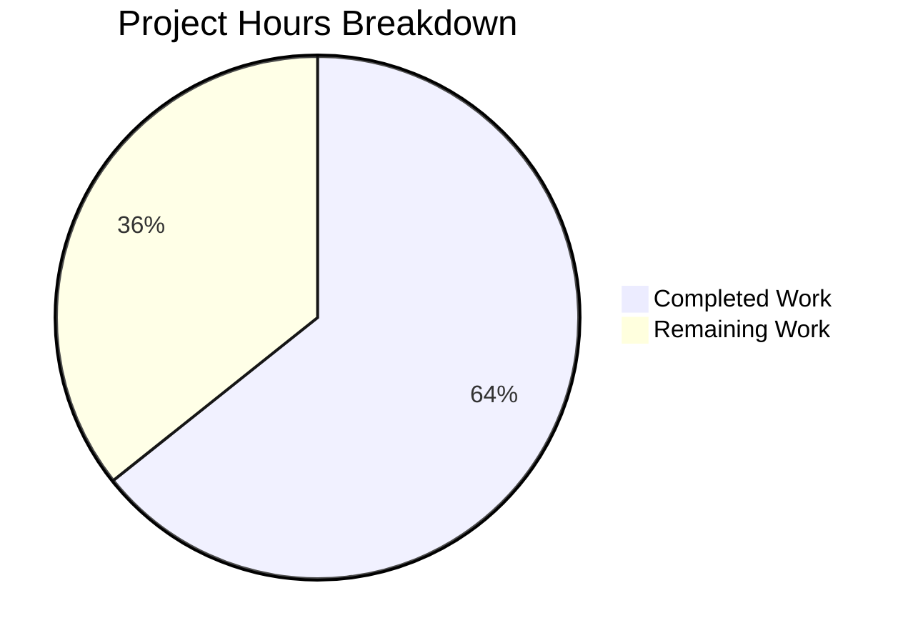

# 1. Executive Summary

## 1.1 Project Overview

`hello_world` is a single-file Node.js HTTP service that answers every request with status 200 and the plain-text body `Hello, World!`. It is a test scaffold for integration tooling: it starts instantly, needs nothing installed and returns something predictable. This project delivered the documentation describing it — a five-line README carrying the project name, the statement that no install step applies and the command that starts the server, plus a one-line JSDoc summary above the request handler in `server.js`. Those two files were touched and nothing else: no executable line, manifest, dependency or tool.

## 1.2 Completion Status

Completion is measured in hours across the work the agreed specification scoped and the path-to-production work still outstanding.



Completed work is shown in Blitzy dark blue (`#5B39F3`); remaining work in white (`#FFFFFF`).

| Metric | Hours |
|---|---|
| Total Hours | 28 |
| Completed Hours (AI + Manual) | 18 |
| Remaining Hours | 10 |
| Percent Complete | 64% |

Calculation: 18 completed ÷ 28 total = **64%**. All 24 requirements are delivered and verified; the 10 remaining hours are release work outside that deliverable (Section 2.2).

## 1.3 Key Accomplishments

- Inline handler documentation added at `server.js:55` as one JSDoc summary line, with all 71 other lines byte-identical.
- `README.md` reduced to five lines: project name, no-install statement, run command.
- Every README claim traced to its source — the manifests, the name field and the only file that listens.
- Served contract verified: 200, `text/plain` and a byte-exact 14-byte body for every request tried.
- Lifecycle verified: one startup line, clean termination, port released, `EADDRINUSE` on a second start.
- Dependency-free bootstrap proven: it serves with nothing installed.
- Browser rendering verified: plain text, no scripts or console output, injected payloads inert.
- Change surface held to exactly two paths, both manifests byte-identical.

## 1.4 Critical Unresolved Issues

Of the 24 requirements this work was scoped against, **0 remain open**; five items outside that scope remain open and account for the 10 remaining hours in Section 2.2.

| Issue | Impact | Owner | ETA |
|---|---|---|---|
| Package entry point unresolved: `package.json`'s `main` names `index.js`, which does not exist, and `scripts.test` is the npm-init placeholder that exits 1 | Any consumer resolving the package entry point, `npm start`, `npm pack` or a CI job invoking `npm test` fails on an otherwise green tree | Repository owner | 1.5 h |
| Tracked platform documents (`blitzy/documentation/Project Guide.md`, `Technical Specifications.md`) still describe a 462-line README, a 71-line `server.js` and Mermaid diagrams | A reader comparing them with the delivered README and code cannot tell which scope is authoritative | Repository owner | 2 h |
| No automated gate: no test suite, linter, type check or CI, and `npm test` fails by design | A future edit to the handler or the documented command can drift undetected | Repository owner | 4 h |
| Listener bind fixed at `127.0.0.1:3000` with no environment or CLI override | The documented command collides with anything else using port 3000, and the README is specified not to document a remedy | Repository owner | 2 h |
| Two JSDoc blocks sit above `const server` (`server.js:50-55`) | Documentation tooling attaches the new handler summary to the declaration and leaves the type annotation above it detached | Repository owner | 0.5 h |

## 1.5 Access Issues

No access issues identified. The repository, the Node.js runtime and loopback networking were reachable and exercised end to end; no credentials, environment variables or third-party services are involved.

## 1.6 Recommended Next Steps

1. **[High]** Resolve the package entry point and the test script (1.5 h).
2. **[Medium]** Add a contract gate asserting `200`, `text/plain` and a 14-byte body (4 h).
3. **[Medium]** Reconcile the tracked platform documents that still describe a larger deliverable (2 h).
4. **[Low]** Make host and port overridable, keeping the current literals as defaults (2 h).
5. **[Low]** Merge the two JSDoc blocks above `const server` (0.5 h).

# 2. Project Hours Breakdown

## 2.1 Completed Work Detail

Each component below traces to a requirement the work was scoped against.

| Component | Hours | Description |
|---|---|---|
| Inline handler documentation (R1) | 3 | Establishing the request handler's contract from the code, writing the single-line JSDoc summary to the specified text, placing it between the existing server-level block and the declaration in the file's own `/** ... */` form, and proving the comment is the only change to the file. |
| Root project documentation (R2, R3, R4, R5) | 4 | Sourcing the project name, the no-install statement and the run command from `package.json`, `package-lock.json` and `server.js`; resolving the run target away from the manifest's stale `main`; writing the five-line README and holding it to the 15-line ceiling, the single-H1 form and the no-forbidden-section rule. |
| Change-surface discipline (R6) | 2.5 | Proving no executable line moved, both manifests are byte-identical, exactly two paths differ and no third file, dependency, tool or configuration appeared. |
| Served-contract and lifecycle validation | 4 | Exercising the delivered listener end to end: startup line, first response, the 200 / `text/plain` / 14-byte contract across paths and methods, byte-exact body, bind address, HTTP/1.0 and keep-alive behaviour, clean termination with port release, `EADDRINUSE` on a second start, and the dependency-free bootstrap on a tree with nothing installed. |
| Cross-client and adversarial validation | 4.5 | Driving the endpoint from `curl` and a real browser; the injection, path-traversal, response-splitting, oversized-body, malformed-request and concurrency batteries; and the equivalence comparison of the delivered revision against the one before it. |
| **Total** | **18** | |

## 2.2 Remaining Work Detail

| Category | Hours | Priority |
|---|---|---|
| Package manifest coherence — resolve the `main` entry point and replace the placeholder test script (path-to-production) | 1.5 | High |
| Automated contract gate for the served contract and the documented run command (path-to-production) | 4 | Medium |
| Documentation reconciliation — the tracked documents that describe a larger deliverable than the one shipped (path-to-production) | 2 | Medium |
| Listener configuration override for host and port (path-to-production) | 2 | Low |
| JSDoc consolidation above `const server` (follow-up on the specified placement) | 0.5 | Low |
| **Total** | **10** | |

## 2.3 Hours Reconciliation

Completed hours (Section 2.1) 18 + remaining hours (Section 2.2) 10 = 28 total project hours. Completion is 18 ÷ 28 = 64%, the figure carried in Section 1.2 and shown in the Section 7 chart. The remaining 10 hours equal the sum of Section 2.2's rows and the estimate attached to each open item in Section 1.4.

# 3. Test Results

Totals below are the cases each verification battery executed against the delivered revision; the served contract, the lifecycle and the behaviour-equivalence checks were additionally re-run independently and reproduced identical results (10 of 10 cases, including a byte-exact body check on a copy re-pointed to a private port). No test framework, coverage tooling or linter exists in this repository, so "Coverage" is not instrumented anywhere; the project's only gates are a syntax parse and the live request check described in Section 9.

| Area / Category | Framework | Tests | Passed | Failed | Coverage | What This Proves |
|---|---|---|---|---|---|---|
| Served HTTP contract — paths, methods, query strings, request bodies, response header set | `curl` and raw Node TCP sockets (no test framework) | 34 | 34 | 0 | Not instrumented | Every request, whatever its path, method, query string or body, receives status 200, `Content-Type: text/plain` and the byte-exact 14-byte body `Hello, World!\n`. |
| Process lifecycle, bind and dependency-free bootstrap | shell probes, port probe, `curl` | 9 | 9 | 0 | Not instrumented | The server prints one startup line, serves the first request, binds loopback only, runs with nothing installed, releases its port on termination and exits with `EADDRINUSE` on a second start. |
| Documented run command as an integration entry point | `curl` and a real browser | 7 | 7 | 0 | Not instrumented | The command the README documents starts the server and serves the documented contract, and two independent clients receive identical status, headers and body. |
| Behaviour equivalence with the revision before the documentation edit | response digests (md5/sha256) | 4 | 4 | 0 | Not instrumented | No status, header or body byte changed, so the documentation edit altered no runtime behaviour. |
| Adversarial and edge-case battery — injection payloads, path traversal, response splitting, oversized bodies, malformed requests, concurrency, client aborts | `curl`, raw sockets, browser | 20 | 20 | 0 | Not instrumented | Request data never reaches the response, no file content is disclosed, and the process survives malformed input, aborted clients and 50 simultaneous requests. |
| Static syntax gate | `node --check` | 1 | 1 | 0 | n/a | The delivered `server.js` parses cleanly. |
| End-to-end acceptance pass — every capability above re-exercised on the delivered revision in a single run | `curl`, raw sockets, browser, OS-level probes | 168 | 165 | 0 | Not instrumented | The full capability set holds together in one continuous run; 3 cases are not applicable rather than skipped — no token or authenticated flow exists, and the project name and the README's line count have no runtime surface. |

**Not Covered**

- **No automated regression protection exists.** The repository has no test suite, linter, type checker or CI pipeline, and `npm test` is the npm-init placeholder that prints "Error: no test specified" and exits 1. Nothing guards the handler's contract or the README's documented command against a future edit; adding the contract gate in Section 1.6 is the recommended first task.
- **IPv6 loopback was never exercised.** `[::1]` cannot be bound on the host this work was validated on (`EADDRNOTAVAIL`), so only IPv4 loopback is proven. A human should confirm behaviour on any host that resolves `localhost` to `::1`.
- **Reachability beyond loopback was never exercised** beyond confirming that a non-loopback address refuses the port. That refusal is the intended posture of a test scaffold; a human should confirm it remains intended before widening the bind.
- **No sustained soak was run.** The longest session covered roughly 600 requests in one process; memory and file-descriptor behaviour over days of uptime are unmeasured.
- **No npm lifecycle entry point was exercised as a gate.** `npm test` fails by design and `main` resolves to a file that does not exist, so `npm start`, `npm pack` and any package-entry resolution path remain unverified.
- **No TLS or HTTPS path exists to test** — the service speaks plain HTTP on loopback only.

# 4. Runtime Validation & UI Verification

- ✅ **Startup and lifecycle** — one stdout line (`Server running at http://127.0.0.1:3000/`), no stderr, the first request served immediately rather than merely the port opening, and `SIGTERM` releasing the port with no process left behind.
- ✅ **Served contract** — status 200, `Content-Type: text/plain`, `Content-Length: 14` and body bytes `48 65 6c 6c 6f 2c 20 57 6f 72 6c 64 21 0a`, reproduced for `/`, unfamiliar paths, `POST` with a body and `HEAD`.
- ✅ **Documented run command** — `node server.js` executed from the repository root printed the startup line and answered `200 text/plain 14`.
- ✅ **Dependency-free bootstrap** — a copy of the tree with nothing installed served the identical contract; `npm install` completed as a no-op and created no `node_modules`.
- ✅ **Browser rendering** — the payload rendered as plain text with no scripts, images or console messages and no error page; the browser's automatic `/favicon.ico` request received the same response.
- ✅ **Request-data inertness** — XSS, SQL-injection-shaped, CRLF-splitting and path-traversal payloads in the path and query string produced the same fixed response, with nothing reflected and no file content disclosed.
- ✅ **Concurrency and malformed input** — 50 simultaneous requests each received 200 with an intact body, and malformed request lines received Node's built-in 47-byte `400 Bad Request` carrying no internal detail.
- ✅ **Second start on a held port** — `listen EADDRINUSE` with exit code 1, the stack written to the operator's stderr and never to a client, with the first instance unaffected.
- ⚠ **External integrations** — none exist to exercise: the process makes no outbound call, reads no configuration, and connects to no database, cache, queue or third-party service.
- ⚠ **Authentication and configuration surfaces** — none exist to exercise: the service issues no credential, sets no cookie, protects no endpoint and reads no environment variable.

Never exercised at runtime: IPv6 loopback (unbindable on the validation host), reachability from a non-loopback interface, a sustained multi-day soak, the package's npm entry points (`npm test`, `npm start`, `main` resolution), and any TLS/HTTPS path.

# 5. Compliance & Quality Review

## 5.1 Compliance Matrix

Every deliverable below stands verified as shown; the matrix records present state, not the path taken to it.

| # | Deliverable | Requirement | Status | Progress | Verified in |
|---|---|---|---|---|---|
| 1 | Inline handler documentation | One single-line JSDoc summary above the request handler, with no `@param`, `@returns`, second paragraph or example | ✅ Pass | 100% | `server.js:55` |
| 2 | Project name in the root documentation | The name the project is known by | ✅ Pass | 100% | `README.md:1` against `package.json:2` |
| 3 | Install statement | The install command, or the statement that none applies | ✅ Pass | 100% | `README.md:3` against both manifests and `server.js:22` |
| 4 | Run command | The command that starts the service | ✅ Pass | 100% | `README.md:5` against `server.js:69` |
| 5 | Root documentation form | Under 15 lines, with no contributing, license, testing, deployment, architecture or table-of-contents section | ✅ Pass | 100% | `README.md:1-5` |
| 6 | Change surface | No executable line of `server.js` changed; no other file created, modified or deleted | ✅ Pass | 100% | `git diff`: `M README.md`, `M server.js` only |
| 7 | Minimal-diff discipline | One inserted line; no refactoring, reformatting or renaming | ✅ Pass | 100% | `server.js:55`, a single added line |
| 8 | Dependency and tooling integrity | No dependency, version, test artefact, lockfile or configuration change | ✅ Pass | 100% | `package.json`, `package-lock.json` byte-identical to base |
| 9 | Scope discipline | No out-of-scope path, hardening, route or error handler introduced | ✅ Pass | 100% | whole tree |
| 10 | Command integrity | No build, preview, generation or validation command invented or added | ✅ Pass | 100% | `package.json` scripts block untouched |
| 11 | Static quality gate | The changed source parses under the project's own syntax gate | ✅ Pass | 100% | `node --check server.js` exit 0 |
| 12 | Runtime contract | The behaviour the documentation states is the behaviour served | ✅ Pass | 100% | 200 / `text/plain` / 14 bytes on every request tried |

## 5.2 AAP & Rule Divergences and Gaps

Six items depart from what the specification assumed or leave a constraint in place. Three are sanctioned by the specification itself, one is sanctioned by the higher-ranked shared-host rule for parallel work on one machine, and two are gaps that need a human decision.

| # | What the AAP/Rule Required | What Was Delivered Instead | Why It Diverged | Impact | Remediation |
|---|---|---|---|---|---|
| D-1 | One single-line JSDoc summary inserted at a fixed position, with every other line preserved character for character | Exactly that; the result is two consecutive JSDoc blocks above one declaration (`server.js:50-55`), the new summary partly restating the behaviour sentence at line 52 | Sanctioned — the specification fixes the text, the anchor and the 71 → 72 line count, leaving no position for a separator or a merged block | Documentation tooling attaches the summary to `const server` and leaves the `@const {http.Server}` annotation detached; no runtime, correctness or security effect | Optional 0.5 h merge of the two blocks if the specification is ever reopened |
| D-2 | The documented run command exercised exactly as the repository ships it | Exercised literally on `127.0.0.1:3000` for the acceptance run, and as a byte-identical copy with only the port literal changed for the runs that had to share the machine | Sanctioned — the shared-host rule requires a private port per parallel checkout, and the source offers no override | No repository file was modified and the artefact is unaffected; literal-port evidence is bounded to the acceptance run | None; the underlying constraint is settled by D-3 |
| D-3 | A run command a reader can execute on any host | `127.0.0.1` (`server.js:30`) and `3000` (`server.js:38`) are literals with no environment or CLI override, and the README is specified to carry no host or port text | The specification excludes environment-variable configuration and fixes the README at five lines | On a machine already using port 3000 the documented command fails with `EADDRINUSE` and the reader has no documented recourse | 2 h — read host and port from the environment, keeping the current literals as defaults |
| D-4 | Manifests and tooling left untouched | `package.json` still declares `main: "index.js"`, which does not exist, and `scripts.test` remains the npm-init placeholder that exits 1 | Sanctioned by the specified scope — manifest and tooling changes were excluded from this work | Any consumer resolving the package entry point, `npm start`, `npm pack` or a CI job invoking `npm test` fails on an otherwise green tree | 1.5 h — point `main` at `server.js` and replace the placeholder script |
| D-5 | Nothing outside the two specified files touched | `blitzy/documentation/Project Guide.md` and `blitzy/documentation/Technical Specifications.md` were left as they were, and still describe a 462-line README, a 71-line `server.js` and Mermaid diagrams | Sanctioned by the specified scope — every other path was excluded, so the delivered documentation could not reconcile them | A reader comparing those documents with the delivered README and code cannot tell which scope is authoritative | 2 h — regenerate or remove them |
| D-6 | A documentation deliverable whose claims stay true as the code evolves | The repository has no test suite, linter, type checker or CI pipeline, and `npm test` fails by design, so only a syntax parse and a live request protect the documented contract | The specification excludes adding any test or documentation tooling | A future edit to the handler or the run command can break the documented behaviour silently | 4 h — a contract gate asserting 200, `text/plain` and a 14-byte body, wired into the project's scripts and CI |

**D-1 — two JSDoc blocks above one declaration.** The summary at `server.js:55` is the fixed text, and it had to sit exactly where it is: between the `@const {http.Server}` block ending at line 54 and the declaration at line 56, with the file growing from 71 to 72 lines and nothing else changing. The consequence is visible in `server.js:50-55` — two JSDoc blocks stack above one declaration, and line 55 restates the behaviour sentence at line 52 in different words. Documentation tooling will attribute the new summary to `const server` and leave the type annotation unattached. The decision for the owner is whether to merge the two blocks, roughly half an hour of work, or to leave the placement as specified.

**D-3 — a bind that cannot be re-pointed.** The README says ``Run: `node server.js` `` and nothing about where the service listens, because five lines with no host or port text were the specified form. The code binds `127.0.0.1:3000` from two literals (`server.js:30`, `server.js:38`) with no environment or CLI override, so the command cannot be redirected; on a workstation or host already using port 3000 it fails immediately with `EADDRINUSE`, which is exactly what a second instance against a held port produced. The owner must decide whether the scaffold should stay deliberately unconfigurable or gain a `HOST`/`PORT` override that keeps the current values as defaults.

**D-4 — a manifest that points at nothing.** `package.json:5` declares `main: "index.js"` while the repository contains no `index.js`, and `scripts.test` is the npm-init placeholder whose output is `Error: no test specified` with exit code 1. The documented run command steers around both, so the shipped README stays accurate, but anyone reaching for the package entry point, `npm start`, `npm pack`, or a CI job that runs `npm test` meets a failure unrelated to the code. The decision is whether to point `main` at `server.js` and replace the script, about ninety minutes including a real smoke check.

**D-5 — tracked documents describing a different deliverable.** `blitzy/documentation/Project Guide.md` and `blitzy/documentation/Technical Specifications.md` describe a 462-line README, a `server.js` grown to 71 lines by 57 lines of JSDoc, and Mermaid diagrams. The tree now holds a five-line README and a 72-line `server.js` with one added summary line. Neither document is read by the application, and this work was scoped to leave every other path untouched, so nothing reconciled them. The owner should decide whether to regenerate them against the delivered state or remove them, leaving one authoritative description for the next reader.

**D-6 — nothing verifies what the documentation claims.** No test suite, linter, type checker or CI configuration exists, and `npm test` is a placeholder that exits 1 by design; the only available checks are `node --check server.js` and a manual request. The contract itself is stable and thoroughly exercised — status 200, `Content-Type: text/plain` and a 14-byte body for every path, method, query string and body tried, and no change in any of those values against the revision before the documentation edit. But a later edit could change them without any signal. The decision is whether to add the small contract gate the remaining-work table budgets for.

# 6. Risk Assessment

These are forward-looking: what could still go wrong once this code is operated, not what was encountered while delivering it.

| Risk | Category | Severity | Probability | Mitigation | Status |
|---|---|---|---|---|---|
| The documentation's claims drift from the served behaviour — the README's run command and no-install statement have no automated guard, so a later edit to `server.js` can invalidate them silently | Technical | Medium | Medium | Add the contract gate from Section 1.6 (4 h); until then re-verify with the Section 9 commands after any handler change | Open |
| The tracked documents under `blitzy/documentation/` still describe a 462-line README and a 71-line `server.js`, and a reader may act on the wrong scope | Operational | Medium | High | Regenerate or remove them (2 h) | Open |
| Package packaging paths are broken: `main` resolves to an absent `index.js` and `scripts.test` exits 1, so a consumer, `npm start`, `npm pack` or a CI job fails on a green tree | Integration | Medium | High | Point `main` at `server.js` and replace the placeholder script (1.5 h) | Open |
| The documented command collides with anything already using port 3000, and the README is specified not to document a remedy | Operational | Medium | Medium | Add a `HOST`/`PORT` override with the current literals as defaults (2 h), or state that port 3000 must be free before running | Open |
| With no linter, type checker, test suite or CI, an edit that breaks parses only by accident; a parse error is the sole automatic signal | Technical | Medium | Medium | The same gate as the first row; a syntax parse alone cannot detect a behaviour change | Open |
| If the loopback bind is ever widened — the code's own comment invites `0.0.0.0` — every reachable client receives the same fixed response, with no authentication, rate limiting, request-size limit or security header in the process | Security | High | Low | Keep the binding loopback, or place the service behind a proxy that supplies the missing controls | Open |
| A client or probe using non-standard method tokens receives a `400` from Node's parser rather than the greeting, header blocks above roughly 16 KB receive `431`, and `HEAD` carries no `Content-Length` | Integration | Low | Low | Document the served contract and these limits wherever the endpoint is consumed | Open |
| There is no request logging, no metric and no health endpoint beyond one startup line, so an incident in an operated deployment leaves nothing to correlate | Operational | Low | Medium | Add a request log or a health endpoint only if the service is operated beyond a test scaffold | Open |

# 7. Visual Project Status


Completed work is shown in Blitzy dark blue (`#5B39F3`); remaining work in white (`#FFFFFF`). The chart reflects 18 hours completed and 10 hours remaining of 28 total, the same figures as Section 1.2.

Remaining hours by category, at the priorities recorded in Section 2.2:

| Category | Hours | Priority |
|---|---|---|
| Automated contract gate | 4 | Medium |
| Documentation reconciliation | 2 | Medium |
| Listener configuration override | 2 | Low |
| Package manifest coherence | 1.5 | High |
| JSDoc consolidation | 0.5 | Low |
| **Total remaining** | **10** | |

| Priority | Hours remaining |
|---|---|
| High | 1.5 |
| Medium | 6 |
| Low | 2.5 |
| **Total** | **10** |

# 8. Summary & Recommendations

**What was delivered.** This project documented a single-file Node.js HTTP service and nothing more. `server.js` gained one JSDoc summary line above its request handler (`server.js:55`), and `README.md` was replaced by a five-line document carrying the project name, the statement that no install step applies, and the run command `node server.js`. All 24 of the requirements this work was scoped against are delivered and verified: the inserted line is byte-identical to the specified text, the README is byte-identical to the specified five lines, all 71 pre-existing lines of `server.js` are byte-identical to the revision they replaced, and the change set is exactly those two paths with both manifests untouched.

**What was exercised to prove it works.** The delivered service was run and queried rather than only read: status 200, `Content-Type: text/plain` and the byte-exact 14-byte body `Hello, World!\n` for every path, method, query string and request body tried; one startup log line; clean termination with the port released and `EADDRINUSE` on a second start; a bootstrap on a copy of the tree with nothing installed. The endpoint was also driven from `curl` and a real browser, which rendered the payload as plain text with no scripts, images or console messages; injected XSS, SQL-injection-shaped, CRLF-splitting and traversal payloads stayed inert; 50 simultaneous requests each returned 200; malformed requests received Node's built-in 47-byte `400`; and the served status, headers and body were digest-identical to the revision before the documentation edit, confirming no behaviour changed. The static side is equally exact: one added line, nothing else in the file different. The one area with no coverage at all is automated: there is no test suite, linter, type checker or CI pipeline, and `npm test` is a placeholder that exits 1 by design.

| Metric | Value |
|---|---|
| Total Hours | 28 |
| Completed Hours (AI + Manual) | 18 |
| Remaining Hours | 10 |
| Percent Complete | 64% |
| Requirements delivered and verified | 24 of 24 |
| Paths changed | 2 (`server.js`, `README.md`) |
| Executable lines changed | 0 |

**What remains, and why the figure is 64% rather than 100%.** No requirement is outstanding; the gap is release work the specification deliberately excluded. `package.json` still points `main` at an `index.js` that does not exist and keeps a test script that exits 1, so packaging and CI paths fail on an otherwise green tree; two tracked documents under `blitzy/documentation/` still describe a 462-line README and a 71-line `server.js`; the listener binds `127.0.0.1:3000` from literals with no override, so the documented command cannot be re-pointed; two JSDoc blocks now stack above one declaration; and nothing automatically guards the contract the documentation describes. Those five items are the 10 remaining hours in Section 2.2.

**Critical path to production.** In order: resolve the package entry point and the test script (1.5 h), add a contract gate that asserts 200, `text/plain` and a 14-byte body (4 h), reconcile the tracked documents that describe a larger deliverable (2 h), make host and port overridable with the current literals as defaults (2 h), and merge the two JSDoc blocks (0.5 h). The first three remove genuine reader-facing traps; the last two are hygiene.

**Production readiness.** The documentation deliverable is ready for review and release as it stands — its claims are true of the code, its scope is exactly what was agreed, and no executable line changed. The repository around it is ready for a test-scaffold deployment on loopback and would need the four items above before anyone treated it as a packaged, operable service. Success for this project is measured narrowly and is met: a reader can find the project name, learn that nothing needs installing, start the server with one command, and trust that the summary above the handler describes what it does.

# 9. Development Guide

## Prerequisites

- **Node.js 22.x** on `PATH` — the runtime the documented command needs. Verified here as `v22.23.4`.
- **npm** — used only to inspect the package; the project declares no dependencies. Verified as `11.21.0`.
- **Git with Git LFS** (`git-lfs/3.7.1` verified). The repository ships four Git LFS hooks that fail with exit code 2 when LFS is missing; leave them in place and keep LFS installed.
- **curl** for the verification steps below, and `od` (or `hexdump`) for the byte-exact body check.
- No database, message broker, cache, container, credential, VPN or environment variable is required. `server.js` reads no environment variable and the package declares no dependency.

## Environment setup

There is nothing to set up. Work from the repository root, where `server.js`, `package.json` and `package-lock.json` sit:

```bash
cd "$(git rev-parse --show-toplevel)"
node --version        # expect v22.x
```

## Install step

None applies. The server loads only Node.js's built-in `http` module, `package.json` declares no dependencies or devDependencies, and `package-lock.json`'s packages map holds only the root entry, which is why the README says so. Running npm is optional and is a no-op:

```bash
npm install           # prints "up to date, audited 1 package"; creates no node_modules
npm ls --depth=0      # expect "(empty)"
```

## Starting the server

```bash
node server.js
```

It binds `127.0.0.1:3000` (both values are literals in the source) and prints exactly one line:

```
Server running at http://127.0.0.1:3000/
```

To run it in the background with its output captured, and then stop it cleanly:

```bash
node server.js > "$HOME/hello_world-server.log" 2>&1 &
PID=$!
sleep 1
cat "$HOME/hello_world-server.log"     # the startup line
kill "$PID"                            # SIGTERM; exit status 143 is expected
```

## Verifying it works

With the server running, this is the whole acceptance check, and the output is exact:

```bash
curl -s -o /dev/null -w '%{http_code} %{content_type} %{size_download}\n' http://127.0.0.1:3000/
# 200 text/plain 14
```

Byte-exact body, including the trailing newline:

```bash
curl -s http://127.0.0.1:3000/ | od -An -tx1
#  48 65 6c 6c 6f 2c 20 57 6f 72 6c 64 21 0a
```

Syntax gate on the source (there is no linter, type checker or test suite to run instead):

```bash
node --check server.js && echo "syntax OK"
```

Confirm the port was released after stopping, using the Node probe below because `ss`, `netstat`, `lsof` and `fuser` are not installed on every host:

```bash
node -e 'const n=require("net"),s=n.createServer();s.once("error",e=>console.log("BUSY",e.code));s.once("listening",()=>s.close(()=>console.log("FREE")));s.listen(3000,"127.0.0.1")'
```

## Running on a port other than 3000

`server.js` hard-codes `const port = 3000;`, so a busy port 3000 or a desire to run a second instance means re-pointing a copy rather than editing the checkout:

```bash
sed 's/^const port = 3000;$/const port = 31000;/' server.js > "$HOME/server-31000.js"
diff server.js "$HOME/server-31000.js"     # exactly one line differs: the port
node "$HOME/server-31000.js"
curl -s -o /dev/null -w '%{http_code} %{content_type} %{size_download}\n' http://127.0.0.1:31000/
# 200 text/plain 14
```

## Example usage

Every request, to any path and by any standard method, receives the same answer:

```bash
curl -i http://127.0.0.1:3000/                      # HTTP/1.1 200 OK, text/plain, Hello, World!
curl -s http://127.0.0.1:3000/does/not/exist        # identical body
curl -s -X POST -d 'x=1' http://127.0.0.1:3000/     # identical body
curl -sI http://127.0.0.1:3000/                     # HEAD: 200, no body bytes
```

## Troubleshooting

- **`Error: listen EADDRINUSE: address already in use 127.0.0.1:3000`** — something else holds port 3000. Find and stop it, or run a re-pointed copy as shown above. Confirm the port is free first with the Node probe.
- **`curl: (7) Failed to connect`** — nothing is listening on that port. Check the startup line was printed and that the port you are calling is the port you started.
- **`npm test` exits 1 with "Error: no test specified"** — expected. It is the npm-init placeholder, there is no test suite, and the exit status is not a regression.
- **`npm start` or `node index.js` fails** — expected. `package.json`'s `main` names `index.js`, which does not exist. `node server.js` is the run command.
- **Git says an LFS hook failed with exit code 2** — `git-lfs` is missing; install it rather than deleting the hooks.
- **Cannot bind `[::1]` (`EADDRNOTAVAIL`)** — the service is IPv4-loopback only by design; call `http://127.0.0.1:3000/`, not `http://localhost:3000/` if the host resolves `localhost` to `::1` first.
- **`ss`, `lsof`, `netstat` or `nc` not found** — use the Node port probe above and `curl`; both are sufficient for every check in this guide.

# 10. Appendices

## A. Command Reference

| Purpose | Command |
|---|---|
| Check the runtime version | `node --version` |
| Start the server (documented command) | `node server.js` |
| Start in the background with a log | `node server.js > "$HOME/hello_world-server.log" 2>&1 &` |
| Stop it | `kill <PID>` (SIGTERM; exit status 143 is expected) |
| Runtime acceptance check | `curl -s -o /dev/null -w '%{http_code} %{content_type} %{size_download}\n' http://127.0.0.1:3000/` → `200 text/plain 14` |
| Byte-exact body | `curl -s http://127.0.0.1:3000/ \| od -An -tx1` → `48 65 6c 6c 6f 2c 20 57 6f 72 6c 64 21 0a` |
| Syntax gate | `node --check server.js` |
| Port availability probe | `node -e 'const n=require("net"),s=n.createServer();s.once("error",e=>console.log("BUSY",e.code));s.once("listening",()=>s.close(()=>console.log("FREE")));s.listen(3000,"127.0.0.1")'` |
| Confirm the dependency-free state | `npm ls --depth=0` → `(empty)` |
| Inspect the change surface | `git diff --name-status <base>..HEAD` → `M README.md`, `M server.js` |
| Confirm the manifests are untouched | `git diff --quiet <base>..HEAD -- package.json package-lock.json` → exit 0 |

## B. Port Reference

| Port | Use |
|---|---|
| 3000 | The port the application binds, hard-coded in `server.js:38`, and the port in the README's run command |
| 31000–31064 | Convenience range for re-pointed copies when 3000 is occupied or several instances must run at once (one port per instance) |
| 32768+ | Ephemeral range used automatically by client sockets; do not bind the server here |

The bind address is `127.0.0.1` (`server.js:30`), so the listener is reachable from the local machine only.

## C. Key File Locations

| Path | Purpose |
|---|---|
| `server.js` | The entire application: one HTTP listener, one catch-all request handler, two bind constants, one startup log call, and the added JSDoc summary at line 55 |
| `README.md` | The five-line root document: project name, no-install statement, run command |
| `package.json` | Name `hello_world`, version `1.0.0`, no dependencies, `main` pointing at an absent `index.js`, npm-init `test` script |
| `package-lock.json` | Lockfile holding only the root entry |
| `blitzy/documentation/Project Guide.md`, `blitzy/documentation/Technical Specifications.md` | Tracked documents describing an earlier, larger deliverable; not read by the application |

## D. Technology Versions

| Component | Version | Notes |
|---|---|---|
| Node.js | v22.23.4 (verified on the validation host) | Any 22.x runtime runs the project; `package.json` declares no `engines` constraint |
| npm | 11.21.0 | Used to inspect the package only |
| Git LFS | 3.7.1 | Required by the repository's four LFS hooks |
| Dependencies | none | The only import is Node's built-in `http` |

## E. Environment Variable Reference

None. `server.js` contains no `process.env` reference, the package declares no `engines` or configuration, and no `.env` file exists — so there is nothing to configure before running. The only runtime value that can be changed today is the port literal in the source (see Section 9's re-pointed-copy recipe); making host and port configurable from the environment is the second-to-last item in Section 2.2.

## F. Developer Tools Guide

| Tool | Availability | Use here |
|---|---|---|
| `node` | Present | Runs the server, the syntax gate and the port probe |
| `npm` | Present | Inspects the package; `npm test` is a placeholder that exits 1 |
| `curl` | Present | The contract check and the request examples |
| `od` / `hexdump` | `od` present | Byte-exact body verification |
| `git`, `git-lfs` | Present | Change-surface inspection; LFS backs the repository's hooks |
| `ss`, `netstat`, `lsof`, `fuser` | Not installed | Use the Node port probe in Appendix A instead |
| `nc` | Not installed | Use `curl` or a raw Node socket for protocol probes |
| Linter, formatter, type checker, bundler, test runner | Absent by design | The project has no such configuration and none is required |

## G. Glossary

- **AAP** — the agreed specification for this work: the two documentation edits, their exact contents, the 24 requirements they satisfy and the scope limits around them.
- **Byte-exact body** — the response payload compared byte by byte, including its trailing newline (`Hello, World!\n`, 14 bytes).
- **Byte-identical** — matching character for character, so that a file or line can be proven unchanged.
- **Change surface** — the set of repository paths that differ from the starting revision; here exactly `server.js` and `README.md`.
- **`EADDRINUSE`** — the error raised when something already holds the port the server tries to bind.
- **`EADDRNOTAVAIL`** — the error raised when the host cannot bind the requested address, as with IPv6 loopback on some hosts.
- **JSDoc summary** — a `/** ... */` comment; the one added here is a single sentence with no `@param`, `@returns` or example.
- **Loopback** — the `127.0.0.1` interface, reachable only from the local machine.
- **Path-to-production** — the work needed to turn a delivered change into a releasable one: the 10 remaining hours in Section 2.2.
