# Technical Specification

# 1. Introduction

## 1.1 Executive Summary

### 1.1.1 Project Overview

The **hello_world** project (v1.0.0) is a minimal, deterministic HTTP server implementation in Node.js designed to serve as a predictable test scaffold for integration testing with Backprop—a tool or service used for code analysis, refactoring, or AI-assisted development workflows. This project exemplifies intentional simplicity: a single-file server with zero external dependencies that provides consistent, reproducible behavior for automated testing scenarios.

The server responds to all HTTP requests with a uniform "Hello, World!" message, making it ideal for validating integration pipelines, testing HTTP client implementations, and establishing baseline connectivity in development environments.

### 1.1.2 Core Business Problem

Integration testing frameworks and AI-assisted development tools like Backprop require stable, predictable endpoints for validation purposes. Traditional test servers often introduce complexity through:

- External dependency management overhead
- Non-deterministic behavior from dynamic content
- Configuration variability across environments
- Complex routing logic that obscures test results

This project addresses these challenges by providing a **zero-configuration, zero-dependency HTTP server** that guarantees identical responses regardless of request method, path, or payload—eliminating variables that could compromise test reliability.

### 1.1.3 Key Stakeholders and Users

| Stakeholder Group | Role | Primary Interests |
|-------------------|------|-------------------|
| **Developers** | Clone, run, and test the server locally | Quick setup, predictable behavior, cross-platform compatibility |
| **Backprop Integration Engineers** | Use as test scaffold for integration validation | Deterministic responses, minimal setup overhead |
| **QA/Test Engineers** | Validate predictable server behavior | Consistent API contract, reproducible results |
| **Operations Staff** | Deployment guidance for test environments | Simple deployment, no dependency management |

### 1.1.4 Business Impact and Value Proposition

| Value Dimension | Impact |
|-----------------|--------|
| **Development Velocity** | Eliminates setup time for test endpoints; developers can begin testing within seconds of cloning |
| **Test Reliability** | Deterministic responses ensure test failures reflect actual issues, not endpoint variability |
| **Maintenance Burden** | Zero external dependencies eliminate version conflicts and security vulnerability management |
| **Portability** | Single-file implementation runs identically across Windows, macOS, and Linux environments |
| **Documentation Quality** | Comprehensive JSDoc and README documentation serves as a reference implementation |

---

## 1.2 System Overview

### 1.2.1 Project Context

#### Business Context and Market Positioning

This project is explicitly categorized as an **internal development tool**—not a market-facing product. It serves the specialized niche of providing a minimal, reproducible HTTP server for testing Backprop integration capabilities. The "Hello World" designation signals its intentional simplicity and educational/testing purpose.

The project occupies a unique position in the development toolchain: it sits at the intersection of integration testing infrastructure and documentation best practices, demonstrating how even the simplest applications benefit from comprehensive technical documentation.

#### Current System State

The documentation enhancement initiative has achieved approximately 90% completion, transforming minimal inline comments into enterprise-grade documentation including:

- Full JSDoc coverage of all code elements
- Comprehensive README with installation, usage, and troubleshooting guidance
- Detailed technical specifications and project guides
- Mermaid-based architectural diagrams

#### Integration with Existing Enterprise Landscape

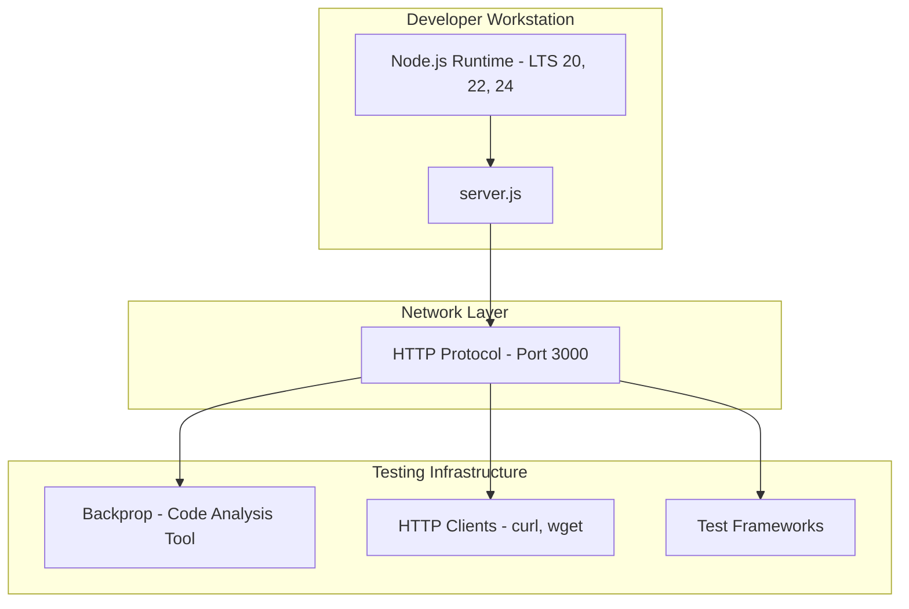

### 1.2.2 High-Level Description

#### Primary System Capabilities

The hello_world server provides the following core capabilities:

| Capability | Description |
|------------|-------------|
| **HTTP Server Creation** | Utilizes Node.js built-in `http.createServer()` for zero-dependency server instantiation |
| **Universal Request Handling** | Responds identically to ALL HTTP methods (GET, POST, PUT, DELETE, PATCH, OPTIONS, HEAD, etc.) |
| **Universal Path Handling** | Responds identically to ALL URL paths (`/`, `/api/test`, `/any/arbitrary/path`) |
| **Consistent Response Delivery** | Always returns HTTP 200 OK with `text/plain` content type and body "Hello, World!\n" |

#### Major System Components

The system architecture is intentionally minimal, comprising:

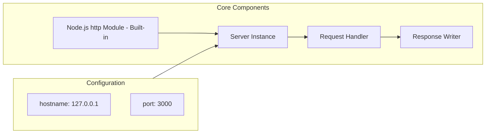

| Component | File Location | Purpose |
|-----------|---------------|---------|
| **HTTP Server** | `server.js` (lines 55-64) | Core server creation and request handling |
| **Configuration Constants** | `server.js` (lines 30, 38) | Hostname and port definitions |
| **npm Manifest** | `package.json` | Project metadata and npm compatibility |
| **Documentation** | `README.md`, `blitzy/documentation/` | Comprehensive usage and technical guidance |

#### Core Technical Approach

The server implements a **stateless, deterministic request-response model**:

1. **Initialization**: Server binds to `127.0.0.1:3000` on startup
2. **Request Reception**: All incoming HTTP requests are captured regardless of method or path
3. **Response Generation**: Every request receives an identical response:
   - Status Code: `200 OK`
   - Content-Type: `text/plain`
   - Body: `Hello, World!\n`
4. **Logging**: Startup confirmation message printed to console

This approach prioritizes **predictability over flexibility**, making the server ideal for integration testing where consistent behavior is paramount.

### 1.2.3 Success Criteria

#### Measurable Objectives

| Objective | Target | Measurement Method |
|-----------|--------|-------------------|
| Server Response Accuracy | 100% "Hello, World!" responses | Automated HTTP request validation |
| JSDoc Documentation Coverage | 100% of code elements | Documentation audit |
| README Completeness | 100% of required sections | Section checklist verification |
| Code Examples Functionality | 100% verified working | Manual execution testing |
| External Dependencies | Zero | `package.json` audit |

#### Critical Success Factors

1. **Zero-Dependency Architecture**: The server must function using only Node.js built-in modules
2. **Cross-Platform Compatibility**: Identical behavior across Windows, macOS, and Linux
3. **Deterministic Behavior**: Every request must produce the exact same response
4. **Instant Startup**: Server must be operational within seconds of execution
5. **Comprehensive Documentation**: All code elements must be fully documented

#### Key Performance Indicators (KPIs)

| KPI | Status | Validation Method |
|-----|--------|-------------------|
| Zero external dependencies maintained | ✅ PASS | `package.json` contains no `dependencies` |
| JavaScript syntax validation | ✅ PASS | Node.js parser verification |
| Runtime server response verification | ✅ PASS | `curl` request returns expected response |
| Git working tree cleanliness | ✅ PASS | `git status` shows no uncommitted changes |

---

## 1.3 Scope

### 1.3.1 In-Scope

#### Core Features and Functionalities

**Must-Have Capabilities:**

| Feature | Description | Implementation Location |
|---------|-------------|------------------------|
| HTTP Server | Functional HTTP server responding to requests | `server.js` |
| Universal Response | "Hello, World!" response to all requests | `server.js` (lines 57-59) |
| Localhost Binding | Server binds to 127.0.0.1:3000 | `server.js` (lines 30, 38) |
| Console Logging | Startup confirmation message | `server.js` (lines 62-63) |

**Primary User Workflows:**

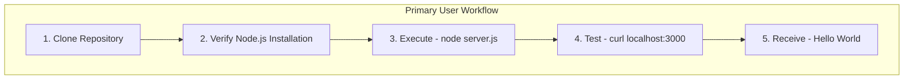

| Step | Command/Action | Expected Result |
|------|----------------|-----------------|
| 1 | `git clone <repository-url>` | Repository cloned locally |
| 2 | `node --version` | Node.js version displayed (LTS recommended) |
| 3 | `node server.js` | "Server running at http://127.0.0.1:3000/" message |
| 4 | `curl http://127.0.0.1:3000/` | "Hello, World!" response received |

**Essential Integrations:**

| Integration Point | Protocol | Purpose |
|-------------------|----------|---------|
| Backprop | HTTP | Primary integration testing target |
| HTTP Clients | HTTP | curl, wget, browser, or programmatic clients |
| Test Frameworks | HTTP | Automated testing via HTTP requests |

**Key Technical Requirements:**

| Requirement | Specification |
|-------------|---------------|
| Runtime | Node.js LTS (20.x, 22.x, or 24.x) |
| Package Manager | npm 7.x or later |
| Network | TCP port 3000 available on localhost |
| Operating System | Windows, macOS, or Linux |

#### Implementation Boundaries

| Boundary Type | Scope Definition |
|---------------|------------------|
| **System Boundaries** | Single HTTP server instance on localhost |
| **User Groups Covered** | Developers, testers, and integration engineers |
| **Geographic Coverage** | Local development environments only (localhost binding) |
| **Data Domains** | Static text response only; no data persistence or processing |
| **Protocol Support** | HTTP only (no HTTPS, WebSocket, or other protocols) |

### 1.3.2 Out-of-Scope

The following items are explicitly excluded from this project's scope:

#### Excluded Features and Capabilities

| Exclusion | Rationale |
|-----------|-----------|
| **Functional Code Changes** | Project scope limited to documentation enhancement |
| **HTTPS Support** | Not implemented; alternative solutions documented for users requiring TLS |
| **Dynamic Routing** | Intentionally omitted to maintain deterministic behavior |
| **Request Body Processing** | All request payloads are ignored by design |
| **Error Handling** | Minimal error handling is intentional for test scaffold simplicity |
| **Environment Variable Configuration** | Hardcoded constants preferred for reproducibility |

#### Future Phase Considerations

| Item | Potential Future Implementation |
|------|--------------------------------|
| OpenAPI/Swagger Specification | Could be added for formal API documentation |
| Automated Test Suite | No tests currently exist; could be added for CI/CD |
| Docker Containerization | Could enable consistent deployment across environments |
| Configuration File Support | Could allow runtime customization without code changes |

#### Integration Points Not Covered

| Integration | Status |
|-------------|--------|
| Database Connectivity | Not applicable—no data persistence |
| External API Calls | Server makes no outbound requests |
| Authentication/Authorization | No security layer implemented |
| Load Balancer Integration | Single-instance localhost binding only |

#### Unsupported Use Cases

| Use Case | Reason for Exclusion |
|----------|---------------------|
| Production Deployment | Explicitly designed as a test scaffold |
| External Network Access | Localhost binding requires code modification |
| High-Availability Scenarios | Single-instance, single-threaded design |
| Secure Communication | HTTP only; no TLS/SSL support |
| Multi-Tenant Applications | Uniform response to all requests |

#### Known Limitations and Issues

| Issue | Description | Resolution Status |
|-------|-------------|-------------------|
| `package.json` main mismatch | References `index.js` but actual entry point is `server.js` | Out of scope; documented as known issue |
| `LoginTest.java` syntax error | Incomplete Java code in repository | Out of scope; unrelated placeholder file |
| HTTP-only protocol | No HTTPS support available | By design; workarounds documented |
| Localhost-only binding | External access requires code modification | By design; modification guidance provided |

#### Unrelated Repository Contents

The following files exist in the repository but are outside the scope of this technical specification:

| File | Description | Status |
|------|-------------|--------|
| `industry.csv` | Static data file with 43 industry categories | Unrelated to server functionality |
| `LoginTest.java` | Java placeholder with syntax errors | Unrelated; not part of Node.js project |
| `test.py.txt` | Empty placeholder file | No functional content |
| `test.txt.txt` | Empty placeholder file | No functional content |

---

## 1.4 Document Conventions

### 1.4.1 Terminology

| Term | Definition |
|------|------------|
| **Backprop** | A tool or service used for code analysis, refactoring, or AI-assisted development |
| **Test Scaffold** | A minimal implementation used as a foundation for testing other systems |
| **Deterministic** | Producing the same output for any given input, every time |
| **LTS** | Long-Term Support version of Node.js, recommended for production stability |

### 1.4.2 API Contract Summary

| Attribute | Value |
|-----------|-------|
| **Base URL** | `http://127.0.0.1:3000/` |
| **Accepted Methods** | All HTTP methods |
| **Accepted Paths** | All URL paths |
| **Response Status** | 200 OK |
| **Content-Type** | text/plain |
| **Response Body** | `Hello, World!\n` |

---

#### References

- `server.js` — Primary HTTP server implementation containing all functional code (72 lines with JSDoc documentation)
- `package.json` — npm manifest defining project metadata, version, author, and license information
- `README.md` — Comprehensive project documentation including installation, usage, and troubleshooting (463 lines)
- `blitzy/documentation/Technical Specifications.md` — Detailed technical specification including scope definitions and success criteria (1535 lines)
- `blitzy/documentation/Project Guide.md` — Project status report with validation results and known issues (250 lines)
- `industry.csv` — Referenced as out-of-scope static data file (43 industry categories)

# 2. Product Requirements

## 2.1 Overview

This section documents the complete set of product requirements for the **hello_world** HTTP server—a minimal, deterministic test scaffold designed for Backprop integration testing. The requirements are organized by feature, with each feature decomposed into testable functional requirements that trace directly to implementation artifacts.

The hello_world server is intentionally simple, comprising five core features that collectively deliver a zero-dependency, predictable HTTP endpoint for automated testing scenarios.

### 2.1.1 Requirements Philosophy

The product requirements for this project prioritize:

| Principle | Description | Rationale |
|-----------|-------------|-----------|
| **Determinism** | Identical responses for all inputs | Eliminates test variability |
| **Simplicity** | Single-file, zero-dependency architecture | Maximizes reproducibility |
| **Predictability** | Consistent behavior across all platforms | Enables reliable integration testing |
| **Minimalism** | Only essential features included | Reduces maintenance burden |

### 2.1.2 Requirements Summary

| Feature ID | Feature Name | Priority | Status |
|------------|--------------|----------|--------|
| F-001 | HTTP Server Creation | Critical | Completed |
| F-002 | Universal Request Handling | Critical | Completed |
| F-003 | Consistent Response Delivery | Critical | Completed |
| F-004 | Localhost Binding | High | Completed |
| F-005 | Startup Confirmation Logging | Medium | Completed |

---

## 2.2 Feature Catalog

### 2.2.1 Feature F-001: HTTP Server Creation

#### Feature Metadata

| Attribute | Value |
|-----------|-------|
| **Unique ID** | F-001 |
| **Feature Name** | HTTP Server Creation |
| **Category** | Core Functionality |
| **Priority Level** | Critical |
| **Status** | Completed |

#### Description

| Aspect | Details |
|--------|---------|
| **Overview** | Creates a functional HTTP server using the Node.js built-in `http.createServer()` method with zero external dependencies. The server is implemented in a single file (`server.js`) and can be started with a single command. |
| **Business Value** | Eliminates setup time for test endpoints. Developers and integration engineers can begin testing within seconds of cloning the repository, without dependency installation or configuration overhead. |
| **User Benefits** | Instant server availability; no `npm install` required; predictable startup behavior; cross-platform compatibility across Windows, macOS, and Linux environments. |
| **Technical Context** | Uses CommonJS module syntax (`require('http')`); single-file architecture in `server.js` (72 lines with JSDoc documentation); Node.js built-in HTTP module provides all server functionality. |

#### Dependencies

| Dependency Type | Details |
|-----------------|---------|
| **Prerequisite Features** | None (foundational feature) |
| **System Dependencies** | Node.js LTS runtime (20.x, 22.x, or 24.x) |
| **External Dependencies** | Zero—uses only Node.js built-in `http` module |
| **Integration Requirements** | TCP port 3000 available on localhost; HTTP protocol support |

---

### 2.2.2 Feature F-002: Universal Request Handling

#### Feature Metadata

| Attribute | Value |
|-----------|-------|
| **Unique ID** | F-002 |
| **Feature Name** | Universal Request Handling |
| **Category** | Core Functionality |
| **Priority Level** | Critical |
| **Status** | Completed |

#### Description

| Aspect | Details |
|--------|---------|
| **Overview** | Server responds identically to ALL HTTP methods (GET, POST, PUT, DELETE, PATCH, OPTIONS, HEAD, etc.) and ALL URL paths. The request handler callback intentionally ignores `req.method` and `req.url`, ensuring uniform behavior. |
| **Business Value** | Deterministic behavior ensures that test failures reflect actual issues in the system under test—not endpoint variability or routing logic complexity. |
| **User Benefits** | Any HTTP request configuration produces the same predictable response; no need to remember specific endpoints or methods; simplifies integration test design. |
| **Technical Context** | Request handler at `server.js` lines 55-63 ignores all request parameters; no routing table or method-specific logic implemented by design. |

#### Dependencies

| Dependency Type | Details |
|-----------------|---------|
| **Prerequisite Features** | F-001 (HTTP Server Creation) |
| **System Dependencies** | Node.js HTTP module request/response objects |
| **External Dependencies** | None |
| **Integration Requirements** | HTTP client capable of sending requests |

---

### 2.2.3 Feature F-003: Consistent Response Delivery

#### Feature Metadata

| Attribute | Value |
|-----------|-------|
| **Unique ID** | F-003 |
| **Feature Name** | Consistent Response Delivery |
| **Category** | Core Functionality |
| **Priority Level** | Critical |
| **Status** | Completed |

#### Description

| Aspect | Details |
|--------|---------|
| **Overview** | Every HTTP request receives an identical response: HTTP 200 OK status, `Content-Type: text/plain` header, and body containing exactly `Hello, World!\n` (including trailing newline). |
| **Business Value** | 100% response accuracy enables reliable integration testing; test assertions can be hardcoded against known response values; eliminates false positives from response variability. |
| **User Benefits** | Predictable response format for any request; simple verification with tools like `curl`; consistent behavior for automated test suites. |
| **Technical Context** | Response constructed at `server.js` lines 57-63: `res.statusCode = 200`, `res.setHeader('Content-Type', 'text/plain')`, `res.end('Hello, World!\n')`. |

#### Dependencies

| Dependency Type | Details |
|-----------------|---------|
| **Prerequisite Features** | F-002 (Universal Request Handling) |
| **System Dependencies** | Node.js HTTP module response object |
| **External Dependencies** | None |
| **Integration Requirements** | HTTP client capable of reading responses |

---

### 2.2.4 Feature F-004: Localhost Binding

#### Feature Metadata

| Attribute | Value |
|-----------|-------|
| **Unique ID** | F-004 |
| **Feature Name** | Localhost Binding |
| **Category** | Configuration |
| **Priority Level** | High |
| **Status** | Completed |

#### Description

| Aspect | Details |
|--------|---------|
| **Overview** | Server binds to `127.0.0.1:3000` by default, restricting access to the local machine only. Configuration is defined via constants in `server.js`. |
| **Business Value** | Security by default for development environments; no accidental exposure to external networks; no firewall configuration required for local testing. |
| **User Benefits** | Immediate, secure access from localhost; standard port (3000) familiar to Node.js developers; predictable endpoint URL for testing. |
| **Technical Context** | Configuration constants at `server.js` lines 30 (`hostname = '127.0.0.1'`) and 38 (`port = 3000`); modification requires code edit (environment variables not supported). |

#### Dependencies

| Dependency Type | Details |
|-----------------|---------|
| **Prerequisite Features** | F-001 (HTTP Server Creation) |
| **System Dependencies** | TCP/IP networking stack; available port 3000 |
| **External Dependencies** | None |
| **Integration Requirements** | Localhost network access |

---

### 2.2.5 Feature F-005: Startup Confirmation Logging

#### Feature Metadata

| Attribute | Value |
|-----------|-------|
| **Unique ID** | F-005 |
| **Feature Name** | Startup Confirmation Logging |
| **Category** | Operational |
| **Priority Level** | Medium |
| **Status** | Completed |

#### Description

| Aspect | Details |
|--------|---------|
| **Overview** | Upon successful port binding, the server prints a confirmation message to the console: `Server running at http://${hostname}:${port}/`. |
| **Business Value** | Immediate feedback that server is operational; provides exact URL for testing; confirms successful startup without requiring external verification. |
| **User Benefits** | Visual confirmation of server availability; no need to manually construct the server URL; clear indication that startup completed successfully. |
| **Technical Context** | Logging callback executed by `server.listen()` at `server.js` lines 68-70; uses `console.log()` for stdout output. |

#### Dependencies

| Dependency Type | Details |
|-----------------|---------|
| **Prerequisite Features** | F-001 (HTTP Server Creation), F-004 (Localhost Binding) |
| **System Dependencies** | Console/stdout output capability |
| **External Dependencies** | None |
| **Integration Requirements** | Terminal or log aggregation system |

---

## 2.3 Functional Requirements Tables

### 2.3.1 F-001: HTTP Server Creation Requirements

#### Requirement Details

| Req ID | Description | Acceptance Criteria | Priority |
|--------|-------------|---------------------|----------|
| F-001-RQ-001 | Server starts via command | `node server.js` binds to port without errors | Must-Have |
| F-001-RQ-002 | Zero external dependencies | No entries in `package.json` dependencies | Must-Have |
| F-001-RQ-003 | Single-file implementation | All server code contained in `server.js` | Should-Have |
| F-001-RQ-004 | Cross-platform compatibility | Identical behavior on Windows, macOS, Linux | Must-Have |

#### Technical Specifications

| Specification | Details |
|---------------|---------|
| **Input Parameters** | None (hardcoded configuration) |
| **Output/Response** | Console message on successful startup |
| **Performance Criteria** | Startup time < 1 second |
| **Data Requirements** | None |

#### Validation Rules

| Rule Type | Details |
|-----------|---------|
| **Business Rules** | Must function identically across all supported platforms |
| **Data Validation** | N/A (no input processing) |
| **Security Requirements** | Localhost-only binding by default |
| **Compliance Requirements** | MIT License compliance |

---

### 2.3.2 F-002: Universal Request Handling Requirements

#### Requirement Details

| Req ID | Description | Acceptance Criteria | Priority |
|--------|-------------|---------------------|----------|
| F-002-RQ-001 | Handle all HTTP methods | GET, POST, PUT, DELETE, PATCH, OPTIONS, HEAD receive identical response | Must-Have |
| F-002-RQ-002 | Handle all URL paths | `/`, `/any/path`, `/deep/nested/path` receive identical response | Must-Have |
| F-002-RQ-003 | Ignore request body | POST data, JSON payloads, form data are ignored | Must-Have |
| F-002-RQ-004 | Ignore request headers | Custom headers do not affect response | Should-Have |

#### Technical Specifications

| Specification | Details |
|---------------|---------|
| **Input Parameters** | Any valid HTTP request (method, path, headers, body) |
| **Output/Response** | Always `Hello, World!\n` regardless of input |
| **Performance Criteria** | Immediate response (no processing delay) |
| **Data Requirements** | None (stateless operation) |

#### Validation Rules

| Rule Type | Details |
|-----------|---------|
| **Business Rules** | All request variations must produce identical output |
| **Data Validation** | N/A (all input ignored) |
| **Security Requirements** | No input parsing reduces attack surface |
| **Compliance Requirements** | N/A |

---

### 2.3.3 F-003: Consistent Response Delivery Requirements

#### Requirement Details

| Req ID | Description | Acceptance Criteria | Priority |
|--------|-------------|---------------------|----------|
| F-003-RQ-001 | Return HTTP 200 OK | `res.statusCode = 200` verified in response | Must-Have |
| F-003-RQ-002 | Set Content-Type header | `Content-Type: text/plain` present in response headers | Must-Have |
| F-003-RQ-003 | Return exact body content | Body is exactly `Hello, World!\n` with trailing newline | Must-Have |
| F-003-RQ-004 | Consistent encoding | UTF-8 text encoding for response body | Should-Have |

#### Technical Specifications

| Specification | Details |
|---------------|---------|
| **Input Parameters** | N/A (response is static) |
| **Output/Response** | HTTP 200, `Content-Type: text/plain`, Body: `Hello, World!\n` |
| **Performance Criteria** | Response time < 10ms |
| **Data Requirements** | None (static response) |

#### Validation Rules

| Rule Type | Details |
|-----------|---------|
| **Business Rules** | Response must be byte-for-byte identical for every request |
| **Data Validation** | N/A |
| **Security Requirements** | Plain text response eliminates injection risks |
| **Compliance Requirements** | N/A |

---

### 2.3.4 F-004: Localhost Binding Requirements

#### Requirement Details

| Req ID | Description | Acceptance Criteria | Priority |
|--------|-------------|---------------------|----------|
| F-004-RQ-001 | Bind to 127.0.0.1 | Server only accessible from localhost | Must-Have |
| F-004-RQ-002 | Use port 3000 | Server listens on TCP port 3000 | Must-Have |
| F-004-RQ-003 | Support configuration change | Code modification enables different hostname/port | Should-Have |
| F-004-RQ-004 | Clear error on port conflict | Meaningful error if port 3000 unavailable | Could-Have |

#### Technical Specifications

| Specification | Details |
|---------------|---------|
| **Input Parameters** | `hostname` (string), `port` (number) as code constants |
| **Output/Response** | Server bound to specified address |
| **Performance Criteria** | N/A (configuration) |
| **Data Requirements** | Valid IPv4 address and available TCP port |

#### Validation Rules

| Rule Type | Details |
|-----------|---------|
| **Business Rules** | Default configuration must not expose server to external networks |
| **Data Validation** | Port must be valid integer (1-65535) |
| **Security Requirements** | Localhost binding provides network isolation |
| **Compliance Requirements** | N/A |

---

### 2.3.5 F-005: Startup Confirmation Logging Requirements

#### Requirement Details

| Req ID | Description | Acceptance Criteria | Priority |
|--------|-------------|---------------------|----------|
| F-005-RQ-001 | Log startup message | Console displays server URL on successful start | Must-Have |
| F-005-RQ-002 | Include hostname in message | Message contains bound hostname | Should-Have |
| F-005-RQ-003 | Include port in message | Message contains bound port number | Should-Have |
| F-005-RQ-004 | Format as clickable URL | Message formatted as valid HTTP URL | Could-Have |

#### Technical Specifications

| Specification | Details |
|---------------|---------|
| **Input Parameters** | `hostname` and `port` constants |
| **Output/Response** | `Server running at http://127.0.0.1:3000/` to stdout |
| **Performance Criteria** | Message appears immediately after binding |
| **Data Requirements** | None |

#### Validation Rules

| Rule Type | Details |
|-----------|---------|
| **Business Rules** | Message must be human-readable and actionable |
| **Data Validation** | N/A |
| **Security Requirements** | No sensitive information in log output |
| **Compliance Requirements** | N/A |

---

## 2.4 Feature Relationships

### 2.4.1 Feature Dependency Map

The following diagram illustrates the hierarchical dependencies between features:

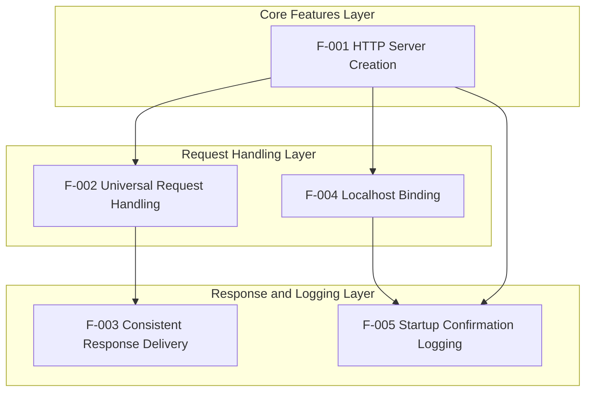

### 2.4.2 Dependency Matrix

| Feature | Depends On | Required By |
|---------|-----------|-------------|
| F-001 | None | F-002, F-004, F-005 |
| F-002 | F-001 | F-003 |
| F-003 | F-002 | None |
| F-004 | F-001 | F-005 |
| F-005 | F-001, F-004 | None |

### 2.4.3 Integration Points

| Feature | Integration Point | Protocol | Direction |
|---------|------------------|----------|-----------|
| F-001 | Backprop | HTTP | Inbound |
| F-001 | HTTP Clients (curl, wget) | HTTP | Inbound |
| F-001 | Test Frameworks | HTTP | Inbound |
| F-003 | Response Validators | HTTP | Outbound |
| F-005 | Log Aggregation Systems | stdout | Outbound |

### 2.4.4 Shared Components

| Component | Location | Used By Features |
|-----------|----------|------------------|
| Node.js `http` module | Built-in | F-001, F-002, F-003 |
| Configuration constants | `server.js` lines 30, 38 | F-004, F-005 |
| Request handler callback | `server.js` lines 55-64 | F-002, F-003 |
| Server instance | `server.js` line 55 | All features |

### 2.4.5 Common Services

| Service | Description | Features Served |
|---------|-------------|-----------------|
| HTTP Request Reception | Incoming request capture | F-002 |
| HTTP Response Transmission | Outgoing response delivery | F-003 |
| Console Output | Stdout logging | F-005 |
| TCP/IP Networking | Network binding and communication | F-001, F-004 |

---

## 2.5 Implementation Considerations

### 2.5.1 Technical Constraints

| Feature | Constraint | Rationale | Evidence |
|---------|-----------|-----------|----------|
| F-001 | Single-file architecture required | Intentional simplicity for test scaffold | `server.js` (72 lines) |
| F-001 | Zero external dependencies | Reproducibility and minimal attack surface | `package.json` no dependencies |
| F-002 | No routing logic permitted | Deterministic behavior mandatory | Design decision |
| F-003 | Static response only | Test scaffold purpose; no dynamic content | `server.js` lines 57-63 |
| F-004 | Hardcoded configuration | Environment variables not supported | `server.js` lines 30, 38 |

### 2.5.2 Performance Requirements

| Feature | Metric | Target | Validation Method |
|---------|--------|--------|-------------------|
| F-001 | Startup time | < 1 second | Timed execution |
| F-003 | Response latency | < 10ms | HTTP timing |
| All | Memory footprint | Node.js baseline (~30MB) | Process monitoring |
| All | CPU utilization | Minimal (idle when not processing) | Process monitoring |

### 2.5.3 Scalability Considerations

| Consideration | Status | Rationale |
|---------------|--------|-----------|
| Horizontal scaling | Not supported | Single-instance design by intention |
| Load balancer integration | Not supported | Localhost binding only |
| High-availability | Not supported | Test scaffold, not production system |
| Connection pooling | Not applicable | Stateless request handling |
| Caching | Not applicable | Static response requires no caching |

### 2.5.4 Security Implications

| Feature | Security Aspect | Status | Mitigation |
|---------|----------------|--------|------------|
| F-004 | Network exposure | Mitigated | Localhost binding (127.0.0.1) |
| F-001 | HTTPS support | Not implemented | HTTP only; documented limitation |
| F-002 | Authentication | Not implemented | None required for test scaffold |
| F-002 | Input validation | Not required | All input ignored by design |
| F-003 | Injection attacks | Mitigated | Static response, no user input reflected |

### 2.5.5 Maintenance Requirements

| Feature | Maintenance Aspect | Requirement | Frequency |
|---------|-------------------|-------------|-----------|
| All | Node.js compatibility | Test against new LTS releases | Per LTS release |
| F-001 | Dependency management | None (zero dependencies) | Never |
| All | Documentation sync | Update JSDoc and README | Per code change |
| All | Security patching | None (no external dependencies) | Never |

---

## 2.6 Traceability Matrix

### 2.6.1 Requirements to Implementation Mapping

| Requirement ID | Feature ID | Implementation File | Lines | Validation |
|----------------|-----------|---------------------|-------|------------|
| F-001-RQ-001 | F-001 | `server.js` | 68-70 | `node server.js` starts |
| F-001-RQ-002 | F-001 | `package.json` | 1-11 | No dependencies key |
| F-001-RQ-003 | F-001 | `server.js` | 1-72 | Single file verified |
| F-001-RQ-004 | F-001 | `server.js` | All | Cross-platform Node.js |
| F-002-RQ-001 | F-002 | `server.js` | 55-64 | `curl -X POST` works |
| F-002-RQ-002 | F-002 | `server.js` | 55-64 | `curl /any/path` works |
| F-002-RQ-003 | F-002 | `server.js` | 55-64 | POST body ignored |
| F-003-RQ-001 | F-003 | `server.js` | 57 | HTTP 200 returned |
| F-003-RQ-002 | F-003 | `server.js` | 60 | Header in response |
| F-003-RQ-003 | F-003 | `server.js` | 63 | Body matches exactly |
| F-004-RQ-001 | F-004 | `server.js` | 30 | `hostname = '127.0.0.1'` |
| F-004-RQ-002 | F-004 | `server.js` | 38 | `port = 3000` |
| F-005-RQ-001 | F-005 | `server.js` | 68-70 | Console output verified |

### 2.6.2 Requirements to Test Mapping

| Requirement ID | Test Method | Expected Result |
|----------------|-------------|-----------------|
| F-001-RQ-001 | Execute `node server.js` | Server binds without errors |
| F-001-RQ-002 | Inspect `package.json` | No `dependencies` key present |
| F-002-RQ-001 | `curl -X GET/POST/PUT/DELETE` | Identical response for all methods |
| F-002-RQ-002 | `curl http://localhost:3000/any/path` | Same response as root path |
| F-003-RQ-001 | `curl -I` (headers only) | Status line: `HTTP/1.1 200 OK` |
| F-003-RQ-002 | `curl -I` (headers only) | `Content-Type: text/plain` present |
| F-003-RQ-003 | `curl` response body | Exact match: `Hello, World!\n` |
| F-004-RQ-001 | External access attempt | Connection refused from non-localhost |
| F-004-RQ-002 | `netstat` or `lsof` | Port 3000 in LISTEN state |
| F-005-RQ-001 | Console observation | URL message displayed |

---

## 2.7 API Contract Specification

### 2.7.1 Endpoint Definition

| Attribute | Value |
|-----------|-------|
| **Base URL** | `http://127.0.0.1:3000/` |
| **Accepted Methods** | All HTTP methods (GET, POST, PUT, DELETE, PATCH, OPTIONS, HEAD, etc.) |
| **Accepted Paths** | All URL paths |
| **Response Status** | 200 OK |
| **Content-Type** | `text/plain` |
| **Response Body** | `Hello, World!\n` |

### 2.7.2 Request-Response Flow

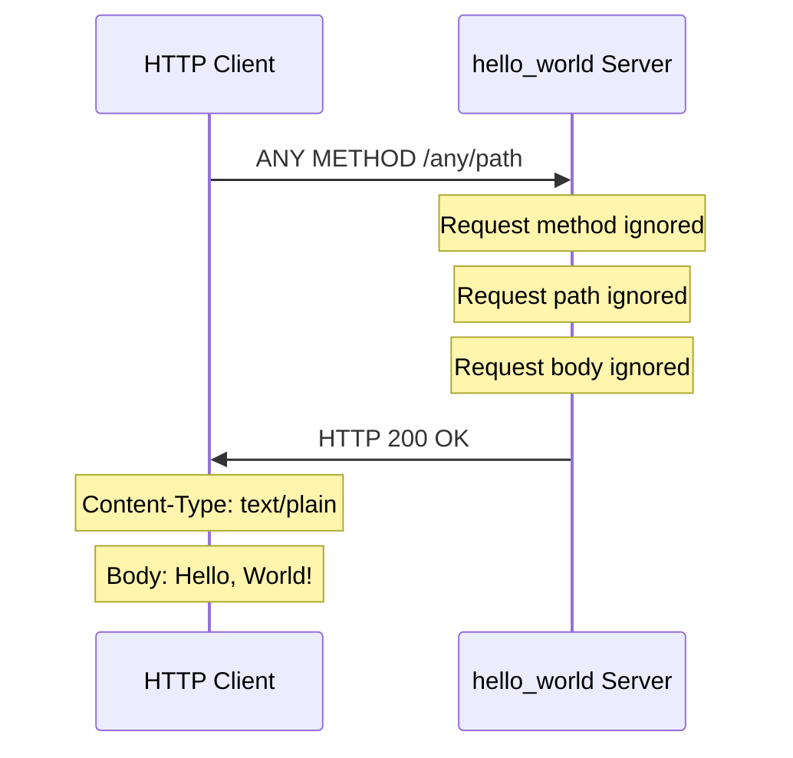

---

## 2.8 Assumptions and Constraints

### 2.8.1 Assumptions

| ID | Assumption | Impact if Invalid |
|----|------------|-------------------|
| A-001 | Node.js LTS is installed on target system | Server will not start |
| A-002 | TCP port 3000 is available | Binding error on startup |
| A-003 | User has terminal/command-line access | Cannot start server |
| A-004 | Localhost network interface is available | Binding error |

### 2.8.2 Constraints

| ID | Constraint | Rationale |
|----|------------|-----------|
| C-001 | HTTP only (no HTTPS) | Test scaffold simplicity |
| C-002 | No environment variable configuration | Reproducibility |
| C-003 | Localhost binding only | Security by default |
| C-004 | Single-threaded, single-instance | Minimal design |
| C-005 | No database or persistence | Stateless operation |

---

#### References

- `server.js` — Primary HTTP server implementation (lines 22, 30, 38, 55-64, 68-70)
- `package.json` — Project metadata confirming zero dependencies and MIT license
- `package-lock.json` — Dependency confirmation (lockfileVersion 3, no packages)
- `README.md` — User documentation for features, prerequisites, installation, and usage
- `blitzy/documentation/Technical Specifications.md` — Sections 1.1, 1.2, 1.3, 1.4 for scope and requirements
- `blitzy/documentation/Project Guide.md` — Project status and validation results

# 3. Technology Stack

## 3.1 OVERVIEW

The **hello_world** project (v1.0.0) implements a deliberately minimalist technology stack, prioritizing simplicity, reproducibility, and zero-dependency architecture over enterprise complexity. This design philosophy directly supports its purpose as a predictable test scaffold for Backprop integration testing.

### 3.1.1 Technology Stack Philosophy

The technology choices for this project are guided by the following principles:

| Principle | Implementation | Rationale |
|-----------|----------------|-----------|
| **Zero Dependencies** | No external npm packages | Eliminates version conflicts and security vulnerability management |
| **Single-File Architecture** | All server code in `server.js` (72 lines) | Maximizes transparency and minimizes complexity |
| **Deterministic Behavior** | Static response to all requests | Ensures predictable test results |
| **Cross-Platform Compatibility** | Node.js built-in modules only | Identical behavior across Windows, macOS, and Linux |

### 3.1.2 Technology Stack Diagram

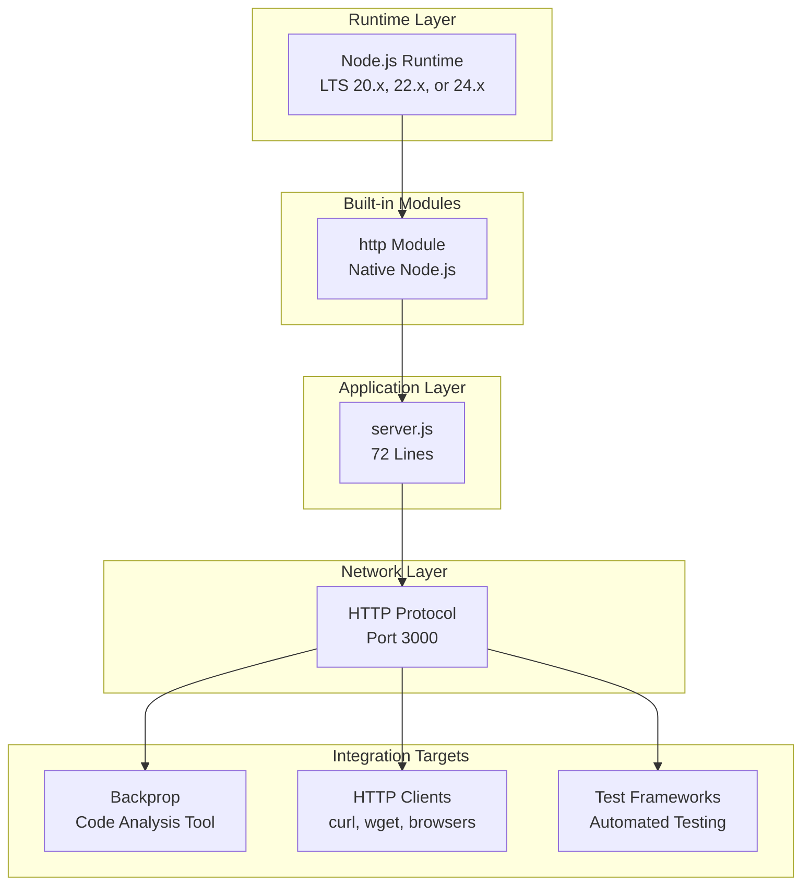

---

## 3.2 PROGRAMMING LANGUAGES

### 3.2.1 Primary Language: JavaScript (Node.js)

| Attribute | Specification |
|-----------|---------------|
| **Language** | JavaScript (ECMAScript) |
| **Runtime** | Node.js |
| **Module System** | CommonJS (`require()` syntax) |
| **Supported Versions** | LTS 20.x, 22.x, or 24.x |
| **File Extension** | `.js` |

#### Version Compatibility Matrix

| Node.js Version | Codename | Status | Support End Date | Recommendation |
|-----------------|----------|--------|------------------|----------------|
| **20.x** | Iron | Maintenance LTS | April 30, 2026 | Supported |
| **22.x** | Jod | Active LTS | April 30, 2027 | **Recommended** |
| **24.x** | Krypton | Active LTS | April 30, 2028 | Supported |

#### Selection Criteria

1. **Native HTTP Support**: Node.js provides a built-in `http` module that eliminates the need for external web server frameworks like Express or Fastify.

2. **Cross-Platform Runtime**: Node.js runs identically across Windows, macOS, and Linux, fulfilling the cross-platform requirement documented in the project specifications.

3. **CommonJS Module System**: The project uses CommonJS syntax (`const http = require('http')`) for maximum compatibility with older Node.js versions rather than ES Modules.

4. **Zero Compilation Required**: JavaScript runs directly without transpilation, compilation, or build steps—supporting instant startup and minimal tooling.

#### Evidence Reference

```
server.js (lines 21-22):
- Uses CommonJS import: const http = require('http');
- No transpilation or build process required
```

### 3.2.2 Languages NOT Applicable

The following languages from the default technology stack are **explicitly not used** in this project:

| Language | Default Use Case | Status | Rationale |
|----------|-----------------|--------|-----------|
| Python | Backend (Flask) | ❌ Not Used | Node.js provides complete server functionality |
| TypeScript | Type-safe JavaScript | ❌ Not Used | Adds compilation complexity; pure JS preferred |
| Swift | iOS development | ❌ Not Applicable | No mobile application component |
| Kotlin | Android development | ❌ Not Applicable | No mobile application component |
| Objective-C | macOS development | ❌ Not Applicable | No native desktop component |

---

## 3.3 FRAMEWORKS & LIBRARIES

### 3.3.1 Core Framework: Node.js Built-in HTTP Module

| Attribute | Value |
|-----------|-------|
| **Module Name** | `http` |
| **Type** | Node.js built-in module |
| **Version** | Bundled with Node.js runtime |
| **Import Method** | `const http = require('http');` |
| **Dependencies** | None (part of Node.js core) |

#### Capabilities Utilized

| Capability | API Method | Usage in Project |
|------------|-----------|------------------|
| Server Creation | `http.createServer()` | Creates HTTP server instance |
| Response Status | `res.statusCode` | Sets 200 OK status |
| Response Headers | `res.setHeader()` | Sets `Content-Type: text/plain` |
| Response Body | `res.end()` | Writes "Hello, World!\n" response |
| Server Binding | `server.listen()` | Binds to 127.0.0.1:3000 |

#### Justification for Built-in HTTP Module

| Decision Factor | Analysis |
|-----------------|----------|
| **Zero Dependencies** | Using built-in module eliminates external package requirements |
| **Stability** | Core modules receive long-term support and security patches |
| **Performance** | No abstraction overhead from framework layers |
| **Simplicity** | Direct API usage reduces complexity for test scaffold purpose |
| **Security** | No third-party code to audit for vulnerabilities |

### 3.3.2 Frameworks NOT Implemented

The following frameworks from the default technology stack are **not applicable** to this project:

| Framework | Category | Status | Rationale |
|-----------|----------|--------|-----------|
| Flask | Python Web Framework | ❌ Not Used | Project uses Node.js, not Python |
| Express.js | Node.js Web Framework | ❌ Not Used | Built-in `http` module sufficient |
| React | Frontend Framework | ❌ Not Applicable | No frontend/UI component |
| React Native | Mobile Framework | ❌ Not Applicable | No mobile application |
| TailwindCSS | CSS Framework | ❌ Not Applicable | No styling requirements |
| Electron | Desktop Framework | ❌ Not Applicable | No desktop application |
| LangChain | AI Framework | ❌ Not Applicable | No AI/ML functionality |

### 3.3.3 Module System Architecture

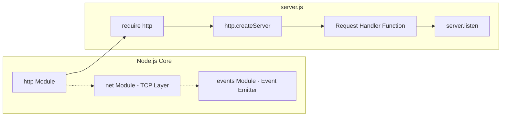

---

## 3.4 OPEN SOURCE DEPENDENCIES

### 3.4.1 Dependency Status: Zero External Dependencies

This project maintains a **zero external dependency** architecture by deliberate design choice.

| Dependency Category | Count | Packages |
|--------------------|-------|----------|
| Production Dependencies | **0** | None declared |
| Development Dependencies | **0** | None declared |
| Peer Dependencies | **0** | None declared |
| Optional Dependencies | **0** | None declared |
| Transitive Dependencies | **0** | None resolved |

#### Package Configuration Evidence

**package.json** (complete contents):
```json
{
    "name": "hello_world",
    "version": "1.0.0",
    "description": "Hello world in Node.js",
    "main": "index.js",
    "author": "hxu",
    "license": "MIT"
}
```

**Key Observations:**
- No `dependencies` field present
- No `devDependencies` field present
- No `scripts` field defined

**package-lock.json** (structure):
| Attribute | Value |
|-----------|-------|
| `lockfileVersion` | 3 (npm 7+ format) |
| `packages` | Root entry only |
| Resolved dependencies | None |

### 3.4.2 Zero-Dependency Justification

| Benefit | Impact |
|---------|--------|
| **Reproducibility** | Identical behavior across all environments without `npm install` |
| **Security** | No third-party code to audit for vulnerabilities |
| **Maintenance** | No version conflicts or dependency updates required |
| **Portability** | Works immediately after cloning with only Node.js installed |
| **Startup Speed** | No dependency resolution or loading overhead |

### 3.4.3 Package Registry Configuration

| Registry | Status | Usage |
|----------|--------|-------|
| npm Registry | Not used | No packages to fetch |
| Yarn Registry | Not applicable | Yarn not configured |
| Private Registry | Not applicable | No private packages |

---

## 3.5 THIRD-PARTY SERVICES

### 3.5.1 Backprop Integration

The **only** third-party service integration is as a **test target** for Backprop.

| Attribute | Value |
|-----------|-------|
| **Service Name** | Backprop |
| **Integration Type** | HTTP Integration Target |
| **Role** | This server is consumed BY Backprop, not consuming Backprop |
| **Authentication** | None required |
| **API Keys** | None |

#### Integration Architecture

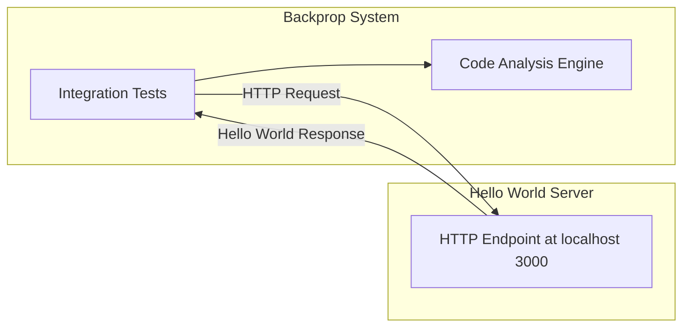

### 3.5.2 Services NOT Implemented

| Service | Default Stack Role | Status | Rationale |
|---------|-------------------|--------|-----------|
| Auth0 | Authentication | ❌ Not Implemented | No authentication required (Constraint C-002) |
| AWS | Cloud Platform | ❌ Not Implemented | Localhost-only binding (Constraint C-003) |
| Monitoring Tools | Observability | ❌ Not Implemented | Test scaffold simplicity |
| External APIs | Integrations | ❌ Not Implemented | Server makes no outbound requests |

---

## 3.6 DATABASES & STORAGE

### 3.6.1 Storage Architecture: Stateless Design

This project implements a **completely stateless architecture** with no data persistence layer.

| Storage Category | Status | Rationale |
|------------------|--------|-----------|
| Primary Database | ❌ None | Stateless operation (Constraint C-005) |
| Secondary Database | ❌ None | No data processing requirements |
| Caching Layer | ❌ Not Applicable | Static response requires no caching |
| File Storage | ❌ None | No file persistence needed |
| Session Storage | ❌ None | No session management |

### 3.6.2 Databases NOT Applicable

| Database | Default Stack Role | Status | Justification |
|----------|-------------------|--------|---------------|
| MongoDB | Primary Database | ❌ Not Applicable | No data persistence requirements |
| PostgreSQL | Relational Database | ❌ Not Applicable | No relational data |
| Redis | Caching | ❌ Not Applicable | Static response, no caching benefit |
| S3 | Object Storage | ❌ Not Applicable | No file storage requirements |

### 3.6.3 Data Flow Architecture

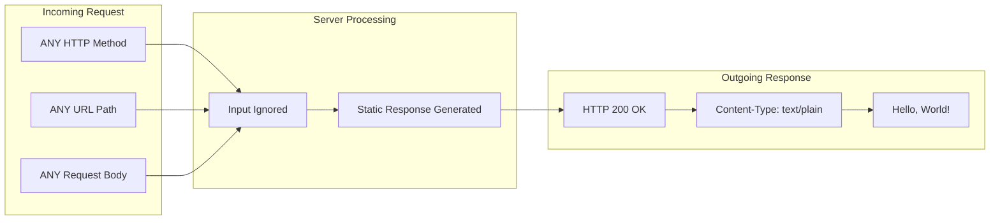

**Key Design Decision**: The stateless architecture ensures deterministic behavior—every request produces identical output regardless of previous requests, supporting reliable integration testing.

---

## 3.7 DEVELOPMENT & DEPLOYMENT

### 3.7.1 Development Tools

#### Required Tools

| Tool | Minimum Version | Purpose | Installation |
|------|-----------------|---------|--------------|
| **Node.js** | LTS 20.x, 22.x, or 24.x | JavaScript runtime | [nodejs.org](https://nodejs.org) |
| **npm** | 7.x or later | Package manager (unused but bundled) | Bundled with Node.js |
| **Git** | Any | Version control | Standard installation |

#### Optional Development Tools

| Tool | Purpose | Status |
|------|---------|--------|
| **curl** | HTTP request testing | Recommended for validation |
| **wget** | Alternative HTTP client | Optional |
| **Code Editor** | Source editing | Developer preference |

### 3.7.2 Build System

| Build Requirement | Status |
|-------------------|--------|
| Compilation | ❌ None required |
| Transpilation | ❌ None required |
| Bundling | ❌ None required |
| Minification | ❌ None required |
| Build Scripts | ❌ None defined |

**Justification**: The single-file JavaScript architecture runs directly on Node.js without any build process, supporting instant startup and eliminating build-related complexity.

### 3.7.3 Containerization

| Container Technology | Status | Future Consideration |
|---------------------|--------|---------------------|
| Docker | ❌ Not Implemented | Listed as future phase consideration |
| Kubernetes | ❌ Not Applicable | Single-instance design |
| Docker Compose | ❌ Not Implemented | No multi-container requirements |

**From Technical Specification Section 1.3.2 (Future Phase Considerations):**
> Docker Containerization could enable consistent deployment across environments but is currently out of scope.

#### Potential Docker Configuration (Not Implemented)

If containerization were implemented, a minimal Dockerfile might resemble:

```
# Hypothetical future implementation

FROM node:22-alpine
WORKDIR /app
COPY server.js .
EXPOSE 3000
CMD ["node", "server.js"]
```

### 3.7.4 CI/CD Pipeline

| CI/CD Component | Status |
|-----------------|--------|
| GitHub Actions | ❌ Not Configured |
| Jenkins | ❌ Not Implemented |
| CircleCI | ❌ Not Implemented |
| Automated Testing | ❌ No tests exist |

**From Technical Specification Section 1.3.2:**
> Automated Test Suite: No tests currently exist; could be added for CI/CD.

### 3.7.5 Deployment Options

The project documents three deployment methods, though all remain manual processes:

#### Option 1: Direct Node.js Execution

| Attribute | Value |
|-----------|-------|
| **Command** | `node server.js` |
| **Use Case** | Local development and testing |
| **Process Management** | Manual (foreground process) |

#### Option 2: PM2 Process Manager

| Attribute | Value |
|-----------|-------|
| **Command** | `pm2 start server.js --name "hello-world"` |
| **Use Case** | Production-like environments |
| **Features** | Process monitoring, automatic restarts |

#### Option 3: systemd Service (Linux)

| Attribute | Value |
|-----------|-------|
| **Use Case** | Linux production servers |
| **Features** | Boot-time startup, system integration |

**systemd Unit File Configuration:**

```ini
[Unit]
Description=Hello World Node.js Server
After=network.target

[Service]
ExecStart=/usr/bin/node /path/to/server.js
Restart=always
User=www-data
Environment=NODE_ENV=production

[Install]
WantedBy=multi-user.target
```

### 3.7.6 Development Workflow

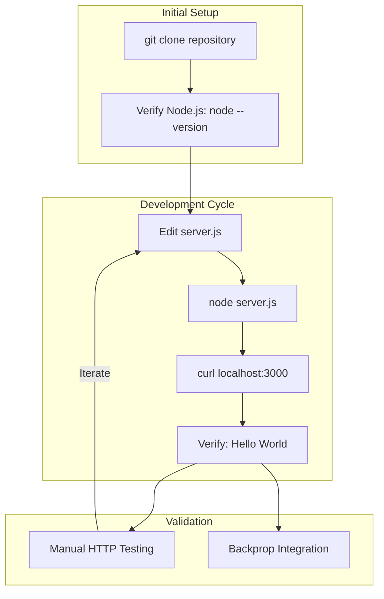

---

## 3.8 CONFIGURATION

### 3.8.1 Server Configuration

| Configuration Option | Default Value | Type | Modification Method |
|---------------------|---------------|------|---------------------|
| `hostname` | `'127.0.0.1'` | string | Edit `server.js` line 30 |
| `port` | `3000` | number | Edit `server.js` line 38 |

### 3.8.2 Configuration Constraints

| Constraint ID | Description | Rationale |
|---------------|-------------|-----------|
| C-002 | No environment variable configuration | Reproducibility |
| C-003 | Localhost binding only | Security by default |

**From Technical Specification Section 2.5.1:**
> Hardcoded configuration - Environment variables not supported (Rationale: Reproducibility)

### 3.8.3 Configuration NOT Supported

| Configuration Method | Status | Rationale |
|---------------------|--------|-----------|
| Environment Variables | ❌ Not Supported | Intentional for reproducibility |
| Configuration Files | ❌ Not Implemented | Single-file architecture |
| Command-Line Arguments | ❌ Not Implemented | Simplicity |
| Runtime Configuration | ❌ Not Supported | Static configuration |

---

## 3.9 PROTOCOL & NETWORKING

### 3.9.1 Network Configuration

| Attribute | Value |
|-----------|-------|
| **Protocol** | HTTP only (no HTTPS) |
| **Default Port** | 3000 |
| **Binding Address** | 127.0.0.1 (localhost only) |
| **TLS/SSL** | Not implemented |
| **WebSocket** | Not supported |

### 3.9.2 Security Implications

| Security Aspect | Status | Mitigation/Rationale |
|-----------------|--------|---------------------|
| HTTPS Support | ❌ Not Implemented | HTTP only; documented limitation |
| Network Exposure | ✅ Mitigated | Localhost binding restricts access |
| Authentication | ❌ Not Implemented | None required for test scaffold |
| Input Validation | ✅ Not Required | All input ignored by design |
| Injection Attacks | ✅ Mitigated | Static response, no user input reflected |

### 3.9.3 Enabling External Access

To allow external network access (not recommended for security reasons), modify `server.js`:

| Change | From | To |
|--------|------|-----|
| Binding Address | `'127.0.0.1'` | `'0.0.0.0'` |

**Security Warning**: Binding to `0.0.0.0` exposes the server to all network interfaces and should only be done in controlled environments.

---

## 3.10 CROSS-PLATFORM COMPATIBILITY

### 3.10.1 Supported Operating Systems

| Platform | Status | Tested Configurations |
|----------|--------|----------------------|
| **Windows** | ✅ Supported | Windows 10, Windows 11, Windows Server |
| **macOS** | ✅ Supported | macOS 12+, Apple Silicon and Intel |
| **Linux** | ✅ Supported | Ubuntu, Debian, RHEL, Alpine, and others |

### 3.10.2 Cross-Platform Compatibility Factors

| Factor | Implementation |
|--------|----------------|
| **Path Handling** | No file system operations |
| **Line Endings** | Static string response, no file I/O |
| **Environment** | No environment variable dependencies |
| **Shell Commands** | Pure JavaScript, no shell invocation |

---

## 3.11 TECHNOLOGY STACK SUMMARY

### 3.11.1 Implemented Technologies

| Category | Technology | Version | Status |
|----------|------------|---------|--------|
| Runtime | Node.js | LTS 20.x/22.x/24.x | ✅ Required |
| Language | JavaScript (CommonJS) | ES6+ | ✅ Implemented |
| HTTP Server | Built-in `http` module | Native | ✅ Implemented |
| Package Manager | npm | 7.x+ | ⚠️ Available (unused) |

### 3.11.2 Explicitly NOT Implemented

| Category | Default Stack | Rationale for Exclusion |
|----------|---------------|------------------------|
| Backend Framework | Flask/Express | Built-in HTTP sufficient |
| Frontend | React/TypeScript | No UI component |
| Mobile | React Native/Swift/Kotlin | No mobile component |
| Database | MongoDB | Stateless design |
| Authentication | Auth0 | Test scaffold purpose |
| Cloud Platform | AWS | Localhost binding only |
| Containerization | Docker | Out of scope (future consideration) |
| CI/CD | GitHub Actions | No automated testing |

### 3.11.3 Design Rationale Summary

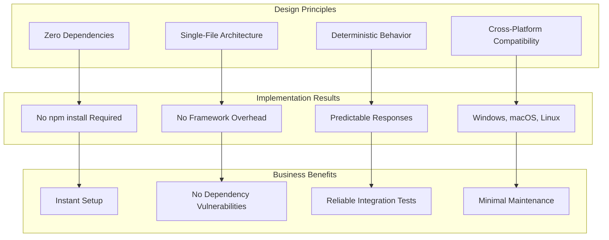

---

## 3.12 REFERENCES

#### Files Examined

| File Path | Relevance |
|-----------|-----------|
| `server.js` | Primary HTTP server implementation; http module usage; configuration constants |
| `package.json` | Package name, version (1.0.0), author (hxu), license (MIT), zero dependencies confirmation |
| `package-lock.json` | lockfileVersion 3, npm 7+ compatibility, empty dependency tree |
| `README.md` | Node.js LTS requirements, npm version, deployment options (PM2, systemd), troubleshooting |

#### Technical Specification Sections Referenced

| Section | Content Used |
|---------|--------------|
| 1.1 Executive Summary | Project overview, zero-dependency rationale, business value |
| 1.2 System Overview | Architecture diagrams, system components, success criteria |
| 1.3 Scope | In-scope features, out-of-scope items, future considerations |
| 2.5 Implementation Considerations | Technical constraints, performance requirements, security implications |
| 2.7 API Contract Specification | Endpoint definition, HTTP protocol details |
| 2.8 Assumptions and Constraints | System assumptions, design constraints |

#### External Sources

| Source | Information Retrieved |
|--------|----------------------|
| nodejs.org | Current LTS versions and release schedule |
| endoflife.date/nodejs | Node.js version support timelines |

# 4. Process Flowchart

This section provides comprehensive visual documentation of all system workflows, processes, and state transitions within the hello_world HTTP server. Given the intentionally minimal architecture designed for Backprop integration testing, the flowcharts emphasize the deterministic, stateless nature of the system while providing complete coverage of all operational scenarios.

## 4.1 SYSTEM WORKFLOW OVERVIEW

### 4.1.1 High-Level System Workflow

The hello_world server implements a deliberately simple workflow paradigm that prioritizes predictability and reproducibility over feature complexity. The following diagram illustrates the complete system workflow from initialization through request handling.

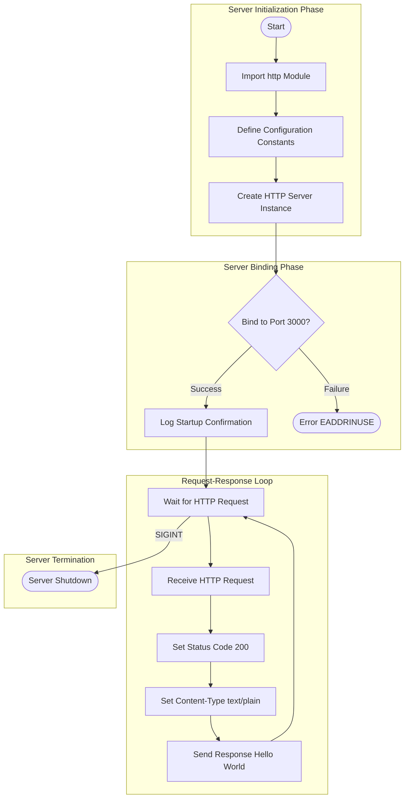

### 4.1.2 System Components Interaction Flow

This diagram shows how the core components interact during the server lifecycle, from the Node.js runtime layer through to client communication.

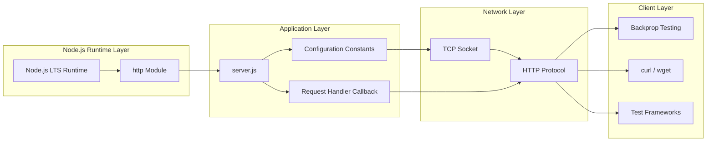

## 4.2 CORE BUSINESS PROCESSES

### 4.2.1 User Journey Flowchart

The following diagram illustrates the complete end-to-end user journey from repository acquisition to successful API integration, with decision points for different user goals.

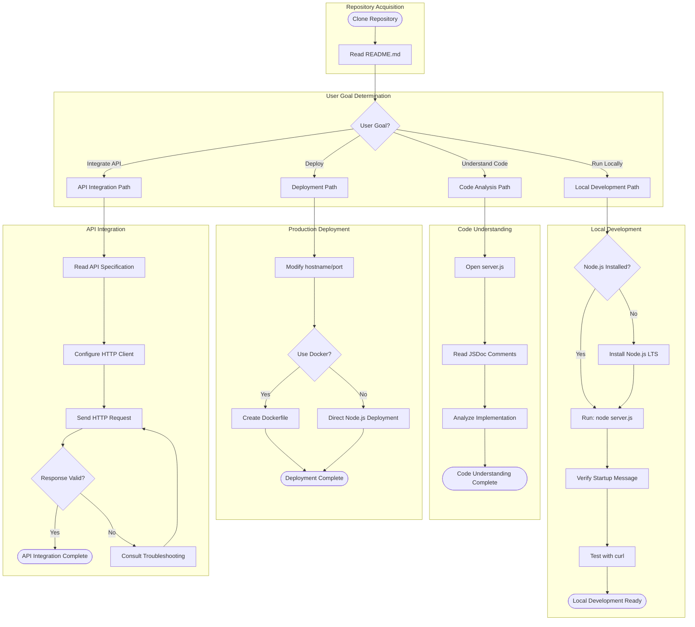

### 4.2.2 Server Startup Process Flow

This detailed flowchart documents every step of the server initialization process, including validation checkpoints and error states.

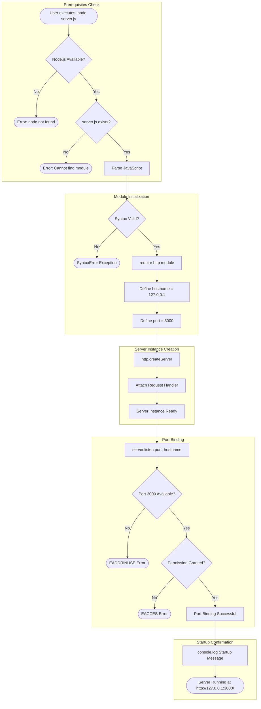

### 4.2.3 Primary Workflow Step Sequence

| Step | Action | Expected Result | Timing |
|------|--------|-----------------|--------|
| 1 | `git clone <repository-url>` | Repository cloned locally | < 5 seconds |
| 2 | `node --version` | Node.js version displayed | Instant |
| 3 | `node server.js` | Server starts, displays confirmation | < 1 second |
| 4 | `curl http://127.0.0.1:3000/` | Receives "Hello, World!" response | < 10ms |

## 4.3 REQUEST-RESPONSE WORKFLOWS

### 4.3.1 HTTP Request Processing Flow

The following diagram details the complete request-response cycle, emphasizing the deterministic nature of the response generation regardless of request characteristics.

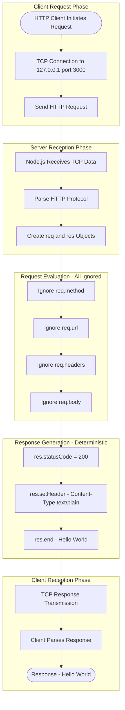

### 4.3.2 Request-Response Sequence Diagram

This sequence diagram illustrates the temporal flow of communications between the HTTP client and the hello_world server.

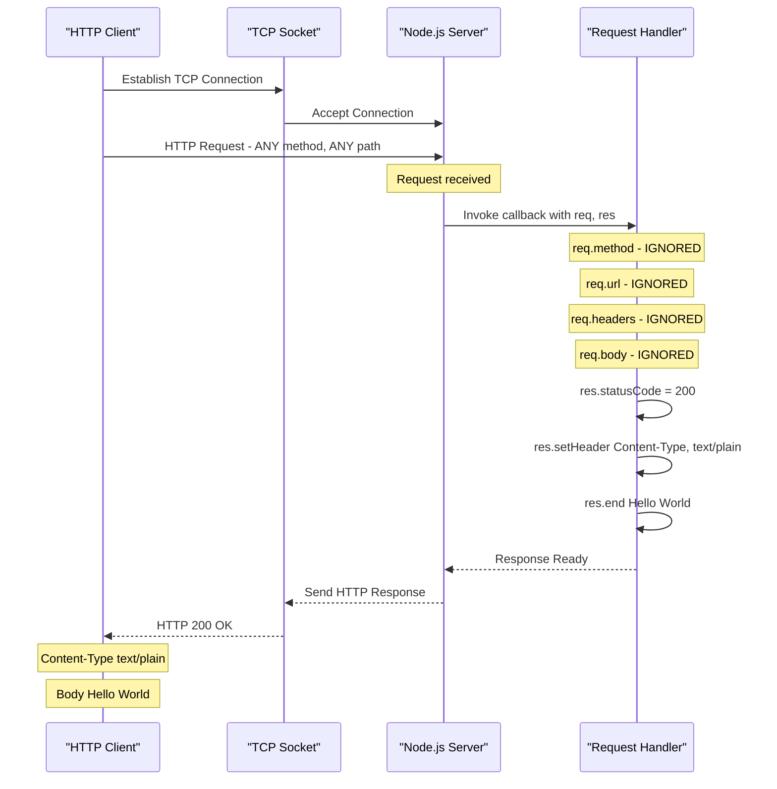

### 4.3.3 Universal Request Handling Matrix

The following table documents the deterministic behavior for all possible request variations:

| Request Variation | Server Behavior | Response |
|------------------|-----------------|----------|
| GET / | Ignored | 200 OK, "Hello, World!" |
| POST /api/data | Ignored | 200 OK, "Hello, World!" |
| PUT /resource/123 | Ignored | 200 OK, "Hello, World!" |
| DELETE /item | Ignored | 200 OK, "Hello, World!" |
| OPTIONS /any/path | Ignored | 200 OK, "Hello, World!" |
| HEAD / | Ignored | 200 OK, "Hello, World!" |
| PATCH /update | Ignored | 200 OK, "Hello, World!" |
| Custom headers | Ignored | 200 OK, "Hello, World!" |
| Request body content | Ignored | 200 OK, "Hello, World!" |

## 4.4 INTEGRATION WORKFLOWS

### 4.4.1 Integration Points Flow Diagram

This diagram illustrates how the hello_world server integrates with various external systems and tools in the testing infrastructure.

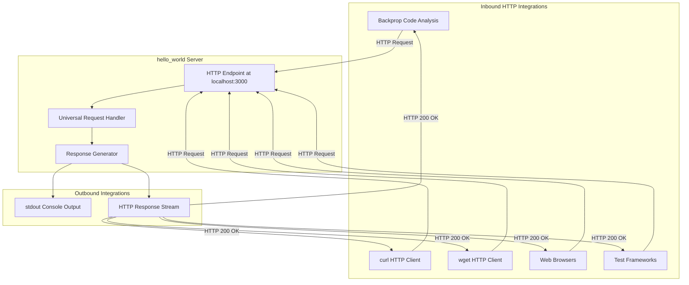

### 4.4.2 Backprop Integration Workflow

The following diagram shows the specific integration workflow with Backprop, the primary integration target for this test scaffold.

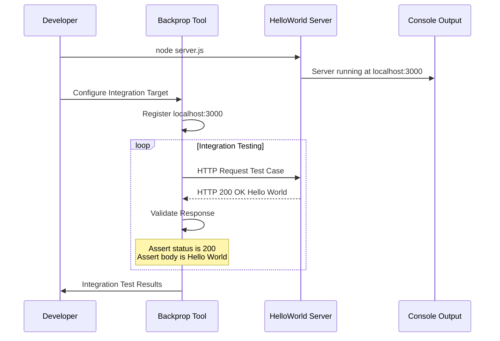

### 4.4.3 Integration Protocol Summary

| Integration Point | Protocol | Direction | Data Format | SLA Target |
|------------------|----------|-----------|-------------|------------|
| Backprop | HTTP | Inbound | Any | < 10ms latency |
| curl/wget | HTTP | Inbound | Any | < 10ms latency |
| Test Frameworks | HTTP | Inbound | Any | < 10ms latency |
| Response Validators | HTTP | Outbound | text/plain | 100% consistency |
| Log Aggregation | stdout | Outbound | Plain text | Startup only |

## 4.5 ERROR HANDLING WORKFLOWS

### 4.5.1 Error Handling Flowchart

The following diagram documents all potential error states and their corresponding recovery procedures.

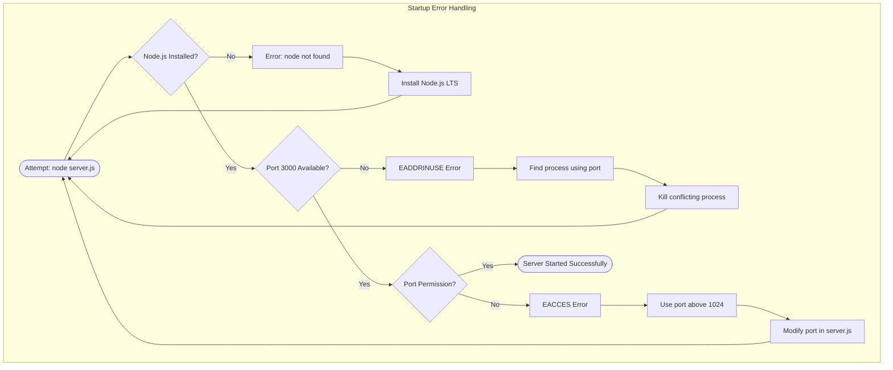

### 4.5.2 Connection Error Recovery Flow

```mermaid
flowchart TD
    subgraph ConnectionErrors["Client Connection Error Handling"]
        ClientAttempt["Client: curl http://127.0.0.1:3000"] --> ConnCheck{"Connection Successful?"}
        
        ConnCheck -->|Refused| RefusedError["Connection Refused"]
        RefusedError --> CheckRunning{"Server Running?"}
        CheckRunning -->|No| StartServer["Start: node server.js"]
        StartServer --> ClientAttempt
        CheckRunning -->|Yes| CheckPort{"Correct Port?"}
        CheckPort -->|No| CorrectPort["Use Correct Port Number"]
        CorrectPort --> ClientAttempt
        CheckPort -->|Yes| CheckHost{"Correct Hostname?"}
        CheckHost -->|No| UseLocalhost["Use 127.0.0.1 or localhost"]
        UseLocalhost --> ClientAttempt
        
        ConnCheck -->|Timeout| TimeoutError["Connection Timeout"]
        TimeoutError --> CheckBinding{"Server Bound to 0.0.0.0?"}
        CheckBinding -->|No| ModifyBinding["Modify hostname in server.js"]
        ModifyBinding --> RestartServer["Restart Server"]
        RestartServer --> ClientAttempt
        CheckBinding -->|Yes| CheckFirewall["Check Firewall Settings"]
        CheckFirewall --> ClientAttempt
        
        ConnCheck -->|Success| ReceiveResponse["Response: Hello, World!"]
    end
```

### 4.5.3 Error State Summary Table

| Error Code | Error Message | Root Cause | Recovery Action |
|------------|---------------|------------|-----------------|
| EADDRINUSE | address already in use :::3000 | Port 3000 occupied | Kill conflicting process or change port |
| EACCES | permission denied | Privileged port (< 1024) | Use port > 1024 or elevate privileges |
| ECONNREFUSED | Connection refused | Server not running | Start server with `node server.js` |
| ETIMEDOUT | Connection timeout | Network or binding issue | Verify hostname binding configuration |
| MODULE_NOT_FOUND | Cannot find module | server.js not found | Verify file path and working directory |

### 4.5.4 Process Recovery Commands

**Linux/macOS Port Conflict Resolution:**
```
lsof -i :3000        # Find process using port
kill -9 <PID>        # Terminate conflicting process
```

**Windows Port Conflict Resolution:**
```
netstat -ano | findstr :3000  # Find process using port
taskkill /PID <PID> /F        # Terminate conflicting process
```

## 4.6 STATE TRANSITION DIAGRAMS

### 4.6.1 Server Lifecycle State Machine

Although the hello_world server is stateless in terms of request handling, the server itself transitions through distinct lifecycle states. The following state diagram documents these transitions.

```mermaid
stateDiagram-v2
    [*] --> Initializing: server.js starts
    
    Initializing --> ConfigurationLoaded: Constants defined
    ConfigurationLoaded --> ServerCreated: http.createServer
    ServerCreated --> Binding: server.listen
    
    Binding --> Running: Port bound successfully
    Binding --> ErrorState: EADDRINUSE or EACCES
    
    state Running {
        [*] --> Listening
        Listening --> ProcessingRequest: HTTP Request received
        ProcessingRequest --> Listening: Response sent
    }
    
    Running --> Terminating: SIGINT
    ErrorState --> [*]: Process exits with error
    Terminating --> [*]: Graceful shutdown
```

### 4.6.2 Request Processing State Machine

This diagram illustrates the state transitions during individual request processing.

```mermaid
stateDiagram-v2
    [*] --> Idle: Server running
    
    Idle --> Receiving: TCP connection accepted
    Receiving --> Parsing: HTTP data received
    Parsing --> Handling: Request parsed
    
    Handling --> SettingStatus: Enter handler callback
    SettingStatus --> SettingHeaders: statusCode = 200
    SettingHeaders --> WritingBody: Content-Type set
    WritingBody --> Responding: res.end called
    
    Responding --> Idle: Response transmitted
    
    note right of Handling : All request data ignored
    note right of SettingStatus : Deterministic path
```

### 4.6.3 Configuration State Diagram

This diagram documents the configuration constants and their relationships within the server lifecycle.

```mermaid
flowchart LR
    subgraph ConfigurationConstants["Configuration Constants"]
        Hostname["hostname: 127.0.0.1"]
        Port["port: 3000"]
    end

    subgraph RuntimeState["Runtime State"]
        ServerInstance["Server Instance"]
        ListeningState["Listening State"]
        EndpointURL["Endpoint URL"]
    end

    Hostname --> ServerInstance
    Port --> ServerInstance
    ServerInstance --> ListeningState
    Hostname --> EndpointURL
    Port --> EndpointURL
```

## 4.7 VALIDATION AND BUSINESS RULES

### 4.7.1 Validation Checkpoint Flowchart

The following diagram shows all validation checkpoints in the system lifecycle.

```mermaid
flowchart TD
    subgraph PrerequisiteValidation["Prerequisite Validation"]
        V1["V-001 - Node.js LTS Installed"]
        V2["V-002 - server.js File Exists"]
        V3["V-003 - Valid JavaScript Syntax"]
    end
    
    subgraph BindingValidation["Binding Validation"]
        V4["V-004 - Port Number Valid 1-65535"]
        V5["V-005 - Port Available"]
        V6["V-006 - Permission Granted"]
        V7["V-007 - Localhost Interface Available"]
    end
    
    subgraph ResponseValidation["Response Validation"]
        V8["V-008 - Status Code 200"]
        V9["V-009 - Content-Type text/plain"]
        V10["V-010 - Body Hello World"]
    end
    
    V1 --> V2
    V2 --> V3
    V3 --> V4
    V4 --> V5
    V5 --> V6
    V6 --> V7
    V7 --> V8
    V8 --> V9
    V9 --> V10
    V10 --> Success(["All Validations Passed"])
```

### 4.7.2 Business Rules at Each Process Step

| Process Step | Business Rule | Validation Requirement |
|--------------|--------------|------------------------|
| Server Creation | Zero external dependencies | No npm packages in dependencies |
| Port Binding | Localhost only by default | hostname must be '127.0.0.1' |
| Request Handling | Universal acceptance | All methods and paths accepted |
| Response Generation | Deterministic output | Identical response for all requests |
| Status Code | Success indication | Must be exactly 200 |
| Content-Type | Plain text format | Must be 'text/plain' |
| Response Body | Canonical message | Must be "Hello, World!\n" |

### 4.7.3 Performance Validation Points

| Checkpoint | Metric | Target | Validation Method |
|------------|--------|--------|-------------------|
| Startup | Time to ready state | < 1 second | Timed execution |
| Request latency | End-to-end response time | < 10ms | HTTP timing |
| Memory usage | Process footprint | ~30MB (Node.js baseline) | Process monitoring |
| CPU utilization | Idle consumption | Minimal | Process monitoring |

## 4.8 FEATURE DEPENDENCY FLOW

### 4.8.1 Feature Execution Dependency Diagram

This diagram illustrates the execution order and dependencies between the five core features.

```mermaid
flowchart TD
    subgraph FoundationLayer["Foundation Layer"]
        F001["F-001<br>HTTP Server Creation<br>CRITICAL"]
    end
    
    subgraph MiddleLayer["Request/Binding Layer"]
        F002["F-002<br>Universal Request Handling<br>CRITICAL"]
        F004["F-004<br>Localhost Binding<br>HIGH"]
    end
    
    subgraph TopLayer["Response/Logging Layer"]
        F003["F-003<br>Consistent Response Delivery<br>CRITICAL"]
        F005["F-005<br>Startup Confirmation Logging<br>MEDIUM"]
    end
    
    F001 -->|requires| F002
    F001 -->|requires| F004
    F002 -->|requires| F003
    F004 -->|requires| F005
    F001 -->|requires| F005
    
    style F001 fill:#ff6b6b
    style F002 fill:#ff6b6b
    style F003 fill:#ff6b6b
    style F004 fill:#ffd93d
    style F005 fill:#6bcb77
```

### 4.8.2 Feature Activation Sequence

```mermaid
sequenceDiagram
    participant Runtime as Node.js Runtime
    participant F001 as F-001 Server Creation
    participant F004 as F-004 Localhost Binding
    participant F005 as F-005 Startup Logging
    participant F002 as F-002 Request Handling
    participant F003 as F-003 Response Delivery
    
    Runtime->>F001: Initialize HTTP Server
    F001->>F004: Bind to 127.0.0.1:3000
    F004->>F005: Port binding successful
    F005->>Runtime: Log startup message
    
    Note over Runtime,F003: Server now operational
    
    loop Request Processing
        Runtime->>F002: HTTP Request received
        F002->>F003: Generate response
        F003->>Runtime: Send HTTP 200 OK
    end
```

## 4.9 TIMING AND SLA CONSIDERATIONS

### 4.9.1 Request-Response Timing Diagram

```mermaid
flowchart LR
    subgraph Timing["Timing Breakdown"]
        T1["TCP Connect < 1ms"]
        T2["Request Send < 1ms"]
        T3["Server Process < 5ms"]
        T4["Response Send < 1ms"]
        T5["Client Receive < 1ms"]
    end
    
    T1 --> T2 --> T3 --> T4 --> T5
    
    subgraph TotalSLA["Total SLA"]
        SLA["End-to-End < 10ms"]
    end
```

### 4.9.2 Performance SLA Summary

| Operation | Target SLA | Maximum Acceptable | Notes |
|-----------|------------|-------------------|-------|
| Server startup | < 1 second | 2 seconds | Cold start timing |
| Request-response latency | < 10ms | 50ms | Round-trip time |
| Port binding | < 100ms | 500ms | Network subsystem |
| Memory allocation | ~30MB | 50MB | Node.js baseline |

## 4.10 DEPLOYMENT WORKFLOW

### 4.10.1 Deployment Configuration Flow

This diagram shows the configuration paths for different deployment scenarios.

```mermaid
flowchart TD
    subgraph DeploymentScenarios["Deployment Scenarios"]
        Start([Deployment Decision]) --> ScenarioChoice{Environment?}
        
        ScenarioChoice -->|Local Dev| LocalConfig["hostname: 127.0.0.1<br>port: 3000"]
        ScenarioChoice -->|Docker| DockerConfig["hostname: 0.0.0.0<br>port: 3000"]
        ScenarioChoice -->|Direct Production| ProdConfig["hostname: 0.0.0.0<br>port: 80 or 8080"]
        ScenarioChoice -->|Behind Proxy| ProxyConfig["hostname: 127.0.0.1<br>port: 3000"]
    end
    
    subgraph ConfigApplication["Configuration Application"]
        LocalConfig --> ModifyServer["Modify server.js constants"]
        DockerConfig --> ModifyServer
        ProdConfig --> ModifyServer
        ProxyConfig --> ModifyServer
        
        ModifyServer --> DeployServer["Deploy and Start Server"]
        DeployServer --> VerifyAccess["Verify Access"]
        VerifyAccess --> DeployComplete(["Deployment Complete"])
    end
```

### 4.10.2 Docker Deployment Workflow

```mermaid
flowchart TD
    subgraph DockerWorkflow["Docker Deployment Workflow"]
        Start(["Docker Deployment"]) --> CreateDockerfile["Create Dockerfile"]
        CreateDockerfile --> ModifyHostname["Set hostname = 0.0.0.0"]
        ModifyHostname --> BuildImage["docker build -t hello_world ."]
        BuildImage --> RunContainer["docker run -p 3000:3000 hello_world"]
        RunContainer --> VerifyAccess["Verify External Access"]
        VerifyAccess --> DockerComplete(["Container Running"])
    end
```

## 4.11 REFERENCES

#### Files Examined

- `server.js` — Primary HTTP server implementation (lines 22-71), request handler logic, configuration constants, JSDoc documentation
- `README.md` — User documentation, existing Mermaid diagrams, API reference, troubleshooting guide
- `package.json` — Project metadata confirming zero dependencies
- `blitzy/documentation/Technical Specifications.md` — Comprehensive technical specifications, feature catalog, implementation considerations

#### Technical Specification Sections Referenced

- Section 1.2 System Overview — High-level architecture and component descriptions
- Section 2.2 Feature Catalog — Complete feature definitions (F-001 through F-005)
- Section 2.4 Feature Relationships — Feature dependency map and integration points
- Section 2.5 Implementation Considerations — Technical constraints and performance requirements
- Section 2.7 API Contract Specification — Request-response flow and endpoint definition
- Section 2.8 Assumptions and Constraints — System assumptions and design constraints
- Section 3.1 Overview — Technology stack philosophy and component diagram
- Section 3.9 Protocol & Networking — Network configuration and security implications

# 5. System Architecture

## 5.1 HIGH-LEVEL ARCHITECTURE

### 5.1.1 System Overview

The hello_world server implements a **stateless, deterministic request-response architecture** designed specifically as a test scaffold for Backprop integration testing. This architectural choice prioritizes predictability and reproducibility over flexibility, making the system ideal for integration testing scenarios where consistent behavior is paramount.

#### Architectural Style and Rationale

The system follows a minimalist, single-tier architecture with the following defining characteristics:

| Architectural Characteristic | Implementation Approach | Rationale |
|------------------------------|------------------------|-----------|
| Zero-Dependency Design | Uses only Node.js built-in `http` module | Eliminates version conflicts, reduces security surface, removes dependency maintenance burden |
| Single-File Architecture | All server logic in `server.js` (72 lines) | Maximizes transparency, simplifies code comprehension, enables instant setup |
| Stateless Processing | No session management or data persistence | Ensures deterministic behavior across all requests |
| Synchronous Request Handling | Immediate response generation | Provides consistent, predictable response timing |

The architectural philosophy reflects the project's purpose as an internal development tool rather than a production application. By intentionally limiting complexity, the system achieves rapid setup times (under 1 second to operational state) and eliminates the variables that typically complicate integration testing.

#### Key Architectural Principles

The system adheres to four foundational principles that guide all design decisions:

1. **Deterministic Behavior**: Every HTTP request—regardless of method, path, headers, or body—receives an identical response (HTTP 200 OK with "Hello, World!" body). This consistency enables reliable test assertions.

2. **Cross-Platform Compatibility**: By using only Node.js built-in modules, the server operates identically across Windows, macOS, and Linux environments without platform-specific configuration.

3. **Security by Default**: Localhost binding (`127.0.0.1`) prevents accidental external network exposure while maintaining full functionality for local testing workflows.

4. **Minimal Footprint**: The complete system requires only Node.js runtime installation—no package managers, configuration files, or environment variables needed for operation.

#### System Boundaries and Major Interfaces

The hello_world server defines clear boundaries that establish its role within the broader development ecosystem:

```mermaid
flowchart TB
    subgraph ExternalBoundary["External Boundary"]
        direction TB
        Backprop["Backprop - Code Analysis"]
        HTTPClients["HTTP Clients - curl and wget"]
        Browsers["Web Browsers"]
        TestFrameworks["Test Frameworks"]
    end
    
    subgraph SystemBoundary["System Boundary - hello_world"]
        direction TB
        NetworkInterface["Network Interface - TCP Socket Port 3000"]
        HTTPServer["HTTP Server - Node.js http module"]
        RequestHandler["Request Handler - Universal Processing"]
        ResponseGenerator["Response Generator - Static Output"]
        ConsoleOutput["Console Output - stdout"]
    end
    
    subgraph RuntimeBoundary["Runtime Boundary"]
        direction TB
        NodeJS["Node.js Runtime - LTS 20.x/22.x/24.x"]
    end
    
    Backprop --> NetworkInterface
    HTTPClients --> NetworkInterface
    Browsers --> NetworkInterface
    TestFrameworks --> NetworkInterface
    
    NetworkInterface --> HTTPServer
    HTTPServer --> RequestHandler
    RequestHandler --> ResponseGenerator
    ResponseGenerator --> NetworkInterface
    HTTPServer --> ConsoleOutput
    
    NodeJS --> HTTPServer
```

| Boundary Type | Interface | Protocol/Format | Access Pattern |
|---------------|-----------|-----------------|----------------|
| Network Interface | TCP Socket on port 3000 | HTTP/1.1 | Inbound requests |
| Localhost Binding | 127.0.0.1 | TCP/IP | Local access only |
| Console Output | stdout stream | Plain text | Outbound logging |
| Process Control | SIGINT signal | OS signals | Graceful shutdown |

### 5.1.2 Core Components Table

The system comprises five logical components that work together to deliver consistent HTTP responses:

| Component Name | Primary Responsibility | Key Dependencies | Integration Points |
|----------------|----------------------|------------------|-------------------|
| HTTP Server Instance | Creates and manages the server lifecycle, accepts TCP connections | Node.js `http` module | Network layer (port 3000), Request Handler |
| Request Handler | Receives and processes all incoming HTTP requests | `http.IncomingMessage`, `http.ServerResponse` | HTTP Server Instance, Response Generator |
| Response Generator | Constructs the deterministic HTTP response | `http.ServerResponse` object | Request Handler, Network Interface |
| Configuration Constants | Defines hostname and port binding parameters | None (hardcoded values) | HTTP Server Instance |
| Startup Logger | Outputs confirmation message upon successful initialization | `console.log()` | HTTP Server Instance, stdout |

### 5.1.3 Data Flow Description

The data flow within the hello_world server follows a linear, deterministic path from client request to server response. This simplicity is intentional—it ensures that integration tests can rely on predictable behavior without accounting for routing logic, authentication states, or data transformations.

#### Primary Data Flow

When an HTTP client sends a request to the server, the following sequence occurs:

1. **TCP Connection Establishment**: The client establishes a TCP connection to `127.0.0.1:3000`. Node.js accepts the connection and prepares to receive HTTP data.

2. **HTTP Protocol Parsing**: The Node.js runtime parses the incoming HTTP request according to HTTP/1.1 specifications, creating `IncomingMessage` (request) and `ServerResponse` (response) objects.

3. **Request Handler Invocation**: The server invokes the registered callback function, passing both objects as parameters. At this point, all request data is available but intentionally ignored.

4. **Response Generation**: The handler executes three sequential operations:
   - Sets `res.statusCode = 200`
   - Sets `res.setHeader('Content-Type', 'text/plain')`
   - Calls `res.end('Hello, World!\n')` to complete the response

5. **Response Transmission**: Node.js serializes the response and transmits it over the TCP connection to the waiting client.

#### Data Transformation Points

| Stage | Input | Transformation | Output |
|-------|-------|----------------|--------|
| TCP Reception | Raw TCP packets | Node.js network buffering | HTTP byte stream |
| HTTP Parsing | HTTP byte stream | Protocol parsing | Request/Response objects |
| Request Handling | Request object | None (ignored) | No data extracted |
| Response Construction | None required | Static value assignment | Response headers and body |
| Response Serialization | Response object | HTTP protocol formatting | TCP byte stream |

#### Key Data Stores and Caches

The system maintains no persistent data stores or caches. This stateless design ensures:

- **No session management**: Each request is processed independently
- **No database connections**: Zero external system dependencies
- **No in-memory caching**: Response is regenerated for each request
- **No file I/O**: All configuration is inline code

This architectural choice eliminates data consistency concerns and makes the server behavior fully predictable across restarts.

### 5.1.4 External Integration Points

The hello_world server is designed to integrate with various HTTP-capable systems for testing purposes. The following table documents all external integration points:

| System Name | Integration Type | Data Exchange Pattern | Protocol/Format |
|-------------|-----------------|----------------------|-----------------|
| Backprop | Primary test target | Request-Response | HTTP/1.1, text/plain |
| curl/wget | Command-line testing | Request-Response | HTTP/1.1, text/plain |
| Web Browsers | Interactive testing | Request-Response | HTTP/1.1, text/plain |
| Test Frameworks | Automated testing | Request-Response | HTTP/1.1, text/plain |
| Log Aggregators | Operational monitoring | Event streaming | stdout, plain text |

---

## 5.2 COMPONENT DETAILS

### 5.2.1 HTTP Server Component

#### Purpose and Responsibilities

The HTTP Server component serves as the foundation of the system, responsible for:

- Creating and initializing the server instance using `http.createServer()`
- Managing the server lifecycle from startup through shutdown
- Accepting incoming TCP connections on the configured port
- Delegating request processing to the Request Handler callback
- Producing startup confirmation via console output

#### Technologies and Frameworks

| Technology | Version Requirement | Role |
|------------|---------------------|------|
| Node.js Runtime | LTS 20.x, 22.x, or 24.x | JavaScript execution environment |
| Built-in `http` Module | Native to Node.js | HTTP server implementation |
| CommonJS Module System | ES6+ compatible | Module loading (`require()`) |

The decision to use the built-in `http` module rather than frameworks like Express provides zero-dependency operation and eliminates external security vulnerabilities while maintaining all functionality required for the test scaffold use case.

#### Key Interfaces and APIs

**Inbound Interface:**

| Attribute | Specification |
|-----------|--------------|
| Protocol | HTTP/1.1 |
| Binding Address | 127.0.0.1 (localhost) |
| Port | 3000 |
| Accepted Methods | All HTTP methods (GET, POST, PUT, DELETE, PATCH, OPTIONS, HEAD, etc.) |
| Accepted Paths | All URL paths |

**Outbound Interface:**

| Attribute | Specification |
|-----------|--------------|
| Response Status | 200 OK (always) |
| Content-Type | text/plain |
| Response Body | `Hello, World!\n` (14 characters) |
| Connection | Closed after response |

#### Data Persistence Requirements

None. The HTTP Server component operates in a completely stateless manner with no persistence requirements.

#### Scaling Considerations

The server operates as a single-threaded, single-instance process. For scenarios requiring higher throughput:

| Scaling Approach | Implementation | Applicability |
|------------------|----------------|---------------|
| Process Manager (PM2) | `pm2 start server.js --name "hello-world"` | Production deployments requiring monitoring |
| Container Orchestration | Docker with hostname `0.0.0.0` | Microservices architecture testing |
| Load Balancer | nginx/HAProxy upstream configuration | Multi-instance testing scenarios |

### 5.2.2 Configuration Component

#### Purpose and Responsibilities

The Configuration component defines the server's operational parameters through inline constants. This approach prioritizes reproducibility over flexibility, ensuring identical behavior across all execution environments.

#### Configuration Parameters

| Parameter | Default Value | Type | Location |
|-----------|---------------|------|----------|
| hostname | `'127.0.0.1'` | string | `server.js` line 30 |
| port | `3000` | number | `server.js` line 38 |

#### Configuration Modification Approach

Configuration changes require direct code modification:

| To Change | Modification Required |
|-----------|----------------------|
| Enable external access | Change `'127.0.0.1'` to `'0.0.0.0'` in line 30 |
| Use different port | Change `3000` to desired port number in line 38 |
| Enable Docker networking | Set hostname to `'0.0.0.0'` for container exposure |

#### Intentionally Unsupported Configuration Methods

| Method | Status | Rationale |
|--------|--------|-----------|
| Environment Variables | Not supported | Ensures reproducible behavior across environments |
| Configuration Files | Not implemented | Maintains single-file architecture |
| Command-Line Arguments | Not implemented | Simplifies usage and documentation |
| Runtime Configuration | Not supported | Prevents dynamic behavior changes |

### 5.2.3 Component Interaction Diagrams

#### Request Processing Sequence

```mermaid
sequenceDiagram
    participant Client as HTTP Client
    participant Socket as TCP Socket
    participant Server as NodeJS Server
    participant Handler as Request Handler
    participant Response as Response Generator
    
    Client->>Socket: TCP Connection Request
    Socket->>Server: Accept Connection
    
    Client->>Server: HTTP Request
    Note over Server: Parse HTTP protocol
    
    Server->>Handler: Invoke callback
    
    Note over Handler: req.method IGNORED
    Note over Handler: req.url IGNORED
    Note over Handler: req.headers IGNORED
    
    Handler->>Response: Set statusCode 200
    Response->>Response: Set Content-Type header
    Response->>Response: Write response body
    
    Response-->>Server: Response complete
    Server-->>Client: HTTP 200 OK Hello World
```

#### Server Lifecycle State Diagram

```mermaid
stateDiagram-v2
    [*] --> Initializing : node server
    
    Initializing --> ConfigurationLoaded : Constants defined
    ConfigurationLoaded --> ServerCreated : createServer called
    ServerCreated --> Binding : listen called
    
    Binding --> Running : Port bound successfully
    Binding --> ErrorState : EADDRINUSE or EACCES
    
    state Running {
        [*] --> Listening
        Listening --> ProcessingRequest : Request received
        ProcessingRequest --> Listening : Response sent
    }
    
    Running --> Terminating : SIGINT received
    ErrorState --> [*] : Process exits with error
    Terminating --> [*] : Graceful shutdown
```

---

## 5.3 TECHNICAL DECISIONS

### 5.3.1 Architecture Style Decisions and Tradeoffs

The following architecture decisions define the system's fundamental approach and represent deliberate tradeoffs favoring simplicity and predictability:

| Decision | Choice Made | Alternatives Considered | Tradeoff Rationale |
|----------|-------------|------------------------|-------------------|
| Dependency Model | Zero external dependencies | Express.js, Fastify, Koa | Eliminates security vulnerabilities, version conflicts, and `npm install` requirement |
| File Architecture | Single file (72 lines) | Multi-file modular structure | Maximizes code transparency; entire implementation visible at once |
| Module System | CommonJS (`require`) | ES Modules (`import`) | Maximum compatibility with older Node.js versions |
| Response Behavior | Deterministic (ignore all input) | RESTful routing | Ensures predictable test outcomes; removes routing as a variable |
| State Management | Stateless | Session-based, database-backed | Eliminates data consistency concerns; each request is independent |

### 5.3.2 Communication Pattern Choices

| Pattern | Implementation | Design Rationale |
|---------|----------------|------------------|
| Request-Response | Synchronous HTTP/1.1 | Standard web protocol; maximum client compatibility |
| Universal Handling | Single handler for all routes | Deterministic behavior for integration testing |
| Connection Model | Short-lived connections | Simplifies resource management; no connection pooling needed |

### 5.3.3 Security Mechanism Selection

Security decisions reflect the test scaffold purpose while maintaining sensible defaults:

| Security Aspect | Decision | Implementation | Rationale |
|-----------------|----------|----------------|-----------|
| Network Binding | Localhost only | `hostname = '127.0.0.1'` | Prevents accidental external exposure |
| Authentication | None implemented | No auth middleware | Not required for test scaffold purpose |
| HTTPS Support | Not implemented | HTTP only | Reduces complexity; TLS not needed for local testing |
| Input Validation | Not required | All input ignored | Injection attacks impossible—no user input processed |
| Privilege Level | User-space port (3000) | Above privileged port range | No root/admin privileges required |

### 5.3.4 Architecture Decision Flow

```mermaid
flowchart TD
    subgraph Principles["Guiding Principles"]
        P1["Zero Dependencies"]
        P2["Single-File Design"]
        P3["Deterministic Behavior"]
        P4["Cross-Platform Support"]
    end
    
    subgraph Decisions["Key Decisions"]
        D1["Use Node.js http module"]
        D2["Ignore all request data"]
        D3["Static response values"]
        D4["Localhost binding"]
    end
    
    subgraph Outcomes["Implementation Outcomes"]
        O1["No npm install"]
        O2["No routing complexity"]
        O3["Predictable tests"]
        O4["Security by default"]
    end
    
    P1 --> D1
    P2 --> D1
    P3 --> D2
    P3 --> D3
    P4 --> D1
    
    D1 --> O1
    D2 --> O2
    D3 --> O3
    D4 --> O4
```

---

## 5.4 CROSS-CUTTING CONCERNS

### 5.4.1 Monitoring and Observability Approach

The system implements minimal observability appropriate for its test scaffold purpose:

| Observability Aspect | Implementation | Details |
|---------------------|----------------|---------|
| Startup Logging | `console.log()` output | Prints `Server running at http://127.0.0.1:3000/` on successful startup |
| Request Logging | Not implemented | Stateless design eliminates need for request tracking |
| Metrics Collection | Not implemented | Test scaffold does not require metrics infrastructure |
| Health Checking | Implicit via HTTP | Any successful HTTP request confirms operational status |

For production deployments requiring enhanced observability, the following extensions would be recommended:

| Enhancement | Implementation Approach |
|-------------|------------------------|
| Request logging | Add `console.log()` in request handler |
| Metrics export | Integrate with Prometheus client library |
| Distributed tracing | Add OpenTelemetry instrumentation |

### 5.4.2 Logging Strategy

| Log Event | Trigger | Output Channel | Format |
|-----------|---------|----------------|--------|
| Server startup | Successful port binding | stdout | `Server running at http://${hostname}:${port}/` |
| Port conflict | EADDRINUSE error | stderr | Node.js default error format |
| Permission denied | EACCES error | stderr | Node.js default error format |

### 5.4.3 Error Handling Patterns

The system encounters errors primarily during the startup phase. Runtime errors during request processing are effectively impossible due to the static nature of the response generation.

#### Error Handling Flow

```mermaid
flowchart TD
    StartNode(["Start node server.js"])
    
    StartNode --> NodeCheck{"Node.js Installed?"}
    NodeCheck -->|No| NodeError["Error: node not found"]
    NodeCheck -->|Yes| FileCheck{"server.js Exists?"}
    
    FileCheck -->|No| FileError["Error: MODULE_NOT_FOUND"]
    FileCheck -->|Yes| SyntaxChk{"Syntax Valid?"}
    
    SyntaxChk -->|No| SyntaxErr["SyntaxError Exception"]
    SyntaxChk -->|Yes| PortCheck{"Port 3000 Available?"}
    
    PortCheck -->|No| PortError["Error: EADDRINUSE"]
    PortCheck -->|Yes| PermCheck{"Port Permission?"}
    
    PermCheck -->|No| PermError["Error: EACCES"]
    PermCheck -->|Yes| Success(["Server Running"])
    
    PortError --> RecoveryPort["Kill conflicting process or change port"]
    PermError --> RecoveryPerm["Use port above 1024 or elevate privileges"]
    RecoveryPort --> StartNode
    RecoveryPerm --> StartNode
```

#### Error State Summary

| Error Code | Error Message | Root Cause | Recovery Action |
|------------|---------------|------------|-----------------|
| EADDRINUSE | address already in use :::3000 | Port 3000 occupied by another process | Terminate conflicting process or modify port |
| EACCES | permission denied | Privileged port (< 1024) without elevated privileges | Use port > 1024 or run with elevated privileges |
| ECONNREFUSED | Connection refused | Server not running | Start server with `node server.js` |
| MODULE_NOT_FOUND | Cannot find module | server.js not found in working directory | Verify file path and current directory |

### 5.4.4 Performance Requirements and SLAs

The system is designed to meet the following performance targets:

| Performance Metric | Target SLA | Maximum Acceptable | Notes |
|-------------------|------------|-------------------|-------|
| Server startup time | < 1 second | 2 seconds | Cold start to operational state |
| Request-response latency | < 10ms | 50ms | End-to-end round-trip time |
| Port binding time | < 100ms | 500ms | Network subsystem initialization |
| Memory consumption | ~30MB | 50MB | Node.js baseline footprint |

#### Timing Breakdown

```mermaid
flowchart LR
    subgraph TimingBreakdown["Request-Response Timing"]
        T1["TCP Connect < 1ms"]
        T2["Request Send < 1ms"]
        T3["Server Process < 5ms"]
        T4["Response Send < 1ms"]
        T5["Client Receive < 1ms"]
    end
    
    T1 --> T2 --> T3 --> T4 --> T5
    
    subgraph TotalSLA["Total SLA Target"]
        SLA["End-to-End < 10ms"]
    end
```

### 5.4.5 Deployment Considerations

The system supports multiple deployment configurations, each requiring specific configuration adjustments:

| Deployment Type | hostname Setting | port Setting | Use Case |
|-----------------|-----------------|--------------|----------|
| Local Development | `'127.0.0.1'` | `3000` | Default configuration for development and testing |
| Docker Container | `'0.0.0.0'` | `3000` | Container networking requires all-interface binding |
| Direct Production | `'0.0.0.0'` | `80` or `8080` | Direct server deployment without reverse proxy |
| Behind Reverse Proxy | `'127.0.0.1'` | `3000` | Production deployment with nginx/Apache frontend |

---

## 5.5 ARCHITECTURAL ASSUMPTIONS AND CONSTRAINTS

### 5.5.1 Assumptions

| ID | Assumption | Impact if Invalid |
|----|------------|-------------------|
| A-001 | Node.js LTS is installed on target system | Server will not start; `node` command not recognized |
| A-002 | TCP port 3000 is available | EADDRINUSE error on startup |
| A-003 | User has terminal/command-line access | Cannot execute startup command |
| A-004 | Localhost network interface is available | Binding error; network stack issue |

### 5.5.2 Constraints

| ID | Constraint | Rationale |
|----|------------|-----------|
| C-001 | HTTP only (no HTTPS) | Test scaffold simplicity; TLS adds unnecessary complexity |
| C-002 | No environment variable configuration | Ensures reproducible behavior across environments |
| C-003 | Localhost binding only (by default) | Security by default prevents accidental exposure |
| C-004 | Single-threaded, single-instance | Minimal design appropriate for test scaffold |
| C-005 | No database or persistence | Stateless operation ensures deterministic behavior |

---

## 5.6 References

### 5.6.1 Source Files

- `server.js` — Primary HTTP server implementation (72 lines with JSDoc documentation)
  - Lines 21-22: HTTP module import
  - Lines 30, 38: Configuration constants (hostname, port)
  - Lines 55-64: Server creation and request handler
  - Lines 68-70: Server startup and console logging

- `package.json` — Project metadata confirming zero dependencies and MIT license

### 5.6.2 Documentation Files

- `README.md` — Comprehensive user documentation including installation, usage, and troubleshooting
- `blitzy/documentation/Technical Specifications.md` — Detailed technical specifications and workflow diagrams

### 5.6.3 Technical Specification Sections Referenced

- Section 1.2: System Overview — Project context and high-level capabilities
- Section 2.2: Feature Catalog — Features F-001 through F-005 specifications
- Section 2.8: Assumptions and Constraints — System prerequisites and limitations
- Section 3.1: Technology Stack Overview — Stack philosophy and principles
- Section 3.8: Configuration — Server configuration options and constraints
- Section 3.9: Protocol & Networking — Network and security configuration
- Section 3.11: Technology Stack Summary — Implemented vs. not implemented technologies
- Section 4.2: Core Business Processes — User journeys and startup flow
- Section 4.3: Request-Response Workflows — Detailed request processing flows
- Section 4.4: Integration Workflows — External system integration points
- Section 4.5: Error Handling Workflows — Error states and recovery procedures
- Section 4.6: State Transition Diagrams — Server lifecycle state machines
- Section 4.9: Timing and SLA Considerations — Performance requirements
- Section 4.10: Deployment Workflow — Deployment configuration options

# 6. SYSTEM COMPONENTS DESIGN

## 6.1 Core Services Architecture

#### INFRASTRUCTURE

## 6.1 Core Services Architecture

### 6.1.1 Applicability Statement

**Core Services Architecture is not applicable for this system.**

The hello_world HTTP server is a minimal, single-file test scaffold explicitly designed to operate as a monolithic, single-instance application without distributed services, microservices patterns, or multi-component architectures. This architectural decision is intentional and well-documented, serving the system's primary purpose as an integration testing target for Backprop.

#### Rationale for Non-Applicability

The following table summarizes why core services architecture patterns do not apply to this system:

| Architecture Pattern | Applicability | Evidence |
|---------------------|---------------|----------|
| Microservices | Not applicable | Single-file architecture (72 lines in `server.js`) |
| Service Discovery | Not applicable | Single localhost binding (`127.0.0.1:3000`) |
| Load Balancing | Not applicable | Constraint C-004: Single-threaded, single-instance |
| Inter-Service Communication | Not applicable | No external service calls or integrations |
| Circuit Breakers | Not applicable | No outbound API dependencies |
| Distributed State | Not applicable | Constraint C-005: No database or persistence |

### 6.1.2 Architectural Justification

#### 6.1.2.1 Design Philosophy

The system implements a **stateless, deterministic request-response architecture** that prioritizes predictability and reproducibility over flexibility. This architectural choice aligns with the project's explicit purpose as an internal development tool for integration testing rather than a production application.

The following guiding principles dictate the architectural approach:

| Principle | Implementation | Resulting Benefit |
|-----------|----------------|-------------------|
| Zero-Dependency Design | Uses only Node.js built-in `http` module | Eliminates version conflicts and security surface |
| Single-File Architecture | All logic contained in `server.js` | Maximizes transparency and code comprehension |
| Stateless Processing | No session management or data persistence | Ensures deterministic behavior across all requests |
| Synchronous Request Handling | Immediate response generation | Provides consistent, predictable response timing |

#### 6.1.2.2 Explicit Constraints Preventing Distributed Architecture

The system operates under architectural constraints that preclude distributed services architecture:

| Constraint ID | Constraint | Rationale |
|--------------|------------|-----------|
| C-001 | HTTP only (no HTTPS) | Test scaffold simplicity; TLS adds unnecessary complexity |
| C-002 | No environment variable configuration | Ensures reproducible behavior across environments |
| C-003 | Localhost binding only (by default) | Security by default prevents accidental exposure |
| C-004 | Single-threaded, single-instance | Minimal design appropriate for test scaffold |
| C-005 | No database or persistence | Stateless operation ensures deterministic behavior |

### 6.1.3 Actual System Architecture

#### 6.1.3.1 Monolithic Single-Instance Design

Rather than a distributed services architecture, the hello_world server implements a minimal monolithic design with five logical components operating within a single process:

| Component Name | Primary Responsibility | Dependencies |
|----------------|----------------------|--------------|
| HTTP Server Instance | Creates and manages server lifecycle, accepts TCP connections | Node.js `http` module |
| Request Handler | Receives and processes all incoming HTTP requests | `http.IncomingMessage`, `http.ServerResponse` |
| Response Generator | Constructs the deterministic HTTP response | `http.ServerResponse` object |
| Configuration Constants | Defines hostname and port binding parameters | None (hardcoded values) |
| Startup Logger | Outputs confirmation message upon initialization | `console.log()` |

#### 6.1.3.2 System Boundary Diagram

The following diagram illustrates the actual system architecture and its boundaries:

```mermaid
flowchart TB
    subgraph ExternalBoundary["External Boundary"]
        Backprop["Backprop: Code Analysis"]
        HTTPClients["HTTP Clients: curl, wget"]
        Browsers["Web Browsers"]
        TestFrameworks["Test Frameworks"]
    end
    
    subgraph SystemBoundary["System Boundary: hello_world"]
        NetworkInterface["Network Interface: TCP Socket Port 3000"]
        HTTPServer["HTTP Server: Node.js http module"]
        RequestHandler["Request Handler: Universal Processing"]
        ResponseGenerator["Response Generator: Static Output"]
        ConsoleOutput["Console Output: stdout"]
    end
    
    subgraph RuntimeBoundary["Runtime Boundary"]
        NodeJS["Node.js Runtime: LTS 20.x 22.x 24.x"]
    end
    
    Backprop --> NetworkInterface
    HTTPClients --> NetworkInterface
    Browsers --> NetworkInterface
    TestFrameworks --> NetworkInterface
    
    NetworkInterface --> HTTPServer
    HTTPServer --> RequestHandler
    RequestHandler --> ResponseGenerator
    ResponseGenerator --> NetworkInterface
    HTTPServer --> ConsoleOutput
    
    NodeJS --> HTTPServer
```

#### 6.1.3.3 Component Interaction Flow

The request processing follows a linear, deterministic path without any service-to-service communication:

```mermaid
sequenceDiagram
    participant Client as HTTP Client
    participant Socket as TCP Socket
    participant Server as Node.js Server
    participant Handler as Request Handler
    participant Response as Response Generator
    
    Client->>Socket: TCP Connection Request
    Socket->>Server: Accept Connection
    
    Client->>Server: HTTP Request
    Note over Server: Parse HTTP protocol
    
    Server->>Handler: Invoke callback
    
    Note over Handler: req.method IGNORED
    Note over Handler: req.url IGNORED
    Note over Handler: req.headers IGNORED
    
    Handler->>Response: Set statusCode 200
    Response->>Response: Set Content-Type header
    Response->>Response: Write response body
    
    Response-->>Server: Response complete
    Server-->>Client: HTTP 200 OK Hello World
```

### 6.1.4 Non-Applicable Service Patterns

The following sections document service architecture patterns that are explicitly excluded from this system by design.

#### 6.1.4.1 Service Components (Not Implemented)

| Pattern | Status | Rationale |
|---------|--------|-----------|
| Service Boundaries and Responsibilities | Not applicable | Single monolithic service handles all requests |
| Inter-Service Communication | Not applicable | No external services exist to communicate with |
| Service Discovery Mechanisms | Not applicable | Single localhost binding eliminates discovery needs |
| Load Balancing Strategy | Not applicable | Single-instance design precludes load distribution |
| Circuit Breaker Patterns | Not applicable | No outbound service calls that could fail |
| Retry and Fallback Mechanisms | Not applicable | Static response generation cannot fail |

#### 6.1.4.2 Scalability Design (Not Implemented)

The system explicitly operates as a single-threaded, single-instance process without scaling capabilities:

| Scaling Pattern | Status | Rationale |
|-----------------|--------|-----------|
| Horizontal Scaling | Not designed | Constraint C-004 mandates single-instance operation |
| Vertical Scaling | Not required | Minimal resource footprint (~30MB memory) |
| Auto-Scaling Triggers | Not applicable | Test scaffold purpose does not require scaling |
| Resource Allocation Strategy | Not applicable | Fixed, minimal resource consumption |
| Performance Optimization | Not applicable | Static response requires no optimization |
| Capacity Planning | Not applicable | Single-instance, localhost-only design |

#### 6.1.4.3 Resilience Patterns (Not Implemented)

| Resilience Pattern | Status | Rationale |
|--------------------|--------|-----------|
| Fault Tolerance Mechanisms | Minimal | Only process restart available |
| Disaster Recovery Procedures | Not applicable | Stateless design requires no data recovery |
| Data Redundancy Approach | Not applicable | No data persistence by design |
| Failover Configurations | Not applicable | Single-instance, no redundancy |
| Service Degradation Policies | Not applicable | Binary state: running or not running |

### 6.1.5 Comparison: Current vs. Distributed Architecture

To clarify the architectural approach, the following diagram contrasts what a distributed services architecture would look like versus the actual implemented architecture:

```mermaid
flowchart LR
    subgraph NotImplemented["NOT IMPLEMENTED - Distributed Architecture"]
        direction TB
        LB["Load Balancer"]
        S1["Service Instance 1"]
        S2["Service Instance 2"]
        S3["Service Instance 3"]
        SD["Service Discovery"]
        DB["Database"]
        Cache["Cache Layer"]
        MQ["Message Queue"]
        
        LB --> S1
        LB --> S2
        LB --> S3
        S1 --> SD
        S2 --> SD
        S3 --> SD
        S1 --> DB
        S2 --> DB
        S3 --> DB
        S1 --> Cache
        S2 --> Cache
        S3 --> Cache
        S1 --> MQ
        S2 --> MQ
        S3 --> MQ
    end
    
    subgraph Implemented["ACTUAL - Monolithic Architecture"]
        direction TB
        SingleServer["Single HTTP Server<br/>127.0.0.1:3000"]
        StaticResponse["Static Response<br/>Hello World"]
        
        SingleServer --> StaticResponse
    end
```

### 6.1.6 Future Scaling Considerations

While not currently implemented, the technical specification documents potential scaling approaches if the system were ever extended beyond its test scaffold purpose:

| Scaling Approach | Implementation | Applicability Scenario |
|------------------|----------------|------------------------|
| Process Manager (PM2) | `pm2 start server.js` | Production deployments requiring monitoring |
| Container Orchestration | Docker with hostname `0.0.0.0` | Microservices architecture testing |
| Load Balancer | nginx/HAProxy upstream configuration | Multi-instance testing scenarios |

These approaches remain outside the current scope as documented in the architectural constraints.

### 6.1.7 Server Lifecycle State Diagram

The following diagram illustrates the complete lifecycle of the single-instance server:

```mermaid
stateDiagram-v2
    [*] --> Initializing : node server.js
    
    Initializing --> ConfigurationLoaded : Constants defined
    ConfigurationLoaded --> ServerCreated : createServer called
    ServerCreated --> Binding : listen called
    
    Binding --> Running : Port bound successfully
    Binding --> ErrorState : EADDRINUSE or EACCES
    
    state Running {
        [*] --> Listening
        Listening --> ProcessingRequest : Request received
        ProcessingRequest --> Listening : Response sent
    }
    
    Running --> Terminating : SIGINT received
    ErrorState --> [*] : Process exits with error
    Terminating --> [*] : Graceful shutdown
```

### 6.1.8 Summary

The hello_world HTTP server intentionally avoids distributed services architecture in favor of a minimal, single-file, single-instance design. This decision directly supports the project's purpose as a test scaffold for Backprop integration testing, where:

- **Predictability** outweighs scalability requirements
- **Simplicity** enables rapid setup and teardown
- **Determinism** ensures consistent test outcomes
- **Zero dependencies** eliminate environmental variables

The architectural constraints (C-001 through C-005) codify these design decisions, explicitly excluding patterns such as service discovery, load balancing, circuit breakers, auto-scaling, and resilience mechanisms from the system scope.

#### References

The following sources were examined in documenting the non-applicability of Core Services Architecture:

- `server.js` - Single-file HTTP server implementation (72 lines) demonstrating monolithic architecture
- `package.json` - npm manifest confirming zero external dependencies
- Technical Specification Section 5.1 HIGH-LEVEL ARCHITECTURE - System overview and boundaries
- Technical Specification Section 5.2 COMPONENT DETAILS - HTTP server component specifications
- Technical Specification Section 5.3 TECHNICAL DECISIONS - Architecture style decisions and tradeoffs
- Technical Specification Section 5.4 CROSS-CUTTING CONCERNS - Monitoring, logging, and error handling
- Technical Specification Section 5.5 ARCHITECTURAL ASSUMPTIONS AND CONSTRAINTS - System constraints including C-004 (single-threaded, single-instance)
- Technical Specification Section 1.2 System Overview - Project context and capabilities
- Technical Specification Section 1.3 Scope - In-scope and out-of-scope definitions including explicit exclusion of load balancer integration and high-availability scenarios

## 6.2 Database Design

### 6.2.1 Applicability Statement

**Database Design is not applicable to this system.**

The hello_world HTTP server is a minimal, stateless test scaffold explicitly designed to operate without any form of data persistence. This architectural decision is intentional, formally codified as Constraint C-005, and directly supports the system's primary purpose as an integration testing target for Backprop. Every request produces an identical, deterministic response regardless of previous requests, eliminating any need for data storage, retrieval, or state management.

#### 6.2.1.1 Governing Architectural Constraint

The system operates under a formal constraint that explicitly precludes database design:

| Constraint ID | Constraint | Rationale |
|---------------|------------|-----------|
| C-005 | No database or persistence | Stateless operation ensures deterministic behavior |

This constraint is one of five architectural constraints (C-001 through C-005) that define the system's intentionally minimal scope. The constraint ensures that the server's behavior remains predictable and reproducible across all environments, which is essential for its role as a test scaffold.

#### 6.2.1.2 State Management Decision

The technical decisions governing this system explicitly favor statelessness over any form of persistence:

| Decision | Choice Made | Tradeoff Rationale |
|----------|-------------|-------------------|
| State Management | Stateless | Eliminates data consistency concerns; each request is independent |
| Response Behavior | Deterministic (ignore all input) | Ensures predictable test outcomes; removes data processing as a variable |

---

### 6.2.2 Storage Architecture Analysis

#### 6.2.2.1 Storage Category Assessment

A comprehensive evaluation of all storage categories confirms that none are applicable to this system:

| Storage Category | Status | Rationale |
|------------------|--------|-----------|
| Primary Database | ❌ None | Stateless operation (Constraint C-005) |
| Secondary Database | ❌ None | No data processing requirements |
| Caching Layer | ❌ Not Applicable | Static response requires no caching |
| File Storage | ❌ None | No file persistence needed |
| Session Storage | ❌ None | No session management |

#### 6.2.2.2 Database Technology Assessment

The following database technologies were evaluated against the system's requirements and determined to be non-applicable:

| Database | Default Stack Role | Status | Justification |
|----------|-------------------|--------|---------------|
| MongoDB | Primary Database | ❌ Not Applicable | No data persistence requirements |
| PostgreSQL | Relational Database | ❌ Not Applicable | No relational data |
| Redis | Caching | ❌ Not Applicable | Static response, no caching benefit |
| S3 | Object Storage | ❌ Not Applicable | No file storage requirements |

#### 6.2.2.3 Dependency Verification

The `package.json` manifest confirms zero external dependencies, including the complete absence of database drivers or ORM libraries:

| Dependency Type | Expected for Database | Actual |
|-----------------|----------------------|--------|
| Database Drivers | mongoose, pg, mysql2, redis | None present |
| ORM/ODM Libraries | sequelize, typeorm, prisma | None present |
| Connection Pooling | generic-pool | None present |
| Migration Tools | knex, db-migrate | None present |

The `package.json` contains no `dependencies` or `devDependencies` fields, reflecting the zero-dependency design philosophy that precludes database integration.

---

### 6.2.3 Data Flow Architecture

#### 6.2.3.1 Stateless Request-Response Model

Rather than implementing database operations, the system follows a purely stateless request-response pattern where all incoming data is intentionally ignored and a static response is returned:

```mermaid
flowchart LR
    subgraph Request ["Incoming Request"]
        AnyMethod["ANY HTTP Method"]
        AnyPath["ANY URL Path"]
        AnyBody["ANY Request Body"]
    end
    
    subgraph Processing ["Server Processing"]
        IgnoreInput["Input Ignored"]
        StaticResponse["Static Response Generated"]
    end
    
    subgraph Response ["Outgoing Response"]
        Status200["HTTP 200 OK"]
        ContentType["Content-Type: text/plain"]
        Body["Hello World"]
    end
    
    AnyMethod --> IgnoreInput
    AnyPath --> IgnoreInput
    AnyBody --> IgnoreInput
    IgnoreInput --> StaticResponse
    StaticResponse --> Status200
    Status200 --> ContentType
    ContentType --> Body
```

#### 6.2.3.2 Data Flow Characteristics

The data flow exhibits characteristics that explicitly preclude database requirements:

| Characteristic | Implementation | Database Implication |
|----------------|----------------|---------------------|
| Input Processing | All request data ignored | No data to store |
| Response Generation | Static string literal | No data to retrieve |
| State Between Requests | None maintained | No session persistence needed |
| Request Independence | Each request is self-contained | No transaction management |

---

### 6.2.4 Schema Design: Not Applicable

#### 6.2.4.1 Entity Relationships

No entity relationships exist within the system. The server does not model any business entities, domain objects, or data structures that would require relational or document-based schema design.

| Schema Element | Status | Rationale |
|----------------|--------|-----------|
| Entity Definitions | ❌ Not Applicable | No domain entities |
| Relationships | ❌ Not Applicable | No data associations |
| Data Models | ❌ Not Applicable | Static response only |
| Constraints | ❌ Not Applicable | No data validation |

#### 6.2.4.2 Indexing, Partitioning, and Replication

| Database Concern | Status | Rationale |
|------------------|--------|-----------|
| Indexing Strategy | ❌ Not Applicable | No queries to optimize |
| Partitioning Approach | ❌ Not Applicable | No data to partition |
| Replication Configuration | ❌ Not Applicable | No data to replicate |
| Backup Architecture | ❌ Not Applicable | No data to backup |

---

### 6.2.5 Data Management: Not Applicable

#### 6.2.5.1 Migration and Versioning

| Management Concern | Status | Rationale |
|--------------------|--------|-----------|
| Migration Procedures | ❌ Not Applicable | No schema to migrate |
| Versioning Strategy | ❌ Not Applicable | No data models to version |
| Archival Policies | ❌ Not Applicable | No historical data |
| Data Retention | ❌ Not Applicable | No data persisted |

#### 6.2.5.2 Caching Policies

Caching is explicitly unnecessary for this system due to the nature of its response generation:

| Caching Aspect | Status | Rationale |
|----------------|--------|-----------|
| Response Caching | ❌ Not Applicable | Static response requires no caching benefit |
| Query Caching | ❌ Not Applicable | No database queries |
| Session Caching | ❌ Not Applicable | No session management |
| Object Caching | ❌ Not Applicable | No complex objects |

---

### 6.2.6 Compliance Considerations: Not Applicable

#### 6.2.6.1 Data Privacy and Retention

Since no user data is collected, processed, or stored, data privacy regulations (GDPR, CCPA, etc.) and retention policies do not apply:

| Compliance Concern | Status | Rationale |
|--------------------|--------|-----------|
| Data Retention Rules | ❌ Not Applicable | No data stored |
| Privacy Controls | ❌ Not Applicable | No user data processed |
| Audit Mechanisms | ❌ Not Applicable | No data access to audit |
| Access Controls | ❌ Not Applicable | No data to protect |
| Right to Deletion | ❌ Not Applicable | No user data exists |

#### 6.2.6.2 Fault Tolerance

| Fault Tolerance Aspect | Status | Rationale |
|------------------------|--------|-----------|
| Backup Policies | ❌ Not Applicable | No data requiring backup |
| Disaster Recovery | ❌ Not Applicable | Stateless design requires no data recovery |
| Data Redundancy | ❌ Not Applicable | No data persistence by design |

---

### 6.2.7 Performance Optimization: Not Applicable

#### 6.2.7.1 Database Performance Patterns

The following performance optimization patterns typically associated with database systems are not applicable:

| Optimization Pattern | Status | Rationale |
|---------------------|--------|-----------|
| Query Optimization | ❌ Not Applicable | No database queries |
| Connection Pooling | ❌ Not Applicable | No database connections |
| Read/Write Splitting | ❌ Not Applicable | No data operations |
| Batch Processing | ❌ Not Applicable | No data processing |
| Index Tuning | ❌ Not Applicable | No indexes |

#### 6.2.7.2 Current Performance Model

Instead of database-optimized performance, the system achieves optimal response times through its stateless architecture:

| Performance Characteristic | Implementation | Benefit |
|---------------------------|----------------|---------|
| Response Time | Constant O(1) | No database latency |
| Memory Usage | ~30MB baseline | No data caching overhead |
| CPU Utilization | Minimal | No query processing |
| I/O Operations | None | No disk access |

---

### 6.2.8 Comparison: Current vs. Database-Backed Architecture

The following diagram contrasts what a database-integrated architecture would require versus the actual stateless implementation:

```mermaid
flowchart TB
    subgraph NotImplemented["NOT IMPLEMENTED - Database-Backed Architecture"]
        direction TB
        DB_Client["HTTP Client"]
        DB_Server["Application Server"]
        DB_Pool["Connection Pool"]
        DB_Primary["Primary Database"]
        DB_Replica["Read Replica"]
        DB_Cache["Redis Cache"]
        DB_Backup["Backup System"]
        
        DB_Client --> DB_Server
        DB_Server --> DB_Pool
        DB_Pool --> DB_Primary
        DB_Pool --> DB_Replica
        DB_Server --> DB_Cache
        DB_Primary --> DB_Backup
    end
    
    subgraph Implemented["ACTUAL - Stateless Architecture"]
        direction TB
        Client["HTTP Client"]
        Server["HTTP Server"]
        Static["Static Response"]
        
        Client --> Server
        Server --> Static
    end
```

---

### 6.2.9 Design Rationale

#### 6.2.9.1 Why Stateless Design Was Chosen

The deliberate exclusion of database functionality directly supports the system's purpose as a test scaffold for Backprop integration testing:

| Design Principle | Benefit | Test Scaffold Relevance |
|------------------|---------|------------------------|
| **Determinism** | Every request produces identical output | Test outcomes are predictable and reproducible |
| **Reproducibility** | Identical behavior across all environments | No database configuration required |
| **Zero Dependencies** | No `npm install` required | Eliminates version conflicts and setup complexity |
| **Predictability** | Binary state: running or not running | No state corruption or data consistency issues |
| **Simplicity** | Minimal attack surface | Focused scope appropriate for test scaffold |

#### 6.2.9.2 Integration Testing Alignment

The stateless architecture aligns with integration testing requirements:

| Testing Requirement | How Statelessness Helps |
|---------------------|------------------------|
| Test Isolation | Each request is independent; no state pollution |
| Environment Parity | No database configuration differences between environments |
| Fast Setup | No database provisioning or seeding required |
| Clean Teardown | No data cleanup necessary |
| Reliable Assertions | Consistent responses enable reliable test assertions |

---

### 6.2.10 Future Considerations

While database functionality is explicitly excluded by Constraint C-005, the technical specification acknowledges potential extensions if the system were ever evolved beyond its test scaffold purpose. Such extensions would require:

| Consideration | Implementation Requirement |
|---------------|---------------------------|
| Schema Design | Define entity models appropriate to use case |
| Driver Integration | Add database driver to `package.json` dependencies |
| Connection Management | Implement connection pooling and error handling |
| Migration Strategy | Establish version-controlled schema migrations |
| Constraint Revision | Formally revise or remove Constraint C-005 |

These considerations remain outside the current scope as documented in the architectural constraints.

---

### 6.2.11 Summary

The hello_world HTTP server intentionally excludes database functionality as a core architectural decision. Constraint C-005 ("No database or persistence") ensures stateless operation that enables deterministic behavior essential for integration testing purposes. Rather than representing a limitation, this design choice directly supports the project's explicit purpose as a test scaffold for Backprop, where:

- **Predictability** outweighs data persistence requirements
- **Simplicity** eliminates database configuration complexity
- **Determinism** ensures consistent test outcomes
- **Zero dependencies** reduce environmental variables

All database-related concerns—schema design, data management, compliance, and performance optimization—are therefore not applicable to this system by deliberate architectural intent.

---

#### References

The following sources were examined in documenting the non-applicability of Database Design:

- `server.js` - HTTP server implementation (72 lines) demonstrating stateless request-response pattern with no database operations
- `package.json` - npm manifest confirming zero external dependencies, including absence of database drivers
- Technical Specification Section 3.6 DATABASES & STORAGE - Explicit documentation of stateless design and storage non-applicability
- Technical Specification Section 5.3 TECHNICAL DECISIONS - State management decision confirming stateless architecture
- Technical Specification Section 5.5 ARCHITECTURAL ASSUMPTIONS AND CONSTRAINTS - Formal definition of Constraint C-005
- Technical Specification Section 6.1 Core Services Architecture - Component architecture confirming no distributed state or persistence

## 6.3 Integration Architecture

### 6.3.1 Applicability Statement

**Traditional Integration Architecture is not applicable for this system.**

The hello_world HTTP server is a minimal, stateless test scaffold explicitly designed to operate without external system integrations. Rather than consuming external services, the server exists as an **integration target** that external tools—primarily Backprop—consume for testing purposes. This architectural decision is intentional, documented through formal constraints (C-001 through C-005), and directly supports the system's primary purpose as a predictable, deterministic endpoint for integration testing.

#### 6.3.1.1 Governing Architectural Constraints

The following constraints explicitly preclude traditional integration architecture patterns:

| Constraint ID | Constraint | Integration Implication |
|---------------|------------|------------------------|
| C-001 | HTTP only (no HTTPS) | No secure API gateway integration |
| C-002 | No environment variable configuration | No external configuration services |
| C-003 | Localhost binding only (by default) | No external network integrations |
| C-004 | Single-threaded, single-instance | No distributed messaging |
| C-005 | No database or persistence | No data integration requirements |

#### 6.3.1.2 Integration Direction Classification

The system exhibits an **inverse integration pattern** where external systems integrate with it, rather than the system integrating with external services:

| Integration Direction | Status | Evidence |
|----------------------|--------|----------|
| Outbound (Server → External) | ❌ Not Implemented | Server makes zero outbound API calls |
| Inbound (External → Server) | ✅ Implemented | HTTP endpoint accepts all requests |

---

### 6.3.2 API Design

#### 6.3.2.1 Protocol Specifications

The server implements a minimal HTTP protocol with the following specifications:

| Attribute | Value |
|-----------|-------|
| Protocol | HTTP/1.1 |
| Transport | TCP |
| Default Port | 3000 |
| Binding Address | 127.0.0.1 (localhost only) |
| TLS/SSL | Not implemented |
| WebSocket | Not supported |

#### 6.3.2.2 Endpoint Specification

The server exposes a single universal endpoint that accepts all requests:

| Attribute | Value |
|-----------|-------|
| Base URL | `http://127.0.0.1:3000/` |
| Accepted Methods | All HTTP methods |
| Accepted Paths | All URL paths |
| Response Status | 200 OK (always) |
| Content-Type | text/plain |
| Response Body | `Hello, World!\n` |

#### 6.3.2.3 API Features Assessment

The following table documents the status of standard API design features:

| API Feature | Status | Rationale |
|-------------|--------|-----------|
| Authentication | ❌ Not Implemented | No authentication required for test scaffold |
| Authorization | ❌ Not Implemented | All requests treated identically |
| Rate Limiting | ❌ Not Implemented | Test scaffold simplicity |
| API Versioning | ❌ Not Implemented | Single static response |
| Request Validation | ❌ Not Implemented | All input intentionally ignored |
| CORS Headers | ❌ Not Implemented | Localhost-only binding |
| Content Negotiation | ❌ Not Implemented | Static text/plain response |

#### 6.3.2.4 Request-Response Contract

```mermaid
sequenceDiagram
    participant Client as HTTP Client
    participant Server as hello-world Server
    
    Client->>Server: ANY METHOD /any/path
    Note over Server: Request method IGNORED
    Note over Server: Request path IGNORED
    Note over Server: Request headers IGNORED
    Note over Server: Request body IGNORED
    Server->>Client: HTTP 200 OK
    Note over Client: Content-Type text/plain
    Note over Client: Body - Hello World
```

---

### 6.3.3 Message Processing

#### 6.3.3.1 Applicability Assessment

Message processing patterns are not applicable to this system. The following table documents why each pattern is excluded:

| Processing Pattern | Status | Rationale |
|-------------------|--------|-----------|
| Event Processing | ❌ Not Applicable | No events to process or emit |
| Message Queues | ❌ Not Applicable | Synchronous request-response only |
| Stream Processing | ❌ Not Applicable | No data streams to process |
| Batch Processing | ❌ Not Applicable | No batch operations required |
| Pub/Sub Patterns | ❌ Not Applicable | No message distribution needs |
| Event Sourcing | ❌ Not Applicable | No state changes to capture |

#### 6.3.3.2 Error Handling Strategy

The system implements minimal error handling appropriate for a test scaffold:

| Error Category | Handling Strategy | Recovery Action |
|----------------|-------------------|-----------------|
| Startup Errors | Process termination | Operator intervention required |
| Port Conflicts (EADDRINUSE) | Process exits with error | Kill conflicting process |
| Permission Errors (EACCES) | Process exits with error | Use port > 1024 |
| Runtime Requests | Never fail | Static response always succeeds |

#### Error Handling Flow Diagram

```mermaid
flowchart TD
    StartAttempt(["Start: node server.js"]) --> NodeCheck{"Node.js Installed?"}
    NodeCheck -->|No| NodeError["Error: node not found"]
    NodeError --> NodeFix["Install Node.js LTS"]
    NodeFix --> StartAttempt
    
    NodeCheck -->|Yes| PortCheck{"Port 3000 Available?"}
    PortCheck -->|No| PortError["EADDRINUSE Error"]
    PortError --> FindProcess["Find conflicting process"]
    FindProcess --> KillProcess["Terminate conflict"]
    KillProcess --> StartAttempt
    
    PortCheck -->|Yes| PermCheck{"Port Permission OK?"}
    PermCheck -->|No| PermError["EACCES Error"]
    PermError --> UseHighPort["Modify to port > 1024"]
    UseHighPort --> StartAttempt
    
    PermCheck -->|Yes| StartSuccess(["Server Running"])
```

---

### 6.3.4 External Systems

#### 6.3.4.1 Third-Party Integration Status

The system does not integrate with external third-party services. Instead, it serves as an integration target:

| Integration Type | Status | Rationale |
|-----------------|--------|-----------|
| Third-Party APIs | ❌ Not Applicable | Server makes no outbound requests |
| Legacy Systems | ❌ Not Applicable | No system integrations |
| API Gateway | ❌ Not Applicable | Single localhost binding |
| External Service Contracts | ❌ Not Applicable | No external dependencies |
| Cloud Services | ❌ Not Applicable | Localhost-only operation |
| Database Services | ❌ Not Applicable | Constraint C-005 |
| Authentication Providers | ❌ Not Applicable | No authentication required |

#### 6.3.4.2 Backprop Integration (As Target)

The **only** third-party relationship is as a test target for Backprop:

| Attribute | Value |
|-----------|-------|
| Service Name | Backprop |
| Integration Type | HTTP Integration Target |
| Integration Direction | Inbound (Backprop → Server) |
| Role | Server is consumed BY Backprop |
| Authentication | None required |
| API Keys | None |
| Service Contract | HTTP 200 with "Hello, World!" response |

#### 6.3.4.3 Inbound Integration Points

The following external systems can consume the hello_world server:

| Integration Point | Protocol | Direction | Purpose |
|------------------|----------|-----------|---------|
| Backprop | HTTP | Inbound | Primary integration testing |
| curl/wget | HTTP | Inbound | Command-line testing |
| Web Browsers | HTTP | Inbound | Interactive testing |
| Test Frameworks | HTTP | Inbound | Automated testing |

---

### 6.3.5 Integration Architecture Diagrams

#### 6.3.5.1 Integration Flow Diagram

The following diagram illustrates the inbound integration pattern:

```mermaid
flowchart TB
    subgraph ExternalClients [External Integration Clients]
        Backprop["Backprop Code Analysis"]
        Curl["curl HTTP Client"]
        Wget["wget HTTP Client"]
        Browser["Web Browsers"]
        TestFW["Test Frameworks"]
    end
    
    subgraph ServerCore [hello-world Server Core]
        HTTPEndpoint["HTTP Endpoint on port 3000"]
        RequestHandler["Universal Request Handler"]
        ResponseGenerator["Response Generator"]
        HTTPEndpoint --> RequestHandler
        RequestHandler --> ResponseGenerator
    end
    
    subgraph OutputChannels [Output Channels]
        Stdout["stdout Console Output"]
        HTTPResponse["HTTP Response Stream"]
    end
    
    Backprop -->|"HTTP Request"| HTTPEndpoint
    Curl -->|"HTTP Request"| HTTPEndpoint
    Wget -->|"HTTP Request"| HTTPEndpoint
    Browser -->|"HTTP Request"| HTTPEndpoint
    TestFW -->|"HTTP Request"| HTTPEndpoint
    
    ResponseGenerator --> HTTPResponse
    ResponseGenerator --> Stdout
    
    HTTPResponse -->|"HTTP 200 OK"| Backprop
    HTTPResponse -->|"HTTP 200 OK"| Curl
    HTTPResponse -->|"HTTP 200 OK"| Wget
    HTTPResponse -->|"HTTP 200 OK"| Browser
    HTTPResponse -->|"HTTP 200 OK"| TestFW
```

#### 6.3.5.2 Backprop Integration Workflow

```mermaid
sequenceDiagram
    participant Dev as Developer
    participant Backprop as Backprop Tool
    participant Server as HelloWorld Server
    participant Console as Console Output
    
    Dev->>Server: node server.js
    Server->>Console: Server running at localhost:3000
    
    Dev->>Backprop: Configure Integration Target
    Backprop->>Backprop: Register localhost:3000
    
    loop Integration Testing
        Backprop->>Server: HTTP Request Test Case
        Server-->>Backprop: HTTP 200 OK Hello World
        Backprop->>Backprop: Validate Response
        Note over Backprop: Assert status is 200
        Note over Backprop: Assert body is Hello World
    end
    
    Backprop->>Dev: Integration Test Results
```

#### 6.3.5.3 API Architecture Diagram

```mermaid
flowchart LR
    subgraph APILayer["API Layer"]
        HTTPServer["Node.js HTTP Server"]
        UniversalEndpoint["Universal Endpoint - All Methods and All Paths"]
    end
    
    subgraph RequestProcessing["Request Processing"]
        IgnoreMethod["Ignore HTTP Method"]
        IgnorePath["Ignore URL Path"]
        IgnoreHeaders["Ignore Headers"]
        IgnoreBody["Ignore Request Body"]
    end
    
    subgraph ResponseGeneration["Response Generation"]
        SetStatus["Set Status 200 OK"]
        SetContentType["Set Content-Type: text/plain"]
        WriteBody["Write Hello World"]
    end
    
    HTTPServer --> UniversalEndpoint
    UniversalEndpoint --> IgnoreMethod
    UniversalEndpoint --> IgnorePath
    UniversalEndpoint --> IgnoreHeaders
    UniversalEndpoint --> IgnoreBody
    
    IgnoreMethod --> SetStatus
    IgnorePath --> SetStatus
    IgnoreHeaders --> SetStatus
    IgnoreBody --> SetStatus
    
    SetStatus --> SetContentType
    SetContentType --> WriteBody
```

#### 6.3.5.4 Comparison: Traditional vs. Actual Integration Architecture

```mermaid
flowchart TB
    subgraph TraditionalArch["Traditional Integration Architecture - NOT IMPLEMENTED"]
        TradServer["Application Server"]
        APIGateway["API Gateway"]
        AuthService["Auth Service"]
        MsgQueue["Message Queue"]
        ExtAPI1["External API 1"]
        ExtAPI2["External API 2"]
        Database["Database"]
        CacheLayer["Cache Layer"]
        
        APIGateway --> TradServer
        TradServer --> AuthService
        TradServer --> MsgQueue
        TradServer --> ExtAPI1
        TradServer --> ExtAPI2
        TradServer --> Database
        TradServer --> CacheLayer
    end
    
    subgraph ActualArch["ACTUAL - Minimal Integration Architecture"]
        SimpleServer["Single HTTP Server 127.0.0.1 port 3000"]
        StaticResponse["Static Response - Hello World"]
        
        SimpleServer --> StaticResponse
    end
```

---

### 6.3.6 Integration Protocol Summary

#### 6.3.6.1 Supported Integration Protocols

| Integration Point | Protocol | Direction | Data Format | SLA Target |
|------------------|----------|-----------|-------------|------------|
| Backprop | HTTP | Inbound | Any | < 10ms latency |
| curl/wget | HTTP | Inbound | Any | < 10ms latency |
| Test Frameworks | HTTP | Inbound | Any | < 10ms latency |
| Response Output | HTTP | Outbound | text/plain | 100% consistency |
| Log Output | stdout | Outbound | Plain text | Startup only |

#### 6.3.6.2 Security Considerations

| Security Aspect | Status | Mitigation/Rationale |
|-----------------|--------|---------------------|
| HTTPS Support | ❌ Not Implemented | HTTP only; documented limitation |
| Network Exposure | ✅ Mitigated | Localhost binding restricts access |
| Authentication | ❌ Not Implemented | None required for test scaffold |
| Input Validation | ✅ Not Required | All input ignored by design |
| Injection Attacks | ✅ Mitigated | Static response, no input reflected |

---

### 6.3.7 Non-Applicable Integration Patterns

#### 6.3.7.1 API Gateway Configuration

API Gateway patterns are not applicable due to the single-instance, localhost-only design:

| Gateway Feature | Status | Rationale |
|-----------------|--------|-----------|
| Request Routing | ❌ Not Applicable | Single universal endpoint |
| Load Balancing | ❌ Not Applicable | Single-instance (C-004) |
| Rate Limiting | ❌ Not Applicable | Test scaffold simplicity |
| SSL Termination | ❌ Not Applicable | HTTP only (C-001) |
| API Key Management | ❌ Not Applicable | No authentication |
| Request Transformation | ❌ Not Applicable | All requests ignored |

#### 6.3.7.2 Service Mesh Patterns

| Service Mesh Feature | Status | Rationale |
|---------------------|--------|-----------|
| Service Discovery | ❌ Not Applicable | Single localhost binding |
| Circuit Breakers | ❌ Not Applicable | No outbound calls |
| Retry Logic | ❌ Not Applicable | Static response never fails |
| Tracing | ❌ Not Applicable | Single-hop request |
| mTLS | ❌ Not Applicable | HTTP only (C-001) |

#### 6.3.7.3 Message Queue Patterns

| Message Pattern | Status | Rationale |
|-----------------|--------|-----------|
| Request-Reply Queues | ❌ Not Applicable | Synchronous HTTP only |
| Event Streaming | ❌ Not Applicable | No events to stream |
| Dead Letter Queues | ❌ Not Applicable | Requests never fail |
| Message Routing | ❌ Not Applicable | No message infrastructure |

---

### 6.3.8 External Access Configuration

#### 6.3.8.1 Default Configuration (Localhost Only)

By default, the server is accessible only from the local machine:

| Configuration | Default Value | Scope |
|--------------|---------------|-------|
| Hostname | `127.0.0.1` | Localhost only |
| Port | `3000` | Unprivileged |
| Protocol | HTTP | Unencrypted |

#### 6.3.8.2 Enabling External Access (Not Recommended)

To enable external network access (outside the default scope), modifications are required:

| Change | From | To |
|--------|------|-----|
| Binding Address | `'127.0.0.1'` | `'0.0.0.0'` |

**Security Warning**: Binding to `0.0.0.0` exposes the server to all network interfaces and should only be done in controlled environments. This modification is outside the system's intended scope.

---

### 6.3.9 Design Rationale

#### 6.3.9.1 Why Traditional Integration Was Excluded

The deliberate exclusion of integration architecture directly supports the system's purpose as a test scaffold:

| Design Principle | Benefit | Test Scaffold Relevance |
|------------------|---------|------------------------|
| Zero Dependencies | No version conflicts | Eliminates integration complexity |
| Stateless Operation | Deterministic behavior | Predictable test outcomes |
| Localhost Binding | Security by default | Safe testing environment |
| Static Response | Consistent output | Reliable test assertions |
| No External Calls | No external failures | Isolated test conditions |

#### 6.3.9.2 Integration Testing Alignment

The minimal architecture aligns with integration testing requirements:

| Testing Requirement | How Minimal Design Helps |
|---------------------|-------------------------|
| Test Isolation | No external service dependencies |
| Environment Parity | No configuration differences |
| Fast Setup | No external services to provision |
| Clean Teardown | No connections to close |
| Reliable Assertions | Consistent static responses |

---

### 6.3.10 Summary

The hello_world HTTP server intentionally excludes traditional integration architecture patterns in favor of a minimal design where the server itself is the integration target. This architectural decision directly supports the project's explicit purpose as a test scaffold for Backprop, where:

- **Predictability** outweighs integration flexibility
- **Simplicity** eliminates external service complexity
- **Determinism** ensures consistent test outcomes
- **Zero dependencies** remove integration failure points

The system exhibits an **inverse integration pattern**: rather than integrating with external services, it provides a stable, predictable HTTP endpoint that external tools (Backprop, curl, test frameworks) can integrate with for testing purposes.

All traditional integration concerns—API gateways, message queues, service mesh, external service contracts, and authentication frameworks—are therefore not applicable to this system by deliberate architectural intent.

---

#### References

The following sources were examined in documenting the Integration Architecture:

- `server.js` - HTTP server implementation (72 lines) demonstrating stateless request-response pattern with no external integrations
- `package.json` - npm manifest confirming zero external dependencies
- `README.md` - Project documentation confirming minimal HTTP server with zero external dependencies
- Technical Specification Section 1.3 Scope - System boundaries and explicit exclusions
- Technical Specification Section 2.7 API Contract Specification - Endpoint definition
- Technical Specification Section 3.5 THIRD-PARTY SERVICES - Backprop integration as test target
- Technical Specification Section 3.9 PROTOCOL & NETWORKING - HTTP-only, localhost binding specifications
- Technical Specification Section 4.4 INTEGRATION WORKFLOWS - Backprop integration workflow documentation
- Technical Specification Section 4.5 ERROR HANDLING WORKFLOWS - Startup and connection error handling
- Technical Specification Section 5.5 ARCHITECTURAL ASSUMPTIONS AND CONSTRAINTS - Formal constraints C-001 through C-005
- Technical Specification Section 6.1 Core Services Architecture - Non-applicability documentation pattern
- Technical Specification Section 6.2 Database Design - Non-applicability documentation pattern

## 6.4 Security Architecture

### 6.4.1 Applicability Statement

**Detailed Security Architecture is not applicable for this system.**

The hello_world HTTP server is a minimal test scaffold explicitly designed for Backprop integration testing. By deliberate architectural decision, the system excludes formal security mechanisms in favor of security-by-default principles appropriate for its constrained operational context. This section documents the standard security practices followed and explains the rationale for excluding traditional security architecture components.

#### 6.4.1.1 Security Architecture Non-Applicability Rationale

The following factors justify the exclusion of formal security architecture:

| Factor | Description | Security Implication |
|--------|-------------|---------------------|
| **Test Scaffold Purpose** | Designed exclusively for local development/testing | No production security requirements |
| **Localhost-Only Operation** | Default binding to `127.0.0.1` | Network isolation prevents external threats |
| **Static Response Model** | All requests receive identical response | No user data processed or stored |
| **Zero Dependencies** | Uses only Node.js built-in `http` module | No third-party vulnerability surface |
| **Stateless Design** | No sessions, persistence, or user context | No data requiring protection |

#### 6.4.1.2 Governing Architectural Constraints

Formal constraints (documented in Section 5.5.2) explicitly preclude security architecture components:

| Constraint ID | Constraint | Security Implication |
|---------------|------------|---------------------|
| C-001 | HTTP only (no HTTPS) | No encrypted transport layer |
| C-002 | No environment variable configuration | No secrets management mechanism |
| C-003 | Localhost binding only (by default) | Network isolation as primary security |
| C-004 | Single-threaded, single-instance | No distributed security concerns |
| C-005 | No database or persistence | No data protection requirements |

---

### 6.4.2 Security Feature Assessment

#### 6.4.2.1 Authentication Framework Status

The system does not implement authentication mechanisms. The following table documents the status of standard authentication components:

| Authentication Component | Status | Rationale |
|--------------------------|--------|-----------|
| Identity Management | ❌ Not Implemented | No user identity context required |
| Multi-Factor Authentication | ❌ Not Implemented | No authentication layer exists |
| Session Management | ❌ Not Implemented | Stateless design by constraint |
| Token Handling | ❌ Not Implemented | No authentication tokens required |
| Password Policies | ❌ Not Applicable | No user credentials managed |
| OAuth/OIDC Integration | ❌ Not Implemented | No identity providers configured |
| API Key Authentication | ❌ Not Implemented | Open access by design |

#### 6.4.2.2 Authorization System Status

The system does not implement authorization controls. All requests are treated identically regardless of origin:

| Authorization Component | Status | Rationale |
|------------------------|--------|-----------|
| Role-Based Access Control | ❌ Not Implemented | No roles or permissions defined |
| Permission Management | ❌ Not Implemented | Universal access to single endpoint |
| Resource Authorization | ❌ Not Implemented | Single static resource for all |
| Policy Enforcement Points | ❌ Not Implemented | No access policies required |
| Audit Logging | ❌ Not Implemented | Console startup log only |
| Access Control Lists | ❌ Not Implemented | No access restrictions |

#### 6.4.2.3 Data Protection Status

The system does not process or store user data, eliminating data protection requirements:

| Data Protection Component | Status | Rationale |
|---------------------------|--------|-----------|
| Encryption Standards | ❌ Not Implemented | HTTP only; no data at rest |
| Key Management | ❌ Not Applicable | No encryption keys required |
| Data Masking Rules | ❌ Not Applicable | No sensitive data processed |
| Secure Communication (TLS) | ❌ Not Implemented | Constraint C-001 (HTTP only) |
| Compliance Controls | ❌ Not Applicable | Test scaffold exempted |
| Data Retention Policies | ❌ Not Applicable | No data persistence |

---

### 6.4.3 Standard Security Practices Followed

Despite the absence of formal security architecture, the system follows essential security-by-default practices appropriate for its operational context.

#### 6.4.3.1 Network Isolation (Primary Security Control)

The localhost binding serves as the primary security mechanism:

| Configuration | Value | Security Benefit |
|---------------|-------|------------------|
| Binding Address | `127.0.0.1` | Prevents external network access |
| Listen Scope | Loopback interface only | Accessible only from local machine |
| Network Exposure | None (by default) | External attackers cannot reach server |

```mermaid
flowchart TB
    subgraph SecurityBoundary["Security Boundary: Localhost Only"]
        subgraph LocalMachine["Local Machine 127.0.0.1"]
            Server["hello_world Server<br/>Port 3000"]
            LocalClients["Local HTTP Clients<br/>curl, browsers, tests"]
            LocalClients -->|"Allowed"| Server
        end
    end
    
    subgraph ExternalNetwork["External Network"]
        RemoteClient["Remote Client<br/>External IP"]
    end
    
    RemoteClient -.->|"Blocked<br/>by localhost binding"| Server
    
    style SecurityBoundary fill:#e8f5e9,stroke:#2e7d32
    style ExternalNetwork fill:#ffebee,stroke:#c62828
```

#### 6.4.3.2 Privilege Minimization

The server operates with minimal system privileges:

| Privilege Aspect | Implementation | Security Benefit |
|------------------|----------------|------------------|
| Port Selection | `3000` (user-space) | No root/admin privileges required |
| File System Access | None | No file system vulnerabilities |
| System Calls | Minimal (network only) | Reduced attack surface |
| Process Isolation | Standard Node.js sandbox | OS-level protection |

#### 6.4.3.3 Zero-Dependency Security

The absence of external dependencies eliminates entire categories of security risks:

| Risk Category | Status | Mitigation |
|---------------|--------|------------|
| Third-Party Vulnerabilities | ✅ Eliminated | No npm packages to audit |
| Supply Chain Attacks | ✅ Eliminated | No dependency resolution |
| Dependency Confusion | ✅ Eliminated | No package registry usage |
| Transitive Vulnerabilities | ✅ Eliminated | No dependency tree |
| Version Conflicts | ✅ Eliminated | No version management |

```mermaid
flowchart LR
    subgraph ZeroDependencyBenefits["Zero-Dependency Security Model"]
        NoDeps["No External Dependencies"]
        NoNPM["No npm install Required"]
        NoRegistry["No Package Registry Access"]
        NoTransitive["No Transitive Dependencies"]
        
        NoVulns["No Third-Party Vulnerabilities"]
        NoSupplyChain["No Supply Chain Attack Vectors"]
        NoConfusion["No Dependency Confusion Risks"]
        FullVisibility["Complete Code Visibility"]
        
        NoDeps --> NoVulns
        NoNPM --> NoSupplyChain
        NoRegistry --> NoConfusion
        NoTransitive --> FullVisibility
    end
```

#### 6.4.3.4 Injection Attack Immunity

The static response model provides inherent protection against injection attacks:

| Injection Vector | Status | Technical Explanation |
|------------------|--------|----------------------|
| SQL Injection | ✅ Immune | No database interaction (C-005) |
| Command Injection | ✅ Immune | No system command execution |
| XSS (Cross-Site Scripting) | ✅ Immune | No user input reflected in response |
| Path Traversal | ✅ Immune | No file system access |
| Header Injection | ✅ Immune | Static headers only |
| Request Smuggling | ✅ Immune | All request data ignored |

---

### 6.4.4 Security Considerations Matrix

#### 6.4.4.1 Comprehensive Security Status

The following matrix provides a complete view of security aspects and their implementation status:

| Security Aspect | Status | Mitigation/Rationale |
|-----------------|--------|---------------------|
| HTTPS Support | ❌ Not Implemented | HTTP only; documented limitation |
| Network Exposure | ✅ Mitigated | Localhost binding restricts access |
| Authentication | ❌ Not Implemented | None required for test scaffold |
| Authorization | ❌ Not Implemented | All requests treated identically |
| Input Validation | ✅ Not Required | All input ignored by design |
| Injection Attacks | ✅ Mitigated | Static response, no input reflected |
| Data Encryption | ❌ Not Implemented | No sensitive data processed |
| Audit Logging | ❌ Not Implemented | Minimal console logging only |
| Rate Limiting | ❌ Not Implemented | Test scaffold simplicity |
| CORS Protection | ❌ Not Implemented | Localhost-only binding |

#### 6.4.4.2 Security Control Classification

| Control Type | Implementation | Coverage |
|--------------|----------------|----------|
| **Preventive Controls** | Localhost binding, zero dependencies | Network isolation |
| **Detective Controls** | Console startup logging | Startup confirmation only |
| **Corrective Controls** | Process termination on error | Manual restart required |
| **Compensating Controls** | Static response model | Eliminates input-based risks |

---

### 6.4.5 Security Architecture Diagrams

#### 6.4.5.1 Security Zone Diagram

```mermaid
flowchart TB
    subgraph TrustZones["Trust Zone Architecture"]
        subgraph TrustedZone["Trusted Zone - Local Machine"]
            Developer["Developer"]
            Terminal["Terminal or CLI"]
            Browser["Web Browser"]
            TestFramework["Test Framework"]
            
            subgraph ServerProcess["Server Process"]
                NodeJS["Node.js Runtime"]
                HTTPModule["http Module - Built-in"]
                ServerJS["server.js"]
            end
            
            Developer --> Terminal
            Terminal --> ServerJS
            Browser --> ServerJS
            TestFramework --> ServerJS
        end
        
        subgraph UntrustedZone["Untrusted Zone - External Network"]
            ExternalUser["External Users"]
            Internet["Internet"]
        end
    end
    
    ExternalUser -.->|"No Access Path"| ServerProcess
    Internet -.->|"Blocked at Network Interface"| ServerProcess
    
    style TrustedZone fill:#e8f5e9,stroke:#2e7d32
    style UntrustedZone fill:#ffebee,stroke:#c62828
    style ServerProcess fill:#fff3e0,stroke:#ef6c00
```

#### 6.4.5.2 Request Security Flow

```mermaid
flowchart TD
    subgraph RequestFlow["Request Security Flow"]
        Request["Incoming HTTP Request"]
        BindCheck{"Binding Check: 127.0.0.1 only?"}
        Accept["Accept Request"]
        Reject["Reject Request"]
        
        Request --> BindCheck
        BindCheck -->|"Local Origin"| Accept
        BindCheck -->|"External Origin"| Reject
    end
    
    subgraph ProcessingPhase["Request Processing"]
        IgnoreMethod["Ignore HTTP Method"]
        IgnorePath["Ignore URL Path"]
        IgnoreHeaders["Ignore Headers"]
        IgnoreBody["Ignore Request Body"]
    end
    
    Accept --> IgnoreMethod
    IgnoreMethod --> IgnorePath
    IgnorePath --> IgnoreHeaders
    IgnoreHeaders --> IgnoreBody
    
    subgraph ResponsePhase["Static Response Generation"]
        SetStatus["Set Status 200 OK"]
        SetContentType["Set Content Type: text/plain"]
        WriteBody["Write Body: Hello World"]
    end
    
    IgnoreBody --> SetStatus
    SetStatus --> SetContentType
    SetContentType --> WriteBody
    WriteBody --> Response["HTTP Response"]
    
    style ProcessingPhase fill:#e3f2fd,stroke:#1565c0
    style ResponsePhase fill:#e8f5e9,stroke:#2e7d32
```

#### 6.4.5.3 Security Decision Flow

```mermaid
flowchart LR
    subgraph DesignPrinciples ["Security Design Principles"]
        P1["Minimal Footprint"]
        P2["Zero Dependencies"]
        P3["Network Isolation"]
        P4["Deterministic Response"]
    end
    
    subgraph SecurityDecisions ["Security Decisions"]
        D1["Use built-in http module only"]
        D2["Bind to localhost"]
        D3["Ignore all request input"]
        D4["Use unprivileged port 3000"]
    end
    
    subgraph SecurityOutcomes ["Security Outcomes"]
        O1["No third-party vulnerabilities"]
        O2["No external attack surface"]
        O3["Injection attacks impossible"]
        O4["No privilege escalation risk"]
    end
    
    P1 --> D1
    P2 --> D1
    P3 --> D2
    P4 --> D3
    P1 --> D4
    
    D1 --> O1
    D2 --> O2
    D3 --> O3
    D4 --> O4
```

---

### 6.4.6 External Access Security Warning

#### 6.4.6.1 Default Security Configuration

The default configuration provides security through network isolation:

| Parameter | Default Value | Security Status |
|-----------|---------------|-----------------|
| `hostname` | `'127.0.0.1'` | ✅ Secure (localhost only) |
| `port` | `3000` | ✅ Secure (unprivileged) |
| Protocol | HTTP | ⚠️ Unencrypted (acceptable for localhost) |

#### 6.4.6.2 External Access Modification (Not Recommended)

Enabling external access requires code modification and introduces security risks:

| Modification | Change | Security Impact |
|--------------|--------|-----------------|
| Binding Address | `'127.0.0.1'` → `'0.0.0.0'` | ⚠️ Exposes to all network interfaces |

**Security Warning**: Binding to `0.0.0.0` exposes the server to all network interfaces and should only be done in controlled environments. If external access is required, the following security measures should be considered:

| Recommended Measure | Purpose |
|---------------------|---------|
| Reverse Proxy (nginx/Apache) | TLS termination, access control |
| Firewall Rules | Network-level access restriction |
| VPN/Private Network | Limit access to authorized networks |
| Authentication Layer | Add identity verification |

---

### 6.4.7 Security Compliance Statement

#### 6.4.7.1 Compliance Applicability

Due to the test scaffold nature and operational constraints, formal compliance frameworks are not applicable:

| Compliance Framework | Applicability | Rationale |
|---------------------|---------------|-----------|
| PCI-DSS | ❌ Not Applicable | No payment card data processed |
| HIPAA | ❌ Not Applicable | No protected health information |
| GDPR | ❌ Not Applicable | No personal data collected or stored |
| SOC 2 | ❌ Not Applicable | Not a production service |
| ISO 27001 | ❌ Not Applicable | Test scaffold exempted |

#### 6.4.7.2 Security Best Practices Alignment

While formal compliance is not required, the system aligns with fundamental security principles:

| Security Principle | Alignment | Implementation |
|-------------------|-----------|----------------|
| Least Privilege | ✅ Aligned | User-space port, minimal system access |
| Defense in Depth | ⚠️ Partial | Network isolation only (single layer) |
| Fail Secure | ✅ Aligned | Process terminates on startup errors |
| Separation of Concerns | ✅ Aligned | Single-purpose, minimal functionality |
| Minimal Attack Surface | ✅ Aligned | Zero dependencies, static response |

---

### 6.4.8 Security Architecture Summary

The hello_world HTTP server intentionally excludes formal security architecture in favor of security-by-default practices appropriate for its test scaffold purpose. The security model relies on:

1. **Network Isolation**: Localhost binding (`127.0.0.1`) as the primary security control
2. **Zero Dependencies**: Elimination of third-party vulnerability surface
3. **Static Response Model**: Inherent immunity to injection attacks
4. **Privilege Minimization**: User-space port requiring no elevated access
5. **Operational Constraints**: Formal constraints (C-001 through C-005) defining security boundaries

This approach provides adequate security for the system's intended use case—local development and integration testing—while maintaining the simplicity and predictability required for a test scaffold.

```mermaid
flowchart TB
    subgraph SecuritySummary["Security Architecture Summary"]
        subgraph ActiveControls["Active Security Controls"]
            LocalhostBinding["Localhost Binding - Primary Control"]
            ZeroDeps["Zero Dependencies - Attack Surface Elimination"]
            StaticResponse["Static Response - Injection Immunity"]
            UnprivPort["Unprivileged Port - Least Privilege"]
        end
        
        subgraph ByDesignExclusions["Excluded by Design"]
            NoAuth["No Authentication"]
            NoAuthz["No Authorization"]
            NoTLS["No TLS/HTTPS"]
            NoAudit["No Audit Logging"]
        end
        
        subgraph Rationale["Design Rationale"]
            TestScaffold["Test Scaffold Purpose"]
            Simplicity["Operational Simplicity"]
            Determinism["Deterministic Behavior"]
        end
        
        TestScaffold --> LocalhostBinding
        TestScaffold --> NoAuth
        Simplicity --> ZeroDeps
        Simplicity --> NoTLS
        Determinism --> StaticResponse
        Determinism --> NoAuthz
    end
```

---

#### References

The following sources were examined in documenting the Security Architecture:

- `server.js` - Core HTTP server implementation demonstrating localhost binding (`hostname = '127.0.0.1'`), user-space port (`port = 3000`), and static response generation
- `package.json` - npm manifest confirming zero external dependencies (no `dependencies` or `devDependencies` fields)
- `README.md` - Project documentation including security warnings for external access modification
- Technical Specification Section 1.2 System Overview - Project context as internal development/testing tool
- Technical Specification Section 1.3 Scope - Explicit security exclusions (Authentication/Authorization, Secure Communication)
- Technical Specification Section 2.7 API Contract Specification - Universal endpoint accepting all requests without authentication
- Technical Specification Section 3.4 OPEN SOURCE DEPENDENCIES - Zero-dependency architecture documentation
- Technical Specification Section 3.9 PROTOCOL & NETWORKING - Network configuration and security implications
- Technical Specification Section 5.3 TECHNICAL DECISIONS - Security mechanism selection rationale
- Technical Specification Section 5.4 CROSS-CUTTING CONCERNS - Minimal logging approach
- Technical Specification Section 5.5 ARCHITECTURAL ASSUMPTIONS AND CONSTRAINTS - Formal constraints C-001 through C-005
- Technical Specification Section 6.3 Integration Architecture - Security considerations for integration patterns

## 6.5 Monitoring and Observability

### 6.5.1 Applicability Statement

**Detailed Monitoring Architecture is not applicable for this system.**

The hello_world HTTP server is a minimal test scaffold explicitly designed for Backprop integration testing. By deliberate architectural decision, the system excludes formal monitoring infrastructure in favor of lightweight observability practices appropriate for its constrained operational context. This section documents the standard monitoring practices followed and explains the rationale for excluding comprehensive monitoring architecture components.

#### 6.5.1.1 Monitoring Architecture Non-Applicability Rationale

The following factors justify the exclusion of formal monitoring architecture:

| Factor | Description | Monitoring Implication |
|--------|-------------|------------------------|
| **Test Scaffold Purpose** | Designed for local development/testing | No production monitoring requirements |
| **Single-File Architecture** | 72 lines in `server.js` | No complex component interactions to monitor |
| **Stateless Design** | No sessions, persistence, or user context | No state to track or metric trends to analyze |
| **Zero Dependencies** | Uses only Node.js built-in `http` module | No dependency health to monitor |
| **Deterministic Behavior** | All requests receive identical response | Simplified health verification |

#### 6.5.1.2 Governing Architectural Constraints

Formal constraints (documented in Section 5.5.2) explicitly limit monitoring architecture scope:

| Constraint ID | Constraint | Monitoring Implication |
|---------------|------------|------------------------|
| C-002 | No environment variable configuration | Cannot configure logging levels dynamically |
| C-004 | Single-threaded, single-instance | No distributed tracing requirements |
| C-005 | No database or persistence | No database metrics to monitor |

---

### 6.5.2 Basic Monitoring Practices

Despite the absence of formal monitoring architecture, the system follows essential observability practices appropriate for its operational context.

#### 6.5.2.1 Startup Logging

The server provides startup confirmation through console output:

| Log Event | Trigger | Output Channel | Format |
|-----------|---------|----------------|--------|
| Server startup | Successful port binding | stdout | `Server running at http://${hostname}:${port}/` |
| Port conflict | EADDRINUSE error | stderr | Node.js default error format |
| Permission denied | EACCES error | stderr | Node.js default error format |

#### Logging Implementation

The `server.js` file implements startup logging at line 70:

```
console.log(`Server running at http://${hostname}:${port}/`);
```

This provides:
- **Operational confirmation** that the server started successfully
- **Configuration visibility** showing bound hostname and port
- **Connection string** for immediate testing use

#### 6.5.2.2 Implicit Health Checking

The system employs an implicit health checking model through HTTP response verification:

| Health Check Method | Implementation | Success Criteria |
|---------------------|----------------|------------------|
| HTTP Request | Any request to `http://127.0.0.1:3000/` | `200 OK` response |
| Response Body | Text content verification | Body equals `Hello, World!\n` |
| Binary State | Server availability | Request completes without timeout |

#### Health Verification Commands

```
# Basic health check

curl http://127.0.0.1:3000/

#### Health check with status code verification

curl -s -o /dev/null -w "%{http_code}" http://127.0.0.1:3000/

#### Health check with timeout

curl --max-time 5 http://127.0.0.1:3000/
```

#### 6.5.2.3 Observability Architecture Diagram

```mermaid
flowchart TB
    subgraph ActiveObservability["Active Observability"]
        StartupLog["Startup Logging via console log"]
        ErrorOutput["Error Output via stderr"]
    end
    
    subgraph ImplicitObservability["Implicit Observability"]
        HTTPHealth["HTTP Health Check with 200 OK Response"]
        ResponseVerify["Response Verification with Hello World Body"]
    end
    
    subgraph ExcludedByDesign["Excluded by Design"]
        RequestLog["Request Logging"]
        MetricsExport["Metrics Collection"]
        DistTrace["Distributed Tracing"]
        AlertSystem["Alert Management"]
    end
    
    subgraph Rationale["Design Rationale"]
        TestScaffold["Test Scaffold Purpose"]
        Simplicity["Operational Simplicity"]
        Determinism["Deterministic Behavior"]
    end
    
    TestScaffold --> StartupLog
    TestScaffold --> RequestLog
    Simplicity --> HTTPHealth
    Simplicity --> MetricsExport
    Determinism --> ResponseVerify
```

---

### 6.5.3 Monitoring Infrastructure Status

#### 6.5.3.1 Component Implementation Matrix

The following matrix documents the implementation status of standard monitoring infrastructure components:

| Component | Status | Rationale |
|-----------|--------|-----------|
| Metrics Collection | ❌ Not Implemented | Test scaffold does not require metrics infrastructure |
| Log Aggregation | ❌ Not Implemented | Console output sufficient for test use case |
| Distributed Tracing | ❌ Not Applicable | Single-instance design (Constraint C-004) |
| Alert Management | ❌ Not Implemented | Manual monitoring appropriate for test scaffold |
| Dashboard Systems | ❌ Not Implemented | No metrics to visualize |

#### 6.5.3.2 Logging Strategy Status

| Logging Aspect | Status | Implementation |
|----------------|--------|----------------|
| Startup Logging | ✅ Implemented | `console.log()` on successful binding |
| Request Logging | ❌ Not Implemented | Stateless design eliminates need |
| Error Logging | ✅ Implemented | stderr for startup errors |
| Structured Logging | ❌ Not Implemented | Plain text format only |
| Log Levels | ❌ Not Implemented | No configuration mechanism |

#### 6.5.3.3 Current Monitoring Flow

```mermaid
flowchart LR
    subgraph ServerProcess["Server Process"]
        Startup["Server Startup"]
        Running["Server Running"]
        Error["Error State"]
    end
    
    subgraph OutputChannels["Output Channels"]
        Stdout["stdout"]
        Stderr["stderr"]
    end
    
    subgraph Verification["Verification Methods"]
        Terminal["Terminal Output"]
        HTTPTest["HTTP Request Test"]
    end
    
    HealthOK["Healthy"]
    HealthFail["Unhealthy"]
    
    Startup -->|Success Message| Stdout
    Startup -->|Startup Error| Stderr
    Error -->|Error Details| Stderr
    
    Stdout --> Terminal
    Stderr --> Terminal
    Running --> HTTPTest
    
    HTTPTest -->|200 OK| HealthOK
    HTTPTest -->|Connection Refused| HealthFail
```

---

### 6.5.4 Observability Patterns

#### 6.5.4.1 Health Check Implementation

The system implements a simplified health checking model:

| Health Aspect | Implementation | Verification Method |
|---------------|----------------|---------------------|
| Process State | Binary (running/stopped) | HTTP connectivity test |
| Response Correctness | Static validation | Body content verification |
| Port Availability | Implicit via response | Successful request completion |

#### Health State Diagram

```mermaid
stateDiagram-v2
    [*] --> Starting: node server.js
    Starting --> Running: Port binding successful
    Starting --> Failed: Startup error
    Running --> Stopped: Process termination
    Failed --> [*]: Error logged to stderr
    Stopped --> [*]: No output
    
    Running --> Running: HTTP requests served
    
    note right of Running: Health verified by HTTP 200 response
    note right of Failed: EADDRINUSE, EACCES, MODULE_NOT_FOUND
```

#### 6.5.4.2 Performance Baseline Metrics

Although not actively monitored, the following performance baselines define expected system behavior:

| Performance Metric | Target SLA | Maximum Acceptable | Notes |
|-------------------|------------|-------------------|-------|
| Server startup time | < 1 second | 2 seconds | Cold start to operational state |
| Request-response latency | < 10ms | 50ms | End-to-end round-trip time |
| Port binding time | < 100ms | 500ms | Network subsystem initialization |
| Memory consumption | ~30MB | 50MB | Node.js baseline footprint |

#### 6.5.4.3 Request-Response Timing Breakdown

```mermaid
flowchart LR
    subgraph TimingBreakdown["Request-Response Timing"]
        T1["TCP Connect<br/>&lt; 1ms"]
        T2["Request Send<br/>&lt; 1ms"]
        T3["Server Process<br/>&lt; 5ms"]
        T4["Response Send<br/>&lt; 1ms"]
        T5["Client Receive<br/>&lt; 1ms"]
    end
    
    T1 --> T2 --> T3 --> T4 --> T5
    
    subgraph TotalSLA["Total SLA Target"]
        SLA["End-to-End &lt; 10ms"]
    end
```

#### 6.5.4.4 Business Metrics Status

| Business Metric Category | Status | Rationale |
|--------------------------|--------|-----------|
| Request Volume Tracking | ❌ Not Implemented | No business value for test scaffold |
| User Session Metrics | ❌ Not Applicable | Stateless design |
| Response Time Percentiles | ❌ Not Implemented | Manual verification sufficient |
| Error Rate Tracking | ❌ Not Implemented | Deterministic response eliminates runtime errors |

---

### 6.5.5 Error State Monitoring

#### 6.5.5.1 Error Classification Matrix

The system experiences errors primarily during the startup phase. Runtime errors during request processing are effectively impossible due to the static nature of response generation.

| Error Code | Error Message | Root Cause | Detection Method |
|------------|---------------|------------|------------------|
| EADDRINUSE | address already in use :::3000 | Port 3000 occupied | stderr output |
| EACCES | permission denied | Privileged port (< 1024) | stderr output |
| ECONNREFUSED | Connection refused | Server not running | HTTP test failure |
| MODULE_NOT_FOUND | Cannot find module | server.js not found | stderr output |

#### 6.5.5.2 Error Recovery Procedures

| Error State | Recovery Action | Verification |
|-------------|-----------------|--------------|
| EADDRINUSE | Kill conflicting process or change port | Successful server restart |
| EACCES | Use port > 1024 or elevate privileges | Successful server restart |
| ECONNREFUSED | Start server with `node server.js` | HTTP 200 response |
| MODULE_NOT_FOUND | Verify file path and working directory | Successful server start |

#### 6.5.5.3 Error Handling Flow

```mermaid
flowchart TD
    subgraph ErrorDetection["Error Detection"]
        StartAttempt(["Attempt: node server.js"])
        StartAttempt --> PortCheck{"Port 3000 Available?"}
        PortCheck -->|No| PortError["EADDRINUSE Error"]
        PortCheck -->|Yes| PermCheck{"Port Permission?"}
        PermCheck -->|No| PermError["EACCES Error"]
        PermCheck -->|Yes| StartSuccess(["Server Running"])
    end
    
    subgraph RecoveryActions["Recovery Actions"]
        PortError --> FindProcess["Find process using port"]
        FindProcess --> KillProcess["Kill conflicting process"]
        KillProcess --> StartAttempt
        
        PermError --> UseHighPort["Modify to port > 1024"]
        UseHighPort --> StartAttempt
    end
    
    subgraph HealthVerification["Health Verification"]
        StartSuccess --> HTTPTest["HTTP Health Test"]
        HTTPTest -->|"200 OK"| Healthy["System Healthy"]
        HTTPTest -->|"Failed"| Investigate["Investigate Issue"]
    end
```

---

### 6.5.6 Process Management Monitoring

#### 6.5.6.1 Process Management Options

For deployments requiring enhanced process monitoring, the following options are documented:

| Management Option | Command | Monitoring Features |
|-------------------|---------|---------------------|
| Direct Execution | `node server.js` | Manual terminal monitoring |
| PM2 Process Manager | `pm2 start server.js --name "hello-world"` | Process monitoring, automatic restarts, log viewing |
| systemd Service | Unit file configuration | Boot-time startup, journal logging |

#### 6.5.6.2 PM2 Monitoring Capabilities

When deployed with PM2, the following monitoring capabilities become available:

| PM2 Feature | Command | Purpose |
|-------------|---------|---------|
| Process Status | `pm2 status` | View running state and metrics |
| Log Viewing | `pm2 logs hello-world` | Real-time log streaming |
| Process Restart | `pm2 restart hello-world` | Automatic or manual restart |
| Monitoring Dashboard | `pm2 monit` | Interactive monitoring interface |

#### 6.5.6.3 systemd Service Configuration

For Linux deployments, systemd provides system-level process monitoring:

```ini
[Unit]
Description=Hello World Node.js Server
After=network.target

[Service]
ExecStart=/usr/bin/node /path/to/server.js
Restart=always
User=www-data
Environment=NODE_ENV=production

[Install]
WantedBy=multi-user.target
```

| systemd Feature | Implementation | Monitoring Benefit |
|-----------------|----------------|-------------------|
| Automatic Restart | `Restart=always` | Service recovery on failure |
| Journal Integration | Default | `journalctl -u hello-world` for logs |
| Boot-Time Startup | `WantedBy=multi-user.target` | Automatic service start |
| Status Monitoring | `systemctl status hello-world` | Process state verification |

#### 6.5.6.4 Process Management Decision Flow

```mermaid
flowchart TD
    subgraph DeploymentDecision["Deployment Decision"]
        UseCase{"Deployment Use Case?"}
        UseCase -->|"Local Dev/Test"| DirectNode["Direct Node.js: node server.js"]
        UseCase -->|"Production-like"| PM2["PM2 Process Manager: pm2 start"]
        UseCase -->|"Linux Server"| Systemd["systemd Service"]
    end
    
    subgraph MonitoringCapabilities["Available Monitoring"]
        DirectNode --> ManualCheck["Manual HTTP Checks, Terminal Output"]
        PM2 --> PM2Monitor["pm2 status, pm2 logs, pm2 monit"]
        Systemd --> SystemdMonitor["systemctl status, journalctl -u"]
    end
```

---

### 6.5.7 Incident Response

#### 6.5.7.1 Incident Classification

Due to the minimal nature of the system, incident types are limited:

| Incident Type | Severity | Detection Method | Response Time |
|---------------|----------|------------------|---------------|
| Server Not Running | High | HTTP connection refused | Immediate |
| Port Conflict | Medium | EADDRINUSE on startup | Before deployment |
| Incorrect Response | Low | Body content mismatch | During testing |

#### 6.5.7.2 Basic Runbook

#### Server Not Responding

| Step | Action | Expected Result |
|------|--------|-----------------|
| 1 | Verify server process: `ps aux \| grep node` | Process listed if running |
| 2 | Test connectivity: `curl http://127.0.0.1:3000/` | `Hello, World!` response |
| 3 | If not running: `node server.js` | Startup confirmation message |
| 4 | Verify startup: `curl http://127.0.0.1:3000/` | `200 OK` response |

#### Port Conflict Resolution

| Step | Action | Expected Result |
|------|--------|-----------------|
| 1 | Identify conflicting process (Linux/macOS): `lsof -i :3000` | Process ID identified |
| 2 | Identify conflicting process (Windows): `netstat -ano \| findstr :3000` | Process ID identified |
| 3 | Terminate process: `kill -9 <PID>` or `taskkill /PID <PID> /F` | Process terminated |
| 4 | Start server: `node server.js` | Successful startup |

#### 6.5.7.3 Alert Flow (Conceptual)

```mermaid
flowchart LR
    subgraph Detection["Issue Detection"]
        ManualTest["Manual HTTP Test"]
        AutoTest["Automated Test Script"]
    end
    
    subgraph Assessment["Issue Assessment"]
        IsRunning{"Is Server Running?"}
    end
    
    subgraph Response["Response Actions"]
        StartServer["Start Server"]
        InvestigateError["Investigate Error"]
        VerifyHealth["Verify Health"]
    end
    
    Resolved["Issue Resolved"]
    Escalate["Manual Investigation"]
    
    ManualTest --> IsRunning
    AutoTest --> IsRunning
    
    IsRunning -->|No| StartServer
    IsRunning -->|"Yes but Error"| InvestigateError
    
    StartServer --> VerifyHealth
    InvestigateError --> VerifyHealth
    
    VerifyHealth -->|"200 OK"| Resolved
    VerifyHealth -->|"Still Failing"| Escalate
```

---

### 6.5.8 Future Enhancement Recommendations

#### 6.5.8.1 Enhancement Roadmap

If production-level monitoring becomes necessary, the following enhancements are recommended:

| Enhancement | Implementation Approach | Complexity |
|-------------|------------------------|------------|
| Request logging | Add `console.log()` in request handler | Low |
| Structured logging | Integrate logging library (e.g., pino, winston) | Medium |
| Metrics export | Integrate Prometheus client library | Medium |
| Distributed tracing | Add OpenTelemetry instrumentation | High |
| Health endpoint | Add `/health` route with JSON response | Low |

#### 6.5.8.2 Recommended Health Endpoint Design

For enhanced health checking, a dedicated endpoint could be implemented:

| Aspect | Current State | Enhanced State |
|--------|---------------|----------------|
| Endpoint | Any path returns `Hello, World!` | `/health` returns JSON status |
| Response Format | Plain text | Structured JSON |
| Information | None | Uptime, version, status |
| Integration | Manual testing | Load balancer compatible |

#### 6.5.8.3 Enhancement Priority Matrix

| Priority | Enhancement | Business Value | Implementation Effort |
|----------|-------------|----------------|----------------------|
| 1 | Request logging | Debugging capability | Low |
| 2 | Health endpoint | Load balancer integration | Low |
| 3 | Structured logging | Log aggregation readiness | Medium |
| 4 | Metrics export | Prometheus/Grafana integration | Medium |
| 5 | Distributed tracing | Microservices preparation | High |

---

### 6.5.9 Monitoring Architecture Summary

The hello_world HTTP server intentionally excludes formal monitoring architecture in favor of lightweight observability practices appropriate for its test scaffold purpose. The monitoring model relies on:

1. **Startup Logging**: Console output (`console.log()`) confirms successful server initialization
2. **Implicit Health Checking**: HTTP response verification confirms operational status
3. **Error Output**: stderr captures startup errors with standard Node.js formatting
4. **Process Management Options**: PM2 and systemd provide enhanced monitoring for production-like deployments
5. **Manual Verification**: curl-based testing serves as the primary health verification method

This approach provides adequate observability for the system's intended use case—local development and Backprop integration testing—while maintaining the simplicity and predictability required for a test scaffold.

```mermaid
flowchart TB
    subgraph MonitoringSummary["Monitoring and Observability Summary"]
        subgraph ActivePractices["Active Monitoring Practices"]
            StartupLog["Startup Logging<br/>console.log()"]
            ErrorStderr["Error Output<br/>stderr"]
            HTTPVerify["HTTP Verification<br/>curl testing"]
        end
        
        subgraph OptionalEnhancements["Optional Process Management"]
            PM2Opt["PM2<br/>Process monitoring"]
            SystemdOpt["systemd<br/>Service management"]
        end
        
        subgraph ExcludedByDesign["Excluded by Design"]
            NoMetrics["Metrics Collection"]
            NoTracing["Distributed Tracing"]
            NoAlerts["Alert Management"]
            NoDashboards["Dashboards"]
        end
        
        subgraph DesignRationale["Design Rationale"]
            TestPurpose["Test Scaffold Purpose"]
            MinimalDesign["Minimal Architecture"]
            DeterministicOps["Deterministic Operation"]
        end
        
        TestPurpose --> StartupLog
        TestPurpose --> NoMetrics
        MinimalDesign --> HTTPVerify
        MinimalDesign --> NoTracing
        DeterministicOps --> ErrorStderr
        DeterministicOps --> NoAlerts
    end
```

---

#### References

The following sources were examined in documenting the Monitoring and Observability architecture:

- `server.js` - Core HTTP server implementation demonstrating startup logging (`console.log()` at line 70), configuration constants (`hostname`, `port`), and static response generation
- `package.json` - npm manifest confirming zero external dependencies, eliminating third-party monitoring requirements
- `README.md` - Project documentation including PM2 process management commands (lines 206-223) and systemd service configuration
- Technical Specification Section 1.2 System Overview - Project context as internal development/testing tool for Backprop integration
- Technical Specification Section 3.7 DEVELOPMENT & DEPLOYMENT - Deployment options including PM2 and systemd configurations
- Technical Specification Section 4.5 ERROR HANDLING WORKFLOWS - Error state classification and recovery procedures
- Technical Specification Section 4.9 TIMING AND SLA CONSIDERATIONS - Performance SLA targets and timing breakdown
- Technical Specification Section 5.4 CROSS-CUTTING CONCERNS - Monitoring and observability approach, logging strategy, and performance requirements
- Technical Specification Section 5.5 ARCHITECTURAL ASSUMPTIONS AND CONSTRAINTS - Formal constraints (C-001 through C-005) impacting monitoring scope
- Technical Specification Section 6.4 Security Architecture - Security monitoring considerations and network isolation approach

## 6.6 Testing Strategy

### 6.6.1 Applicability Statement

**Detailed Testing Strategy is not applicable for this system.**

The hello_world HTTP server is a minimal test scaffold explicitly designed for Backprop integration testing. By deliberate architectural decision, the system excludes a formal testing infrastructure in favor of manual validation practices appropriate for its constrained scope and purpose. This section documents the rationale for excluding comprehensive automated testing and provides guidance on basic testing approaches appropriate for the system's design.

#### 6.6.1.1 Testing Non-Applicability Rationale

The following factors justify the exclusion of comprehensive automated testing:

| Factor | Description | Testing Implication |
|--------|-------------|---------------------|
| **Test Scaffold Purpose** | Designed as an integration testing target for Backprop | System IS the test subject, not the test executor |
| **Single-File Architecture** | 72 lines in `server.js` | Trivial complexity does not warrant test infrastructure |
| **Deterministic Behavior** | All requests receive identical static response | Binary pass/fail via manual HTTP request |
| **Zero Dependencies** | Uses only Node.js built-in `http` module | No third-party code to test or mock |
| **Stateless Design** | No sessions, persistence, or user context | No state transitions to verify |

#### 6.6.1.2 Current Test Infrastructure Status

| Component | Status | Details |
|-----------|--------|---------|
| Test Framework | ❌ Not Installed | No Jest, Mocha, or other testing framework |
| Test Script | ❌ Placeholder Only | `npm test` returns error by design |
| Test Files | ❌ Empty/Invalid | `test.py.txt` and `test.txt.txt` are empty placeholders |
| CI/CD Pipeline | ❌ Not Configured | No GitHub Actions or automated testing |
| Code Coverage | ❌ Not Implemented | No coverage tooling installed |

**From `package.json` (lines 6-8):**
```json
"scripts": {
    "test": "echo \"Error: no test specified\" && exit 1"
}
```

#### 6.6.1.3 Governing Architectural Constraints

Formal constraints explicitly limit testing architecture scope:

| Constraint ID | Constraint | Testing Implication |
|---------------|------------|---------------------|
| C-001 | Zero external dependencies | Cannot add testing frameworks without violating design principle |
| C-002 | No environment variable configuration | Cannot configure test modes dynamically |
| C-003 | Single-file architecture | No modular components requiring unit tests |
| C-004 | Single-threaded, single-instance | No concurrency scenarios to test |
| C-005 | No database or persistence | No data integrity tests required |

---

### 6.6.2 Manual Validation Approach

Despite the absence of automated testing infrastructure, the system employs comprehensive manual validation practices appropriate for its test scaffold purpose.

#### 6.6.2.1 Validation Methods Matrix

| Validation Method | Command/Action | Purpose | Expected Result |
|-------------------|----------------|---------|-----------------|
| Syntax Check | `node --check server.js` | Verify JavaScript syntax validity | No output (success) |
| Runtime Test | `node server.js` | Verify server starts successfully | Startup confirmation message |
| HTTP Response Test | `curl http://127.0.0.1:3000/` | Verify correct response body | `Hello, World!` |
| Headers Verification | `curl -v http://127.0.0.1:3000/` | Verify response headers | `200 OK`, `text/plain` |

#### 6.6.2.2 Validation Checkpoint Flowchart

```mermaid
flowchart TD
    subgraph PrerequisiteValidation["Prerequisite Validation"]
        V1["V-001<br>Node.js LTS Installed"]
        V2["V-002<br>server.js File Exists"]
        V3["V-003<br>Valid JavaScript Syntax"]
    end
    
    subgraph BindingValidation["Binding Validation"]
        V4["V-004<br>Port Number Valid 1-65535"]
        V5["V-005<br>Port Available"]
        V6["V-006<br>Permission Granted"]
        V7["V-007<br>Localhost Interface Available"]
    end
    
    subgraph ResponseValidation["Response Validation"]
        V8["V-008<br>Status Code 200"]
        V9["V-009<br>Content-Type text/plain"]
        V10["V-010<br>Body Hello World"]
    end
    
    V1 --> V2
    V2 --> V3
    V3 --> V4
    V4 --> V5
    V5 --> V6
    V6 --> V7
    V7 --> V8
    V8 --> V9
    V9 --> V10
    V10 --> Success(["All Validations Passed"])
```

#### 6.6.2.3 Manual Test Procedures

#### Syntax Validation

| Step | Command | Expected Result |
|------|---------|-----------------|
| 1 | `node --check server.js` | No output (syntax valid) |
| 2 | On failure: Check error line number | SyntaxError with location |

#### Server Startup Validation

| Step | Command | Expected Result |
|------|---------|-----------------|
| 1 | `node server.js` | `Server running at http://127.0.0.1:3000/` |
| 2 | On failure: Check stderr | EADDRINUSE or EACCES error |

#### Response Content Validation

| Step | Command | Expected Result |
|------|---------|-----------------|
| 1 | `curl http://127.0.0.1:3000/` | `Hello, World!` |
| 2 | `curl -s -o /dev/null -w "%{http_code}" http://127.0.0.1:3000/` | `200` |
| 3 | `curl -I http://127.0.0.1:3000/` | `Content-Type: text/plain` |

---

### 6.6.3 Testing Requirements Summary

#### 6.6.3.1 Feature Test Requirements Matrix

If automated testing were implemented, the following features would require coverage:

| Feature ID | Feature Name | Test Type | Verification Criteria |
|------------|--------------|-----------|----------------------|
| F-001 | HTTP Server Creation | Integration | Server binds to port successfully |
| F-002 | Universal Request Handling | Integration | All HTTP methods accepted |
| F-003 | Consistent Response Delivery | Integration | Response matches specification |
| F-004 | Localhost Binding | Integration | Server accessible only on 127.0.0.1 |
| F-005 | Startup Confirmation Logging | Unit | Console output contains correct message |

#### 6.6.3.2 Test Coverage Requirements

| Coverage Category | Current State | Target (If Implemented) |
|-------------------|---------------|-------------------------|
| Statement Coverage | N/A | 80% minimum |
| Branch Coverage | N/A | 70% minimum |
| Function Coverage | N/A | 100% |
| Line Coverage | N/A | 80% minimum |

#### 6.6.3.3 Business Rules Test Requirements

| Process Step | Business Rule | Test Assertion |
|--------------|---------------|----------------|
| Server Creation | Zero external dependencies | No npm packages in dependencies |
| Port Binding | Localhost only by default | `hostname === '127.0.0.1'` |
| Request Handling | Universal acceptance | All methods return same response |
| Response Generation | Deterministic output | Response always `Hello, World!\n` |
| Status Code | Success indication | Response code always `200` |
| Content-Type | Plain text format | Header is `text/plain` |

---

### 6.6.4 Test Automation Architecture (Conceptual)

#### 6.6.4.1 Recommended Framework Selection

If automated testing were to be implemented, the following frameworks would be appropriate:

| Framework | Purpose | Justification |
|-----------|---------|---------------|
| Node.js Test Runner | Unit testing | Built-in (Node 18+), zero dependencies |
| Jest | Full testing suite | Most popular, comprehensive features |
| Mocha + Chai | Unit/integration | Flexible, well-documented |
| Supertest | HTTP assertions | Specialized for HTTP server testing |

#### 6.6.4.2 Conceptual Test Execution Flow

```mermaid
flowchart TD
    subgraph TestTriggers [Test Triggers]
        ManualRun["Manual npm test"]
        PreCommit["Pre-Commit Hook"]
        CICD["CI/CD Pipeline"]
    end

    subgraph TestExecution [Test Execution]
        SyntaxCheck["Syntax Validation"]
        UnitTests["Unit Tests"]
        IntegrationTests["Integration Tests"]
    end

    subgraph Assertions [Assertion Categories]
        ServerStart["Server Startup"]
        ResponseCode["Response Status Code"]
        ResponseBody["Response Body Content"]
        ResponseHeaders["Response Headers"]
    end

    subgraph Results [Results Processing]
        PassFail["Pass/Fail Determination"]
        CoverageReport["Coverage Report"]
        TestReport["Test Report"]
    end

    ManualRun --> SyntaxCheck
    PreCommit --> SyntaxCheck
    CICD --> SyntaxCheck

    SyntaxCheck --> UnitTests
    UnitTests --> IntegrationTests

    IntegrationTests --> ServerStart
    ServerStart --> ResponseCode
    ResponseCode --> ResponseBody
    ResponseBody --> ResponseHeaders

    ResponseHeaders --> PassFail
    PassFail --> CoverageReport
    CoverageReport --> TestReport
```

#### 6.6.4.3 Conceptual Test Environment Architecture

```mermaid
flowchart TB
    subgraph LocalDev["Local Development Environment"]
        DevMachine["Developer Machine"]
        NodeRuntime["Node.js Runtime"]
        TestRunner["Test Runner"]
        ServerInstance["Server Instance on Port 3000"]
    end
    
    subgraph TestComponents["Test Components"]
        UnitSuite["Unit Test Suite"]
        IntegrationSuite["Integration Test Suite"]
        HTTPClient["HTTP Test Client"]
    end
    
    subgraph Verification["Verification Layer"]
        Assertions["Test Assertions"]
        CoverageAnalysis["Coverage Analysis"]
    end
    
    DevMachine --> NodeRuntime
    NodeRuntime --> TestRunner
    TestRunner --> ServerInstance
    
    TestRunner --> UnitSuite
    TestRunner --> IntegrationSuite
    IntegrationSuite --> HTTPClient
    HTTPClient --> ServerInstance
    
    UnitSuite --> Assertions
    IntegrationSuite --> Assertions
    Assertions --> CoverageAnalysis
```

---

### 6.6.5 Unit Testing Approach (If Implemented)

#### 6.6.5.1 Test Organization Structure

If unit testing were implemented, tests would be organized as follows:

| Directory | Purpose | Contents |
|-----------|---------|----------|
| `test/` | Test root directory | All test files |
| `test/unit/` | Unit tests | Server component tests |
| `test/integration/` | Integration tests | HTTP request/response tests |
| `test/fixtures/` | Test data | Mock configurations |

#### 6.6.5.2 Test Naming Conventions

| Convention | Pattern | Example |
|------------|---------|---------|
| Test File | `*.test.js` | `server.test.js` |
| Describe Block | Feature name | `describe('HTTP Server')` |
| Test Case | `should + expected behavior` | `it('should return 200 OK')` |

#### 6.6.5.3 Mocking Strategy

Due to the zero-dependency architecture, mocking requirements are minimal:

| Component | Mock Required | Rationale |
|-----------|---------------|-----------|
| HTTP Module | Optional | Could mock `http.createServer()` for unit isolation |
| Console | Optional | Could capture `console.log()` output for verification |
| Network | Not Required | Localhost binding eliminates network variability |
| External APIs | Not Applicable | No external dependencies exist |

#### 6.6.5.4 Example Test Patterns

#### Unit Test Pattern (Conceptual)

```
describe('Server Configuration')
  ├── it('should define hostname as 127.0.0.1')
  ├── it('should define port as 3000')
  └── it('should log startup message on listen')

describe('Request Handler')
  ├── it('should set status code to 200')
  ├── it('should set Content-Type to text/plain')
  └── it('should return Hello, World! body')
```

#### Integration Test Pattern (Conceptual)

```
describe('HTTP Server Integration')
  ├── it('should respond to GET request')
  ├── it('should respond to POST request')
  ├── it('should respond to any URL path')
  └── it('should return consistent response headers')
```

---

### 6.6.6 Integration Testing Approach (If Implemented)

#### 6.6.6.1 Service Integration Test Strategy

| Test Scenario | Method | Endpoint | Expected Response |
|---------------|--------|----------|-------------------|
| Basic GET | GET | `/` | `Hello, World!` |
| Alternative Path | GET | `/any/path` | `Hello, World!` |
| POST Request | POST | `/` | `Hello, World!` |
| PUT Request | PUT | `/data` | `Hello, World!` |
| DELETE Request | DELETE | `/resource` | `Hello, World!` |

#### 6.6.6.2 API Testing Strategy

| Test Category | Verification Points |
|---------------|---------------------|
| Response Status | Always returns `200 OK` |
| Response Body | Always returns `Hello, World!\n` |
| Content-Type | Always returns `text/plain` |
| Method Handling | All HTTP methods produce identical response |
| Path Handling | All URL paths produce identical response |

#### 6.6.6.3 Test Data Flow Diagram

```mermaid
flowchart LR
    subgraph TestClient["Test Client"]
        Request["HTTP Request - Any Method Any Path"]
    end
    
    subgraph ServerUnderTest["Server Under Test"]
        Handler["Request Handler"]
        Response["Static Response"]
    end
    
    subgraph Verification["Verification"]
        StatusCheck["Status equals 200"]
        BodyCheck["Body equals Hello World"]
        HeaderCheck["ContentType equals text/plain"]
        Result["Test Result"]
    end
    
    Request --> Handler
    Handler --> Response
    Response --> StatusCheck
    StatusCheck --> BodyCheck
    BodyCheck --> HeaderCheck
    HeaderCheck --> Result
```

---

### 6.6.7 Quality Metrics and Gates

#### 6.6.7.1 Performance Test Thresholds

Although not actively tested, the following performance baselines define expected system behavior:

| Performance Metric | Target SLA | Maximum Acceptable | Test Method |
|-------------------|------------|-------------------|-------------|
| Server startup time | < 1 second | 2 seconds | Timed execution |
| Request-response latency | < 10ms | 50ms | HTTP timing measurement |
| Port binding time | < 100ms | 500ms | Startup profiling |
| Memory consumption | ~30MB | 50MB | Process monitoring |

#### 6.6.7.2 Quality Gates (If Implemented)

| Gate | Threshold | Blocking |
|------|-----------|----------|
| Syntax Validation | 100% pass | Yes |
| Unit Test Pass Rate | 100% pass | Yes |
| Integration Test Pass Rate | 100% pass | Yes |
| Code Coverage | 80% minimum | No |
| Performance SLA | Within thresholds | No |

#### 6.6.7.3 Test Success Rate Requirements

| Test Category | Required Pass Rate | Rationale |
|---------------|-------------------|-----------|
| Syntax Validation | 100% | Code must be syntactically valid |
| Unit Tests | 100% | All assertions must pass |
| Integration Tests | 100% | HTTP behavior must match specification |
| Performance Tests | 95% | Allow for environmental variance |

---

### 6.6.8 CI/CD Integration (Future Consideration)

#### 6.6.8.1 Current CI/CD Status

| CI/CD Component | Status | Future Consideration |
|-----------------|--------|---------------------|
| GitHub Actions | ❌ Not Configured | Could be added for automated testing |
| Pre-Commit Hooks | ❌ Not Implemented | Could enforce syntax validation |
| Automated Testing | ❌ No tests exist | Could be added for CI/CD |
| Deployment Pipeline | ❌ Manual only | Not required for test scaffold |

#### 6.6.8.2 Conceptual CI/CD Pipeline

If automated testing were integrated into a CI/CD pipeline:

```mermaid
flowchart TD
    subgraph Trigger["Pipeline Triggers"]
        Push["Push to main"]
        PR["Pull Request"]
        Manual["Manual Trigger"]
    end

    subgraph Validation["Validation Stage"]
        Checkout["Checkout Code"]
        SetupNode["Setup Node.js LTS"]
        SyntaxCheck["Syntax Check"]
    end

    subgraph Testing["Testing Stage"]
        UnitTest["Run Unit Tests"]
        IntegrationTest["Run Integration Tests"]
        CoverageReport["Generate Coverage Report"]
    end

    subgraph QualityGates["Quality Gates"]
        AllPassing["All Tests Passing"]
        CoverageMet["Coverage Threshold Met"]
    end

    subgraph Results["Pipeline Results"]
        Success["Pipeline Success"]
        Failure["Pipeline Failure"]
    end

    Push --> Checkout
    PR --> Checkout
    Manual --> Checkout
    Checkout --> SetupNode
    SetupNode --> SyntaxCheck
    SyntaxCheck --> UnitTest
    UnitTest --> IntegrationTest
    IntegrationTest --> CoverageReport
    CoverageReport --> AllPassing
    AllPassing -->|Yes| CoverageMet
    AllPassing -->|No| Failure
    CoverageMet -->|Yes| Success
    CoverageMet -->|No| Failure
```

#### 6.6.8.3 Automated Test Triggers

| Trigger Event | Test Scope | Blocking |
|---------------|------------|----------|
| Push to main | Full test suite | Yes |
| Pull Request | Full test suite | Yes |
| Scheduled (Daily) | Full test suite + performance | No |
| Manual Dispatch | Configurable | No |

---

### 6.6.9 Security Testing Considerations

#### 6.6.9.1 Security Testing Requirements

Due to the minimal attack surface, security testing requirements are limited:

| Security Aspect | Testing Required | Rationale |
|-----------------|------------------|-----------|
| Input Validation | ❌ Not Applicable | All input ignored by design |
| Authentication | ❌ Not Applicable | No auth implemented |
| Authorization | ❌ Not Applicable | No access control |
| Injection Attacks | ❌ Not Applicable | No user input processed |
| Network Exposure | ✅ Verify localhost | Confirm binding to 127.0.0.1 only |

#### 6.6.9.2 Network Binding Verification

| Test Case | Verification Method | Expected Result |
|-----------|---------------------|-----------------|
| Localhost Only | Attempt connection from external IP | Connection refused |
| Port Binding | Check listening ports | Only 127.0.0.1:3000 |
| No External Access | Network scan | Port 3000 not visible externally |

---

### 6.6.10 Future Testing Enhancement Recommendations

#### 6.6.10.1 Enhancement Roadmap

If testing infrastructure becomes necessary, the following enhancements are recommended in priority order:

| Priority | Enhancement | Complexity | Value |
|----------|-------------|------------|-------|
| 1 | Add Node.js built-in test runner | Low | Zero dependencies |
| 2 | Create basic HTTP integration tests | Low | Validates core functionality |
| 3 | Add syntax validation to npm test | Low | Pre-commit safety |
| 4 | Configure GitHub Actions CI | Medium | Automated validation |
| 5 | Add code coverage reporting | Medium | Quality metrics |

#### 6.6.10.2 Minimal Test Implementation Example

If maintaining zero external dependencies, Node.js 18+ built-in test runner could be used:

| Component | Implementation |
|-----------|----------------|
| Test File | `test/server.test.js` |
| Test Runner | `node --test` (Node.js 18+) |
| Assertions | `node:assert` module |
| HTTP Client | `node:http` module |

#### 6.6.10.3 Testing Framework Comparison

| Framework | Dependencies | Best For | Complexity |
|-----------|--------------|----------|------------|
| Node.js Test Runner | Zero | Maintaining zero-dependency goal | Low |
| Jest | ~50+ packages | Comprehensive testing features | Medium |
| Mocha + Chai | ~30+ packages | Flexible assertion styles | Medium |
| Tap | ~20+ packages | TAP output format | Low |

---

### 6.6.11 Testing Strategy Summary

The hello_world HTTP server intentionally excludes formal automated testing infrastructure in favor of manual validation practices appropriate for its test scaffold purpose. The testing model relies on:

1. **Manual Syntax Validation**: `node --check server.js` verifies code validity
2. **Manual Runtime Verification**: `node server.js` confirms successful startup
3. **Manual HTTP Testing**: `curl`-based requests verify response correctness
4. **Deterministic Behavior**: Static response eliminates test variability
5. **Implicit Health Checking**: Any successful HTTP request confirms operational status

This approach provides adequate validation for the system's intended use case—serving as a predictable test endpoint for Backprop integration testing—while maintaining the zero-dependency simplicity required for a test scaffold.

```mermaid
flowchart TB
    subgraph TestingSummary["Testing Strategy Summary"]
        subgraph CurrentPractices["Current Validation Practices"]
            SyntaxVal["Syntax Validation"]
            RuntimeVal["Runtime Validation"]
            HTTPVal["HTTP Validation"]
        end
        
        subgraph DesignRationale["Design Rationale"]
            TestScaffold["Test Scaffold Purpose"]
            MinimalDesign["Minimal Architecture"]
            Deterministic["Deterministic Behavior"]
        end
        
        subgraph ExcludedByDesign["Excluded by Design"]
            NoFramework["Testing Framework"]
            NoCICDInt["CI/CD Integration"]
            NoCoverage["Coverage Reporting"]
            NoPerformanceTests["Performance Tests"]
        end
        
        subgraph FutureOptions["Future Enhancement Options"]
            BuiltInRunner["NodeJS Test Runner"]
            GHActions["GitHub Actions CI"]
            IntegrationTests["HTTP Integration Tests"]
        end
    end
    
    TestScaffold --> SyntaxVal
    TestScaffold --> NoFramework
    MinimalDesign --> RuntimeVal
    MinimalDesign --> NoCICDInt
    Deterministic --> HTTPVal
    Deterministic --> NoCoverage
    
    NoFramework -.-> BuiltInRunner
    NoCICDInt -.-> GHActions
    NoCoverage -.-> IntegrationTests
```

---

#### References

The following sources were examined in documenting the Testing Strategy:

- `server.js` - Core HTTP server implementation (72 lines) demonstrating single-file architecture, response generation logic (lines 55-63), and startup logging (line 70)
- `package.json` - npm manifest confirming placeholder test script (`echo "Error: no test specified" && exit 1`), zero dependencies, and no test framework installation
- `README.md` - Project documentation including manual validation procedures and curl-based testing commands
- `test.py.txt` - Empty placeholder file (no test content)
- `test.txt.txt` - Empty placeholder file (no test content)
- Technical Specification Section 1.3 Scope - Out-of-scope items including automated test suite as future consideration
- Technical Specification Section 2.2 Feature Catalog - Feature definitions (F-001 through F-005) specifying testable behaviors
- Technical Specification Section 3.7 DEVELOPMENT & DEPLOYMENT - CI/CD status confirming no automated testing configured
- Technical Specification Section 4.7 VALIDATION AND BUSINESS RULES - Validation checkpoints and business rules defining test assertions
- Technical Specification Section 5.3 TECHNICAL DECISIONS - Architecture decisions (zero dependencies, deterministic behavior) constraining testing approach
- Technical Specification Section 5.4 CROSS-CUTTING CONCERNS - Performance SLA targets and timing requirements
- Technical Specification Section 6.5 MONITORING AND OBSERVABILITY - Applicability statement pattern and implicit health checking approach
- Blitzy Project Guide - Validation gate status confirming tests N/A for minimal scaffold

# 7. User Interface Design

## 7.1 APPLICABILITY STATEMENT

**No user interface required.**

The hello_world HTTP server is a minimal backend test scaffold explicitly designed to operate without a graphical user interface. This architectural decision is intentional and directly aligned with the project's purpose as a test target for Backprop integration testing.

### 7.1.1 Design Rationale

The absence of a user interface is a deliberate architectural choice, not a limitation. The following table documents the rationale:

| Aspect | Decision | Justification |
|--------|----------|---------------|
| **Response Format** | `text/plain` | Plain text responses eliminate rendering requirements |
| **Primary Users** | Developers and integration engineers | Target users interact programmatically, not visually |
| **Interaction Model** | HTTP request-response | Clients use curl, wget, or programmatic API calls |
| **Technology Exclusion** | No React/TypeScript | Documented in Technology Stack as intentionally excluded |
| **Project Purpose** | Backprop integration testing | Test scaffolds require predictable API endpoints, not visual interfaces |

### 7.1.2 Technology Stack Confirmation

The Technology Stack Summary (Section 3.11) explicitly documents the exclusion of frontend technologies:

| Category | Technology | Status | Rationale |
|----------|------------|--------|-----------|
| Frontend | React/TypeScript | ❌ Explicitly NOT Implemented | No UI component required |
| Mobile | React Native/Swift/Kotlin | ❌ Explicitly NOT Implemented | No mobile component required |
| Web Framework | N/A | ❌ Not Applicable | Plain text response only |
| CSS Framework | N/A | ❌ Not Applicable | No visual styling requirements |

---

## 7.2 SYSTEM INTERACTION MODEL

### 7.2.1 User Interaction Paradigm

Although no graphical user interface exists, users interact with the system through standardized HTTP clients. The interaction paradigm is **command-line and programmatic** rather than visual.

#### Primary Interaction Methods

| Interaction Method | Tool/Client | Example Command | Response Format |
|-------------------|-------------|-----------------|-----------------|
| Command Line | curl | `curl http://127.0.0.1:3000/` | Plain text |
| Command Line | wget | `wget -qO- http://127.0.0.1:3000/` | Plain text |
| Programmatic | Test Frameworks | HTTP library requests | Plain text |
| Programmatic | Backprop | Automated integration tests | Plain text |
| Browser | Any web browser | Navigate to URL | Plain text (displayed as-is) |

### 7.2.2 Interaction Flow Diagram

```mermaid
flowchart TD
    subgraph UserTypes["User Types"]
        Developer["Developer"]
        Tester["Integration Tester"]
        Backprop["Backprop Tool"]
    end
    
    subgraph InteractionMethods["Interaction Methods - No Visual UI"]
        CLI["Command Line Interface"]
        ProgrammaticAPI["Programmatic HTTP Client"]
        BrowserView["Browser - Plain Text View"]
    end
    
    subgraph ServerResponse["Server Response"]
        PlainText["text/plain - Hello World"]
    end
    
    Developer -->|"curl or wget"| CLI
    Developer -->|"Test scripts"| ProgrammaticAPI
    Developer -->|"URL navigation"| BrowserView
    
    Tester -->|"curl or wget"| CLI
    Tester -->|"Test frameworks"| ProgrammaticAPI
    
    Backprop -->|"HTTP requests"| ProgrammaticAPI
    
    CLI --> PlainText
    ProgrammaticAPI --> PlainText
    BrowserView --> PlainText
```

### 7.2.3 Browser Rendering Behavior

When accessed through a web browser, the server returns plain text that browsers render without any styling or formatting:

| Browser Behavior | Description |
|------------------|-------------|
| **Content Display** | Browser displays raw text: `Hello, World!` |
| **Font Rendering** | Default monospace or system font (browser-dependent) |
| **Styling** | No CSS applied; browser default styling only |
| **Interactive Elements** | None; static text display only |
| **JavaScript Execution** | None; no client-side scripts returned |

This behavior is intentional—the server's purpose is to provide a consistent, verifiable HTTP response for integration testing, not to deliver visual content.

---

## 7.3 CLIENT-SERVER INTERACTION BOUNDARIES

### 7.3.1 Interaction Architecture

The system implements a stateless request-response model with no frontend application layer:

```mermaid
sequenceDiagram
    participant User as User/Client
    participant HTTP as HTTP Client Tool
    participant Server as Node.js HTTP Server
    
    User->>HTTP: Initiate request
    HTTP->>Server: HTTP Request
    
    Note over Server: Request details ignored
    Note over Server: No template rendering
    Note over Server: No HTML generation
    
    Server->>HTTP: HTTP 200 OK
    Note over HTTP: Content-Type text/plain
    Note over HTTP: Body Hello World
    
    HTTP->>User: Display plain text response
```

### 7.3.2 Request-Response Contract

| Attribute | Client Responsibility | Server Responsibility |
|-----------|----------------------|----------------------|
| **Request Initiation** | Send HTTP request to `http://127.0.0.1:3000/` | Listen on configured endpoint |
| **Request Method** | Any HTTP method supported | All methods accepted identically |
| **Request Path** | Any URL path supported | All paths accepted identically |
| **Request Body** | Optional (ignored) | Content not processed |
| **Response Handling** | Parse `text/plain` response | Return static text response |
| **Connection Management** | Close after response received | Close after response sent |

### 7.3.3 Client-Side Requirements

The system imposes minimal requirements on client applications:

| Requirement | Specification |
|-------------|---------------|
| **Protocol Support** | HTTP/1.1 capable client |
| **Network Access** | Connectivity to `127.0.0.1:3000` |
| **Content Parsing** | Ability to handle `text/plain` content type |
| **UI Requirements** | None—text can be displayed or logged |
| **JavaScript Requirements** | None—no client-side scripts |
| **Cookie Support** | Not required—stateless interaction |

---

## 7.4 VISUAL DESIGN CONSIDERATIONS

### 7.4.1 Applicability Assessment

Visual design considerations are not applicable to this system due to its text-only response format:

| Design Consideration | Status | Rationale |
|---------------------|--------|-----------|
| Color Palette | ❌ Not Applicable | No visual rendering |
| Typography | ❌ Not Applicable | Plain text only |
| Layout and Grid System | ❌ Not Applicable | No structured UI |
| Responsive Design | ❌ Not Applicable | No visual viewport |
| Accessibility (WCAG) | ❌ Not Applicable | Text-only response |
| Iconography | ❌ Not Applicable | No graphical elements |
| Animation/Transitions | ❌ Not Applicable | Static response |
| Dark/Light Themes | ❌ Not Applicable | Client-controlled display |

### 7.4.2 Client Display Responsibility

Visual presentation of the server's response is entirely the responsibility of the consuming client:

| Client Type | Display Behavior |
|-------------|-----------------|
| **Terminal (curl/wget)** | Raw text output to stdout |
| **Web Browser** | Plain text in browser viewport with default styling |
| **Test Framework** | Response captured for assertion validation |
| **IDE HTTP Client** | Response displayed in tool-specific format |

---

## 7.5 SCREENS AND VIEWS

### 7.5.1 Applicability Statement

No screens or views are implemented in this system. The following table documents the intentional absence:

| Screen/View Category | Status | Alternative |
|---------------------|--------|-------------|
| Landing Page | ❌ Not Implemented | Plain text response at root path |
| Dashboard | ❌ Not Implemented | Not required for test scaffold |
| Forms | ❌ Not Implemented | No data input required |
| Navigation | ❌ Not Implemented | Single-endpoint design |
| Error Pages | ❌ Not Implemented | HTTP 200 returned for all requests |
| Settings/Configuration | ❌ Not Implemented | Hardcoded configuration |
| Authentication Screens | ❌ Not Implemented | No authentication layer |

### 7.5.2 Endpoint Response Visualization

The single endpoint response is depicted below:

```mermaid
flowchart LR
    subgraph Request["HTTP Request"]
        AnyMethod["ANY Method"]
        AnyPath["ANY Path"]
        AnyHeaders["ANY Headers"]
    end
    
    subgraph Server["Server Processing"]
        Handler["Request Handler"]
        IgnoreInput["Ignore All Input"]
        GenerateResponse["Generate Static Response"]
    end
    
    subgraph Response["HTTP Response - No UI Rendering"]
        Status["200 OK"]
        ContentType["Content-Type: text/plain"]
        Body["Hello, World!"]
    end
    
    AnyMethod --> Handler
    AnyPath --> Handler
    AnyHeaders --> Handler
    Handler --> IgnoreInput
    IgnoreInput --> GenerateResponse
    GenerateResponse --> Status
    Status --> ContentType
    ContentType --> Body
```

---

## 7.6 USER WORKFLOWS WITHOUT UI

### 7.6.1 Primary User Workflow

Users interact with the system through command-line workflows rather than visual interfaces:

```mermaid
flowchart TD
    Start([Start - User needs to test HTTP connectivity])
    Step1["1. Open Terminal or Command Prompt"]
    Step2["2. Navigate to project directory"]
    Step3["3. Execute node server.js"]
    Confirm["Console Output - Server running at localhost port 3000"]
    Step4["4. Open new terminal window"]
    Step5["5. Execute curl localhost port 3000"]
    Result["Terminal Output - Hello World"]
    Verify["6. Verify response matches expected output"]
    EndNode([End - Integration test complete])
    
    Start --> Step1
    Step1 --> Step2
    Step2 --> Step3
    Step3 --> Confirm
    Confirm --> Step4
    Step4 --> Step5
    Step5 --> Result
    Result --> Verify
    Verify --> EndNode
```

### 7.6.2 User Interaction Summary

| Workflow Step | User Action | System Response | UI Element |
|--------------|-------------|-----------------|------------|
| Server Start | `node server.js` | Console startup message | Terminal only |
| Request Send | `curl localhost:3000` | Text response returned | Terminal only |
| Response View | Read terminal output | N/A | Terminal only |
| Server Stop | `Ctrl+C` | Process termination | Terminal only |

---

## 7.7 COMPARISON: TRADITIONAL UI VS. ACTUAL DESIGN

### 7.7.1 Architectural Comparison

```mermaid
flowchart TB
    subgraph TraditionalUI["Traditional Web Application - NOT IMPLEMENTED"]
        FEFramework["Frontend Framework - React/Vue/Angular"]
        UIComponents["UI Component Library"]
        StateManagement["State Management"]
        Routing["Client-Side Routing"]
        Styling["CSS/Styling Framework"]
        APILayer["API Integration Layer"]
        Templates["HTML Templates"]
        
        FEFramework --> UIComponents
        FEFramework --> StateManagement
        FEFramework --> Routing
        FEFramework --> Styling
        FEFramework --> APILayer
        FEFramework --> Templates
    end
    
    subgraph ActualDesign["ACTUAL - Text-Only Response"]
        SimpleEndpoint["HTTP Endpoint"]
        PlainTextResponse["Plain Text: Hello, World!"]
        
        SimpleEndpoint --> PlainTextResponse
    end
```

### 7.7.2 Feature Comparison Matrix

| UI Feature | Traditional Web App | hello_world Server |
|------------|--------------------|--------------------|
| HTML Rendering | ✅ Yes | ❌ No |
| CSS Styling | ✅ Yes | ❌ No |
| JavaScript Client | ✅ Yes | ❌ No |
| Component Library | ✅ Yes | ❌ No |
| State Management | ✅ Yes | ❌ No |
| Routing | ✅ Yes | ❌ No (universal endpoint) |
| Forms | ✅ Yes | ❌ No |
| Interactive Elements | ✅ Yes | ❌ No |
| Response Format | `text/html` | `text/plain` |

---

## 7.8 REPOSITORY UI ASSET ANALYSIS

### 7.8.1 UI-Related File Search Results

A comprehensive search of the repository for user interface assets yielded no results:

| Search Category | Files Found | Evidence |
|-----------------|-------------|----------|
| HTML Files | 0 | No `.html` files in repository |
| CSS Files | 0 | No `.css` or `.scss` files in repository |
| JavaScript UI Files | 0 | No frontend `.js` files (only `server.js` backend) |
| Template Files | 0 | No `.ejs`, `.hbs`, `.pug`, or similar files |
| Static Assets | 0 | No `/public`, `/static`, or `/assets` directories |
| UI Component Directories | 0 | No `/components`, `/views`, or `/client` directories |

### 7.8.2 Package.json Dependency Analysis

The `package.json` manifest confirms the absence of UI dependencies:

| Dependency Category | Package Count | Examples |
|--------------------|---------------|----------|
| Frontend Frameworks | 0 | No React, Vue, Angular |
| CSS Frameworks | 0 | No Tailwind, Bootstrap |
| Build Tools | 0 | No Webpack, Vite, Rollup |
| UI Libraries | 0 | No Material-UI, Ant Design |
| Template Engines | 0 | No EJS, Handlebars, Pug |
| **Total Dependencies** | **0** | `dependencies` and `devDependencies` not defined |

---

## 7.9 SUMMARY

The hello_world HTTP server intentionally excludes user interface components to maintain its purpose as a minimal, deterministic test scaffold for Backprop integration testing. Key points:

| Aspect | Summary |
|--------|---------|
| **UI Status** | Not implemented by design |
| **Response Format** | Plain text (`text/plain`) only |
| **User Interaction** | Command-line tools and programmatic HTTP clients |
| **Frontend Stack** | None—explicitly excluded in technology decisions |
| **Visual Design** | Not applicable—client controls display |
| **Repository Evidence** | Zero UI-related files, directories, or dependencies |

The absence of a user interface directly supports the system's core design principles:

- **Zero Dependencies**: No frontend build tools or libraries required
- **Predictability**: Static text response ensures deterministic testing
- **Simplicity**: Single-file architecture with no client-side complexity
- **Test Scaffold Focus**: Optimized for HTTP connectivity validation, not visual presentation

---

#### References

The following sources were examined in documenting the User Interface Design section:

- `server.js` - Core server implementation confirming `text/plain` response format with `res.setHeader('Content-Type', 'text/plain')` and `res.end('Hello, World!\n')`
- `package.json` - npm manifest confirming zero dependencies (no frontend frameworks or UI libraries)
- `README.md` - Project documentation describing command-line usage patterns without UI references
- Technical Specification Section 1.2 System Overview - System architecture confirming backend-only design
- Technical Specification Section 1.3 Scope - Explicit exclusions documenting no frontend requirements
- Technical Specification Section 3.11 Technology Stack Summary - Explicit confirmation that "Frontend: React/TypeScript" is "NOT Implemented" with rationale "No UI component"
- Technical Specification Section 5.2 Component Details - Component architecture showing HTTP Server and Configuration components only
- Technical Specification Section 6.3 Integration Architecture - Interaction model documenting HTTP client consumption patterns

# 8. Infrastructure

## 8.1 APPLICABILITY STATEMENT

### 8.1.1 Infrastructure Architecture Non-Applicability Declaration

**Detailed Infrastructure Architecture is not applicable for this system.**

The hello_world HTTP server is a minimal test scaffold explicitly designed for Backprop integration testing. By deliberate architectural decision, the system excludes formal infrastructure components such as cloud services, containerization, orchestration, and CI/CD pipelines in favor of manual deployment practices appropriate for its constrained operational context.

#### 8.1.1.1 Non-Applicability Rationale

The following factors justify the exclusion of formal infrastructure architecture:

| Factor | Evidence | Infrastructure Implication |
|--------|----------|---------------------------|
| **Test Scaffold Purpose** | Designed for local development and Backprop integration testing (`server.js`, `README.md`) | No production infrastructure requirements |
| **Single-File Architecture** | Complete implementation in 72 lines (`server.js`) | No microservices orchestration needed |
| **Zero Dependencies** | No npm packages; only Node.js built-in `http` module (`package.json`) | No dependency management infrastructure |
| **Localhost-Only Operation** | Default binding to `127.0.0.1` (`server.js` line 30) | No cloud networking or load balancing |
| **Stateless Design** | No database, sessions, or persistence (Constraint C-005) | No data infrastructure required |

#### 8.1.1.2 Governing Architectural Constraints

Formal constraints documented in Section 5.5.2 explicitly preclude infrastructure architecture components:

| Constraint ID | Constraint | Infrastructure Impact |
|---------------|------------|----------------------|
| C-001 | HTTP only (no HTTPS) | No TLS certificate management infrastructure |
| C-002 | No environment variable configuration | No secrets management or configuration service |
| C-003 | Localhost binding only (by default) | No cloud networking or external access |
| C-004 | Single-threaded, single-instance | No orchestration or clustering |
| C-005 | No database or persistence | No data storage infrastructure |

---

## 8.2 MINIMAL BUILD AND DISTRIBUTION REQUIREMENTS

### 8.2.1 Runtime Environment Requirements

The system requires only Node.js as its runtime environment. No build process, compilation, or transpilation is needed.

#### 8.2.1.1 Required Runtime Components

| Component | Version Requirement | Purpose | Installation Source |
|-----------|---------------------|---------|---------------------|
| **Node.js** | LTS 20.x, 22.x, or 24.x | JavaScript runtime | [nodejs.org](https://nodejs.org) |
| **npm** | 7.x or later (bundled) | Package manager (unused) | Bundled with Node.js |

#### 8.2.1.2 Build System Status

| Build Requirement | Status | Rationale |
|-------------------|--------|-----------|
| Compilation | ❌ None required | JavaScript runs directly on Node.js |
| Transpilation | ❌ None required | ES6+ natively supported |
| Bundling | ❌ None required | Single-file architecture |
| Minification | ❌ None required | No production optimization needed |
| Build Scripts | ❌ None defined | No build process exists |

**Design Justification**: The single-file JavaScript architecture runs directly on Node.js without any build process, supporting instant startup and eliminating build-related complexity.

### 8.2.2 Distribution Model

The system follows a source-code distribution model with no artifact generation:

| Distribution Aspect | Implementation |
|---------------------|----------------|
| **Distribution Format** | Source code repository |
| **Artifact Generation** | None (direct execution of source) |
| **Package Registry** | Not published to npm |
| **Versioning** | Git-based version control |

#### 8.2.2.1 Distribution Architecture Diagram

```mermaid
flowchart TD
    subgraph SourceDistribution["Source Code Distribution"]
        GitRepo["Git Repository"]
        ServerJS["server.js - 72 lines"]
        PackageJSON["package.json - Manifest"]
        README["README.md - Documentation"]
    end
    
    subgraph RuntimeExecution["Runtime Execution"]
        NodeRuntime["Node.js Runtime - LTS 20.x, 22.x, 24.x"]
        HTTPModule["Built-in http Module"]
    end
    
    subgraph Deployment["Deployment Target"]
        LocalMachine["Local Developer Machine"]
    end
    
    GitRepo --> ServerJS
    GitRepo --> PackageJSON
    GitRepo --> README
    
    ServerJS --> NodeRuntime
    NodeRuntime --> HTTPModule
    HTTPModule --> LocalMachine
```

---

## 8.3 DEPLOYMENT ENVIRONMENT

### 8.3.1 Target Environment Assessment

#### 8.3.1.1 Environment Type

| Aspect | Specification |
|--------|---------------|
| **Primary Environment** | Local development workstations |
| **Environment Type** | On-premises (localhost) |
| **Network Exposure** | None (127.0.0.1 binding) |
| **Cloud Deployment** | Not applicable |

#### 8.3.1.2 Resource Requirements

The system has minimal resource requirements appropriate for its test scaffold purpose:

| Resource Category | Minimum | Recommended | Maximum |
|-------------------|---------|-------------|---------|
| **CPU** | 1 core | 1 core | Any |
| **Memory** | ~30MB | 50MB | 100MB |
| **Disk Space** | < 1MB | 1MB | 5MB |
| **Network** | Loopback only | Loopback only | Local network |

#### 8.3.1.3 Operating System Support

| Operating System | Status | Notes |
|------------------|--------|-------|
| **Windows** | ✅ Supported | Windows 10/11, Server 2019+ |
| **macOS** | ✅ Supported | macOS 10.15+ |
| **Linux** | ✅ Supported | Any distribution with Node.js support |

### 8.3.2 Environment Configuration

#### 8.3.2.1 Configuration Parameters

The server uses hardcoded configuration values with no external configuration mechanism:

| Parameter | Default Value | Location | Modification Method |
|-----------|---------------|----------|---------------------|
| `hostname` | `'127.0.0.1'` | `server.js` line 30 | Direct source code edit |
| `port` | `3000` | `server.js` line 38 | Direct source code edit |

#### 8.3.2.2 Configuration NOT Supported

| Configuration Method | Status | Rationale |
|---------------------|--------|-----------|
| Environment Variables | ❌ Not Implemented | Constraint C-002: Ensures reproducible behavior |
| Configuration Files | ❌ Not Implemented | Single-file architecture |
| Command-Line Arguments | ❌ Not Implemented | Simplicity for test scaffold |
| Runtime Configuration | ❌ Not Implemented | Deterministic behavior requirement |

### 8.3.3 Deployment Configuration Scenarios

#### 8.3.3.1 Deployment Configuration Flow

```mermaid
flowchart TD
    subgraph DeploymentDecision ["Deployment Decision"]
        Start(["Deployment Decision"]) --> ScenarioChoice{"Environment?"}
        
        ScenarioChoice -->|Local Dev| LocalConfig["Local - 127.0.0.1 port 3000"]
        ScenarioChoice -->|Docker| DockerConfig["Docker - 0.0.0.0 port 3000"]
        ScenarioChoice -->|Direct Production| ProdConfig["Prod - 0.0.0.0 port 80 or 8080"]
        ScenarioChoice -->|Behind Proxy| ProxyConfig["Proxy - 127.0.0.1 port 3000"]
    end
    
    subgraph ConfigApply ["Configuration Application"]
        ModifyServer["Modify server.js constants"]
        DeployServer["Deploy and Start Server"]
        VerifyAccess["Verify Access"]
        DeployComplete(["Deployment Complete"])
        
        ModifyServer --> DeployServer
        DeployServer --> VerifyAccess
        VerifyAccess --> DeployComplete
    end
    
    LocalConfig --> ModifyServer
    DockerConfig --> ModifyServer
    ProdConfig --> ModifyServer
    ProxyConfig --> ModifyServer
```

#### 8.3.3.2 Deployment Scenario Matrix

| Scenario | `hostname` | `port` | Security Considerations |
|----------|------------|--------|------------------------|
| **Local Development** | `'127.0.0.1'` | `3000` | ✅ Secure (localhost only) |
| **Docker Container** | `'0.0.0.0'` | `3000` | ⚠️ Requires container isolation |
| **Direct Production** | `'0.0.0.0'` | `80` or `8080` | ⚠️ Requires firewall configuration |
| **Behind Reverse Proxy** | `'127.0.0.1'` | `3000` | ✅ Secure (proxy handles external access) |

---

## 8.4 DEPLOYMENT OPTIONS

### 8.4.1 Manual Deployment Methods

The project documents three deployment methods, all of which are manual processes without automation.

#### 8.4.1.1 Option 1: Direct Node.js Execution

The simplest deployment method for development and testing:

| Attribute | Value |
|-----------|-------|
| **Command** | `node server.js` |
| **Use Case** | Local development and testing |
| **Process Management** | Manual (foreground process) |
| **Lifecycle** | Process terminates on terminal close |

**Execution Steps:**

| Step | Command | Expected Result |
|------|---------|-----------------|
| 1 | `cd /path/to/project` | Navigate to project directory |
| 2 | `node server.js` | `Server running at http://127.0.0.1:3000/` |
| 3 | `curl http://127.0.0.1:3000/` | `Hello, World!` |

#### 8.4.1.2 Option 2: PM2 Process Manager

For production-like environments requiring process monitoring and automatic restarts:

| Attribute | Value |
|-----------|-------|
| **Prerequisite** | `npm install -g pm2` |
| **Start Command** | `pm2 start server.js --name "hello-world"` |
| **Use Case** | Production-like environments |
| **Features** | Process monitoring, automatic restarts, log management |

**PM2 Management Commands:**

| Action | Command | Purpose |
|--------|---------|---------|
| Start | `pm2 start server.js --name "hello-world"` | Start server with PM2 |
| Status | `pm2 status` | View process status |
| Logs | `pm2 logs hello-world` | Stream logs in real-time |
| Monitor | `pm2 monit` | Interactive monitoring dashboard |
| Restart | `pm2 restart hello-world` | Restart the process |
| Stop | `pm2 stop hello-world` | Stop the process |
| Delete | `pm2 delete hello-world` | Remove from PM2 |

#### 8.4.1.3 Option 3: systemd Service (Linux)

For Linux server deployments with system-level integration:

| Attribute | Value |
|-----------|-------|
| **Use Case** | Linux production servers |
| **Features** | Boot-time startup, system integration, journal logging |
| **Unit File Location** | `/etc/systemd/system/hello-world.service` |

**systemd Unit File Configuration:**

```ini
[Unit]
Description=Hello World Node.js Server
After=network.target

[Service]
ExecStart=/usr/bin/node /path/to/server.js
Restart=always
User=www-data
Environment=NODE_ENV=production

[Install]
WantedBy=multi-user.target
```

**systemd Management Commands:**

| Action | Command | Purpose |
|--------|---------|---------|
| Enable | `sudo systemctl enable hello-world` | Enable boot-time startup |
| Start | `sudo systemctl start hello-world` | Start the service |
| Status | `sudo systemctl status hello-world` | Check service status |
| Logs | `journalctl -u hello-world` | View service logs |
| Restart | `sudo systemctl restart hello-world` | Restart the service |
| Stop | `sudo systemctl stop hello-world` | Stop the service |

### 8.4.2 Deployment Workflow Diagram

```mermaid
flowchart TD
    subgraph DeploymentSetup["Initial Setup"]
        Clone["git clone repository"]
        VerifyNode["Verify Node.js version"]
    end
    
    subgraph DeploymentChoice["Deployment Method Selection"]
        Choice{"Deployment Method"}
        DirectExec["Direct Execution - node server.js"]
        PM2Deploy["PM2 Manager - pm2 start"]
        SystemdDeploy["systemd Service - systemctl start"]
    end
    
    subgraph Validation["Validation"]
        HTTPTest["HTTP Test - curl localhost:3000"]
        VerifyResponse["Verify Response - Hello World"]
        DeployComplete(["Deployment Complete"])
    end
    
    Clone --> VerifyNode
    VerifyNode --> Choice
    
    Choice -->|Development| DirectExec
    Choice -->|Production| PM2Deploy
    Choice -->|Linux Server| SystemdDeploy
    
    DirectExec --> HTTPTest
    PM2Deploy --> HTTPTest
    SystemdDeploy --> HTTPTest
    
    HTTPTest --> VerifyResponse
    VerifyResponse --> DeployComplete
```

---

## 8.5 CONTAINERIZATION STATUS

### 8.5.1 Current Implementation Status

**Containerization is NOT implemented for this system.**

Docker containerization is listed as a future phase consideration but is explicitly out of scope for the current implementation.

| Container Technology | Status | Rationale |
|---------------------|--------|-----------|
| **Docker** | ❌ Not Implemented | Out of scope; listed as future consideration |
| **Kubernetes** | ❌ Not Applicable | Single-instance design (Constraint C-004) |
| **Docker Compose** | ❌ Not Implemented | No multi-container requirements |

### 8.5.2 Future Consideration: Docker Configuration

If containerization were to be implemented in a future phase, a minimal Dockerfile configuration would resemble:

| Configuration Aspect | Hypothetical Value |
|---------------------|-------------------|
| **Base Image** | `node:22-alpine` |
| **Working Directory** | `/app` |
| **Exposed Port** | `3000` |
| **Hostname Modification** | `'0.0.0.0'` (required for container networking) |

#### 8.5.2.1 Hypothetical Docker Deployment Workflow

```mermaid
flowchart TD
    subgraph DockerWorkflow ["Docker Deployment Workflow"]
        Start["Docker Deployment"]
        CreateDockerfile["Create Dockerfile"]
        ModifyHostname["Set hostname to 0.0.0.0"]
        BuildImage["docker build command"]
        RunContainer["docker run on port 3000"]
        VerifyAccess["Verify External Access"]
        DockerComplete["Container Running"]
        
        Start --> CreateDockerfile
        CreateDockerfile --> ModifyHostname
        ModifyHostname --> BuildImage
        BuildImage --> RunContainer
        RunContainer --> VerifyAccess
        VerifyAccess --> DockerComplete
    end
    
    style Start stroke-dasharray:5,5
    style DockerComplete stroke-dasharray:5,5
```

**Security Warning**: Binding to `0.0.0.0` exposes the server to all network interfaces. Container deployments require proper network isolation and firewall rules.

---

## 8.6 CI/CD PIPELINE STATUS

### 8.6.1 Current Implementation Status

**CI/CD Pipeline is NOT configured for this system.**

The project does not implement automated build, test, or deployment pipelines.

| CI/CD Component | Status | Notes |
|-----------------|--------|-------|
| **GitHub Actions** | ❌ Not Configured | No workflow files exist |
| **Jenkins** | ❌ Not Implemented | No Jenkinsfile |
| **CircleCI** | ❌ Not Implemented | No config.yml |
| **Pre-Commit Hooks** | ❌ Not Implemented | No hooks configured |
| **Automated Testing** | ❌ No Tests Exist | Placeholder test script only |

### 8.6.2 Test Script Status

The `package.json` contains a placeholder test script that intentionally fails:

| Script | Command | Behavior |
|--------|---------|----------|
| `test` | `echo "Error: no test specified" && exit 1` | Returns error exit code |

### 8.6.3 Conceptual CI/CD Pipeline (Future Enhancement)

If automated testing and CI/CD were to be implemented, the following pipeline structure would be appropriate:

```mermaid
flowchart TD
    subgraph Trigger["Pipeline Triggers - Conceptual"]
        Push["Push to main"]
        PR["Pull Request"]
        Manual["Manual Trigger"]
    end

    subgraph Validation["Validation Stage"]
        Checkout["Checkout Code"]
        SetupNode["Setup Node.js LTS"]
        SyntaxCheck["Syntax Check"]
    end

    subgraph Testing["Testing Stage"]
        StartServer["Start Server"]
        HTTPTest["HTTP Integration Test"]
        VerifyResponse["Verify Response"]
    end

    subgraph QualityGates["Quality Gates"]
        AllPassing["All Tests Passing"]
    end

    subgraph Results["Pipeline Results"]
        Success["Pipeline Success"]
        Failure["Pipeline Failure"]
    end

    Push --> Checkout
    PR --> Checkout
    Manual --> Checkout
    Checkout --> SetupNode
    SetupNode --> SyntaxCheck
    SyntaxCheck --> StartServer
    StartServer --> HTTPTest
    HTTPTest --> VerifyResponse
    VerifyResponse --> AllPassing
    AllPassing -->|Yes| Success
    AllPassing -->|No| Failure
```

---

## 8.7 INFRASTRUCTURE MONITORING

### 8.7.1 Current Monitoring Implementation

The system implements minimal observability appropriate for its test scaffold purpose:

| Monitoring Component | Status | Implementation |
|---------------------|--------|----------------|
| **Startup Logging** | ✅ Implemented | `console.log()` at server start |
| **Request Logging** | ❌ Not Implemented | Stateless design |
| **Metrics Collection** | ❌ Not Implemented | Test scaffold simplicity |
| **Distributed Tracing** | ❌ Not Applicable | Single-instance design |
| **Alert Management** | ❌ Not Implemented | Manual monitoring |

### 8.7.2 Startup Logging

The server provides startup confirmation through console output:

| Log Event | Trigger | Output Channel | Format |
|-----------|---------|----------------|--------|
| Server startup | Successful port binding | stdout | `Server running at http://${hostname}:${port}/` |
| Port conflict | EADDRINUSE error | stderr | Node.js default error format |
| Permission denied | EACCES error | stderr | Node.js default error format |

### 8.7.3 Health Verification

The system employs an implicit health checking model through HTTP response verification:

| Health Check Method | Implementation | Success Criteria |
|---------------------|----------------|------------------|
| **Basic Request** | `curl http://127.0.0.1:3000/` | `Hello, World!` response |
| **Status Code Check** | `curl -s -o /dev/null -w "%{http_code}" http://127.0.0.1:3000/` | `200` status code |
| **Timeout Check** | `curl --max-time 5 http://127.0.0.1:3000/` | Response within timeout |

### 8.7.4 Monitoring Architecture Diagram

```mermaid
flowchart TB
    subgraph ActiveMonitoring[Active Monitoring Practices]
        StartupLog["Startup Logging: console.log"]
        ErrorStderr["Error Output: stderr"]
    end
    
    subgraph ImplicitMonitoring[Implicit Monitoring]
        HTTPHealth["HTTP Health Check: curl testing"]
        ResponseVerify["Response Verification: Hello World body"]
    end
    
    subgraph ProcessManagement[Optional Process Monitoring]
        PM2Monitor["PM2: pm2 status and logs"]
        SystemdMonitor["systemd: systemctl status and journalctl"]
    end
    
    subgraph ExcludedByDesign[Excluded by Design]
        NoMetrics["Metrics Collection"]
        NoTracing["Distributed Tracing"]
        NoAlerts["Alert Management"]
        NoDashboards["Dashboards"]
    end
    
    StartupLog --> HTTPHealth
    ErrorStderr --> HTTPHealth
    HTTPHealth --> ResponseVerify
    
    PM2Monitor -.-> HTTPHealth
    SystemdMonitor -.-> HTTPHealth
```

---

## 8.8 PERFORMANCE BASELINES

### 8.8.1 Performance SLA Targets

Although not actively monitored, the following performance baselines define expected system behavior:

| Performance Metric | Target SLA | Maximum Acceptable | Notes |
|-------------------|------------|-------------------|-------|
| **Server startup time** | < 1 second | 2 seconds | Cold start to operational state |
| **Request-response latency** | < 10ms | 50ms | End-to-end round-trip time |
| **Port binding time** | < 100ms | 500ms | Network subsystem initialization |
| **Memory consumption** | ~30MB | 50MB | Node.js baseline footprint |

### 8.8.2 Request-Response Timing Breakdown

```mermaid
flowchart LR
    subgraph TimingBreakdown["Request-Response Timing Breakdown"]
        T1["TCP Connect: < 1ms"]
        T2["Request Send: < 1ms"]
        T3["Server Process: < 5ms"]
        T4["Response Send: < 1ms"]
        T5["Client Receive: < 1ms"]
    end
    
    T1 --> T2 --> T3 --> T4 --> T5
    
    subgraph TotalSLA["Total SLA Target"]
        SLA["End-to-End: < 10ms"]
    end
```

---

## 8.9 ERROR HANDLING AND RECOVERY

### 8.9.1 Infrastructure Error States

The system encounters errors primarily during the startup phase:

| Error Code | Error Message | Root Cause | Recovery Action |
|------------|---------------|------------|-----------------|
| `EADDRINUSE` | `address already in use :::3000` | Port 3000 occupied | Kill conflicting process or change port |
| `EACCES` | `permission denied` | Privileged port (< 1024) | Use port > 1024 or elevate privileges |
| `ECONNREFUSED` | `Connection refused` | Server not running | Start server with `node server.js` |
| `MODULE_NOT_FOUND` | `Cannot find module` | server.js not found | Verify file path and working directory |

### 8.9.2 Error Handling Flow

```mermaid
flowchart TD
    subgraph ErrorDetection["Error Detection"]
        StartAttempt("Attempt: node server.js")
        PortCheck{"Port 3000 Available?"}
        PermCheck{"Port Permission?"}
        StartSuccess("Server Running")
    end

    subgraph ErrorStates["Error States"]
        PortError["EADDRINUSE Error"]
        PermError["EACCES Error"]
    end

    subgraph RecoveryActions["Recovery Actions"]
        FindProcess["Find process using port"]
        KillProcess["Kill conflicting process"]
        UseHighPort["Modify to port above 1024"]
    end

    subgraph HealthVerification["Health Verification"]
        HTTPTest["HTTP Health Test"]
        Healthy["System Healthy"]
        Investigate["Investigate Issue"]
    end

    StartAttempt --> PortCheck
    PortCheck -->|No| PortError
    PortCheck -->|Yes| PermCheck
    PermCheck -->|No| PermError
    PermCheck -->|Yes| StartSuccess

    PortError --> FindProcess
    FindProcess --> KillProcess
    KillProcess --> StartAttempt

    PermError --> UseHighPort
    UseHighPort --> StartAttempt

    StartSuccess --> HTTPTest
    HTTPTest -->|200 OK| Healthy
    HTTPTest -->|Failed| Investigate
```

### 8.9.3 Port Conflict Resolution Procedures

| Platform | Command to Identify Process | Command to Terminate |
|----------|----------------------------|---------------------|
| **Linux/macOS** | `lsof -i :3000` | `kill -9 <PID>` |
| **Windows** | `netstat -ano \| findstr :3000` | `taskkill /PID <PID> /F` |

---

## 8.10 SECURITY CONSIDERATIONS

### 8.10.1 Infrastructure Security Status

| Security Aspect | Status | Implementation |
|-----------------|--------|----------------|
| **Network Exposure** | ✅ Mitigated | Localhost binding (`127.0.0.1`) |
| **TLS/SSL** | ❌ Not Implemented | HTTP only (Constraint C-001) |
| **Secrets Management** | ❌ Not Required | No credentials or API keys |
| **Firewall** | Not Required | Localhost-only binding |

### 8.10.2 Network Isolation (Primary Security Control)

```mermaid
flowchart TB
    subgraph SecurityBoundary["Security Boundary: Localhost Only"]
        subgraph LocalMachine["Local Machine - 127.0.0.1"]
            Server["hello_world Server<br>Port 3000"]
            LocalClients["Local HTTP Clients<br>curl, browsers, tests"]
            LocalClients -->|Allowed| Server
        end
    end
    
    subgraph ExternalNetwork["External Network"]
        RemoteClient["Remote Client<br>External IP"]
    end
    
    RemoteClient -.->|"Blocked by localhost binding"| Server
    
    style SecurityBoundary fill:#e8f5e9,stroke:#2e7d32
    style ExternalNetwork fill:#ffebee,stroke:#c62828
```

### 8.10.3 External Access Warning

**Security Warning**: Modifying the hostname from `'127.0.0.1'` to `'0.0.0.0'` exposes the server to all network interfaces. If external access is required, implement the following security measures:

| Recommended Measure | Purpose |
|---------------------|---------|
| **Reverse Proxy (nginx/Apache)** | TLS termination, access control |
| **Firewall Rules** | Network-level access restriction |
| **VPN/Private Network** | Limit access to authorized networks |
| **Authentication Layer** | Add identity verification |

---

## 8.11 FUTURE ENHANCEMENT RECOMMENDATIONS

### 8.11.1 Infrastructure Enhancement Roadmap

If production-level infrastructure becomes necessary, the following enhancements are recommended:

| Priority | Enhancement | Complexity | Business Value |
|----------|-------------|------------|----------------|
| 1 | Docker Containerization | Low | Consistent deployment environments |
| 2 | GitHub Actions CI/CD | Medium | Automated syntax validation |
| 3 | Automated Test Suite | Medium | Regression prevention |
| 4 | Health Endpoint (`/health`) | Low | Load balancer integration |
| 5 | Environment Variable Support | Medium | Configuration flexibility |

### 8.11.2 Minimal CI/CD Implementation Path

If maintaining the zero-dependency philosophy, a minimal CI/CD pipeline could leverage:

| Component | Implementation | Dependencies Added |
|-----------|----------------|-------------------|
| **Test Runner** | Node.js built-in test runner (Node 18+) | Zero |
| **CI Platform** | GitHub Actions | Zero (platform feature) |
| **Assertions** | `node:assert` module | Zero (built-in) |
| **HTTP Testing** | `node:http` module | Zero (built-in) |

---

## 8.12 INFRASTRUCTURE ARCHITECTURE SUMMARY

The hello_world HTTP server intentionally excludes formal infrastructure architecture in favor of minimal deployment practices appropriate for its test scaffold purpose. The infrastructure model relies on:

1. **Manual Deployment**: Direct Node.js execution, PM2, or systemd—no automated pipelines
2. **Source Distribution**: Git repository with direct source execution—no build artifacts
3. **Localhost Isolation**: Network security through binding restriction—no cloud infrastructure
4. **Minimal Monitoring**: Console logging and HTTP health checks—no metrics infrastructure
5. **Zero Dependencies**: No external packages—no dependency management infrastructure

This approach provides adequate operational support for the system's intended use case—local development and Backprop integration testing—while maintaining the simplicity and predictability required for a test scaffold.

```mermaid
flowchart TB
    subgraph InfraSummary["Infrastructure Architecture Summary"]
        subgraph ActiveComponents["Active Infrastructure Components"]
            NodeRuntime["Node.js Runtime - LTS 20.x, 22.x, 24.x"]
            ManualDeploy["Manual Deployment - Direct, PM2, systemd"]
            ConsoleLogs["Console Logging - Startup confirmation"]
            HTTPHealth["HTTP Health Checks - curl testing"]
        end
        
        subgraph ExcludedByDesign["Excluded by Design"]
            NoDocker["Docker Containerization"]
            NoCICD["CI/CD Pipelines"]
            NoCloud["Cloud Services"]
            NoOrch["Orchestration"]
            NoMetrics["Metrics Infrastructure"]
        end
        
        subgraph DesignRationale["Design Rationale"]
            TestScaffold["Test Scaffold Purpose"]
            MinimalDesign["Minimal Architecture"]
            ZeroDeps["Zero Dependencies"]
        end
        
        TestScaffold --> NodeRuntime
        TestScaffold --> NoDocker
        MinimalDesign --> ManualDeploy
        MinimalDesign --> NoCICD
        ZeroDeps --> ConsoleLogs
        ZeroDeps --> NoCloud
    end
```

---

## 8.13 REFERENCES

### 8.13.1 Repository Files Examined

| File Path | Relevance |
|-----------|-----------|
| `server.js` | Core HTTP server implementation, configuration constants, startup logging |
| `package.json` | npm manifest, zero dependencies confirmation, placeholder test script |
| `README.md` | Deployment documentation including PM2 and systemd configurations |

### 8.13.2 Technical Specification Sections Referenced

| Section | Information Retrieved |
|---------|----------------------|
| 1.2 System Overview | Project context, integration landscape, success criteria |
| 1.3 Scope | In-scope/out-of-scope features, future phase considerations |
| 3.7 DEVELOPMENT & DEPLOYMENT | Build system status, containerization status, CI/CD status, deployment options |
| 3.11 TECHNOLOGY STACK SUMMARY | Implemented and excluded technologies |
| 4.10 DEPLOYMENT WORKFLOW | Deployment configuration flows and scenarios |
| 5.4 CROSS-CUTTING CONCERNS | Monitoring approach, logging strategy, performance SLAs |
| 5.5 ARCHITECTURAL ASSUMPTIONS AND CONSTRAINTS | Formal constraints C-001 through C-005 |
| 6.4 Security Architecture | Security feature assessment, network isolation |
| 6.5 Monitoring and Observability | Monitoring status, health checking, process management |
| 6.6 Testing Strategy | CI/CD integration status, test infrastructure status |

# 9. Appendices

This appendices section serves as a comprehensive reference compendium for the hello_world HTTP server Technical Specification. It consolidates additional technical information, terminology definitions, and expanded acronyms used throughout this document, providing readers with a single authoritative resource for quick reference.

---

## 9.1 ADDITIONAL TECHNICAL INFORMATION

This section captures supplementary technical details referenced throughout the specification but not fully documented in other sections. These reference tables provide consolidated lookup information for identifiers, configurations, and system parameters.

### 9.1.1 Identifier Reference System

The Technical Specification employs a structured identifier system to ensure traceability across requirements, constraints, assumptions, features, and validations. The following diagram illustrates the identifier hierarchy and relationships.

```mermaid
flowchart TD
    subgraph IdentifierHierarchy["Identifier Reference System"]
        direction TB
        
        subgraph Constraints["Architectural Constraints"]
            C001["C-001: HTTP Only"]
            C002["C-002: No Env Vars"]
            C003["C-003: Localhost Only"]
            C004["C-004: Single-Threaded"]
            C005["C-005: No Persistence"]
        end
        
        subgraph Assumptions["System Assumptions"]
            A001["A-001: Node.js Installed"]
            A002["A-002: Port Available"]
            A003["A-003: CLI Access"]
            A004["A-004: Loopback Available"]
        end
        
        subgraph Features["Feature Definitions"]
            F001["F-001: Server Creation"]
            F002["F-002: Request Handling"]
            F003["F-003: Response Delivery"]
            F004["F-004: Localhost Binding"]
            F005["F-005: Startup Logging"]
        end
        
        subgraph Validations["Validation Checkpoints"]
            V001["V-001: Node.js Check"]
            V008["V-008: Status 200"]
            V010["V-010: Body Verification"]
        end
    end
    
    C001 --> F001
    A001 --> F001
    F001 --> V001
```

### 9.1.2 Constraint Reference Table

Architectural constraints define non-negotiable design boundaries that preserve the test scaffold's simplicity and deterministic behavior.

| ID | Constraint | Description | Rationale | Documented In |
|----|------------|-------------|-----------|---------------|
| C-001 | HTTP Only | No HTTPS/TLS support | Test scaffold simplicity | Section 5.5, 6.4 |
| C-002 | No Env Vars | No environment variable configuration | Ensures reproducible behavior | Section 5.5 |
| C-003 | Localhost Only | Default binding to 127.0.0.1 | Security by default | Section 5.5, 6.4 |
| C-004 | Single-Threaded | Single process, single instance | Minimal design footprint | Section 5.5 |
| C-005 | No Persistence | No database or data storage | Stateless operation | Section 5.5, 6.4 |

### 9.1.3 Assumption Reference Table

System assumptions document environmental prerequisites required for correct operation.

| ID | Assumption | Description | Impact if Invalid |
|----|------------|-------------|-------------------|
| A-001 | Node.js LTS | Node.js LTS (20.x, 22.x, or 24.x) installed | Server cannot start; `node` command not recognized |
| A-002 | Port 3000 | TCP port 3000 is available | EADDRINUSE error on startup |
| A-003 | CLI Access | User has terminal/command-line access | Cannot execute startup command |
| A-004 | Loopback | Localhost network interface available | Binding error; network stack issue |

### 9.1.4 Feature Reference Table

Core features are assigned unique identifiers for traceability throughout the specification.

| ID | Feature Name | Category | Priority | Status |
|----|--------------|----------|----------|--------|
| F-001 | HTTP Server Creation | Core Functionality | Critical | Completed |
| F-002 | Universal Request Handling | Core Functionality | Critical | Completed |
| F-003 | Consistent Response Delivery | Core Functionality | Critical | Completed |
| F-004 | Localhost Binding | Configuration | High | Completed |
| F-005 | Startup Confirmation Logging | Operational | Medium | Completed |

### 9.1.5 Validation Checkpoint Reference

Validation checkpoints define verification points in the system lifecycle.

| ID | Checkpoint | Category | Validation Method |
|----|------------|----------|-------------------|
| V-001 | Node.js LTS Installed | Prerequisite | `node --version` |
| V-002 | server.js File Exists | Prerequisite | File system check |
| V-003 | Valid JavaScript Syntax | Prerequisite | `node --check server.js` |
| V-004 | Port Number Valid (1-65535) | Binding | Configuration audit |
| V-005 | Port Available | Binding | `netstat` or `lsof` |
| V-006 | Permission Granted | Binding | Startup attempt |
| V-007 | Localhost Interface Available | Binding | Network stack check |
| V-008 | Status Code 200 | Response | `curl -I` |
| V-009 | Content-Type text/plain | Response | `curl -I` |
| V-010 | Body "Hello, World!" | Response | `curl` body check |

### 9.1.6 Requirements Traceability Reference

Feature requirements follow the pattern `F-XXX-RQ-YYY` where `XXX` is the feature ID and `YYY` is the requirement number.

| Requirement ID | Feature | Description | Implementation |
|----------------|---------|-------------|----------------|
| F-001-RQ-001 | F-001 | Server starts with `node server.js` | `server.js` lines 68-70 |
| F-001-RQ-002 | F-001 | Zero external dependencies | `package.json` |
| F-001-RQ-003 | F-001 | Single-file architecture | `server.js` (72 lines) |
| F-001-RQ-004 | F-001 | Cross-platform compatibility | Node.js runtime |
| F-002-RQ-001 | F-002 | All HTTP methods accepted | `server.js` lines 55-64 |
| F-002-RQ-002 | F-002 | All URL paths accepted | `server.js` lines 55-64 |
| F-002-RQ-003 | F-002 | Request body ignored | `server.js` lines 55-64 |
| F-003-RQ-001 | F-003 | HTTP 200 status returned | `server.js` line 57 |
| F-003-RQ-002 | F-003 | Content-Type header set | `server.js` line 60 |
| F-003-RQ-003 | F-003 | Response body matches exactly | `server.js` line 63 |
| F-004-RQ-001 | F-004 | Hostname is 127.0.0.1 | `server.js` line 30 |
| F-004-RQ-002 | F-004 | Port is 3000 | `server.js` line 38 |
| F-005-RQ-001 | F-005 | Startup message to console | `server.js` lines 68-70 |

---

## 9.2 VERSION COMPATIBILITY MATRIX

### 9.2.1 Node.js Runtime Compatibility

The server is designed to operate on Node.js Long-Term Support (LTS) versions.

| Version | Codename | Status | Support End Date | Recommendation |
|---------|----------|--------|------------------|----------------|
| 20.x | Iron | Maintenance LTS | April 30, 2026 | ✅ Supported |
| 22.x | Jod | Active LTS | April 30, 2027 | ✅ **Recommended** |
| 24.x | Krypton | Active LTS | April 30, 2028 | ✅ Supported |

### 9.2.2 Operating System Compatibility

| Operating System | Support Status | Notes |
|------------------|----------------|-------|
| Linux (Ubuntu, CentOS, Debian) | ✅ Fully Supported | Primary development target |
| macOS (10.15+) | ✅ Fully Supported | Development workstations |
| Windows (10, 11, Server) | ✅ Fully Supported | Native Node.js support |

### 9.2.3 npm Version Requirements

| npm Version | Node.js Version | Status |
|-------------|-----------------|--------|
| 7.x+ | Node.js 16+ | ✅ Compatible |
| 9.x+ | Node.js 18+ | ✅ Compatible |
| 10.x+ | Node.js 20+ | ✅ **Recommended** |

---

## 9.3 NETWORK CONFIGURATION REFERENCE

### 9.3.1 Default Configuration Parameters

| Parameter | Default Value | Data Type | Modifiable |
|-----------|---------------|-----------|------------|
| `hostname` | `'127.0.0.1'` | String | Requires code edit |
| `port` | `3000` | Number | Requires code edit |
| Protocol | HTTP | N/A | By design (C-001) |
| TLS/SSL | Disabled | N/A | Not implemented |

### 9.3.2 Deployment Configuration Profiles

| Profile | hostname | port | Use Case |
|---------|----------|------|----------|
| Local Development | `'127.0.0.1'` | `3000` | Default configuration |
| Docker Container | `'0.0.0.0'` | `3000` | Container networking |
| Direct Production | `'0.0.0.0'` | `80` or `8080` | External access |
| Behind Reverse Proxy | `'127.0.0.1'` | `3000` | TLS termination via proxy |

### 9.3.3 Port Classification Reference

| Port Range | Classification | Privilege Required | Example |
|------------|----------------|-------------------|---------|
| 1-1023 | Privileged Ports | Root/Administrator | 80, 443 |
| 1024-49151 | Registered Ports | None | **3000** |
| 49152-65535 | Dynamic/Private | None | Ephemeral ports |

---

## 9.4 ERROR CODE REFERENCE

### 9.4.1 Node.js System Error Codes

| Error Code | Message | Root Cause | Recovery Action |
|------------|---------|------------|-----------------|
| EADDRINUSE | Address already in use :::3000 | Port 3000 occupied | Kill conflicting process or change port |
| EACCES | Permission denied | Binding to privileged port | Use port > 1024 or elevate privileges |
| ECONNREFUSED | Connection refused | Server not running | Start server with `node server.js` |
| ETIMEDOUT | Connection timed out | Network or binding issue | Verify hostname binding configuration |
| MODULE_NOT_FOUND | Cannot find module | server.js not found | Verify file path and working directory |

### 9.4.2 Error Recovery Commands

#### Linux/macOS Commands

| Action | Command |
|--------|---------|
| Find process using port | `lsof -i :3000` |
| Kill process by PID | `kill -9 <PID>` |
| Check listening ports | `netstat -tlnp` or `ss -tlnp` |

#### Windows Commands

| Action | Command |
|--------|---------|
| Find process using port | `netstat -ano \| findstr :3000` |
| Kill process by PID | `taskkill /PID <PID> /F` |
| Check listening ports | `netstat -an` |

---

## 9.5 PROJECT METADATA

### 9.5.1 Package Information

Extracted from `package.json`:

| Field | Value | Description |
|-------|-------|-------------|
| name | `hello_world` | npm package name |
| version | `1.0.0` | Semantic version |
| description | Hello world in Node.js | Package description |
| main | `index.js` | Entry point (note: mismatch with actual `server.js`) |
| author | `hxu` | Package author |
| license | `MIT` | Open source license |
| dependencies | None | Zero external dependencies |
| devDependencies | None | No development dependencies |

### 9.5.2 Repository File Structure

| File/Folder | Purpose | Lines |
|-------------|---------|-------|
| `server.js` | Primary HTTP server implementation | 72 |
| `package.json` | npm package manifest | 11 |
| `package-lock.json` | Dependency lock file | N/A |
| `README.md` | Project documentation | 463 |
| `blitzy/documentation/` | Technical documentation governance | — |

### 9.5.3 Known Issues and Limitations

| Issue | Description | Status |
|-------|-------------|--------|
| Entry Point Mismatch | `package.json` references `index.js` but actual entry point is `server.js` | Documented |
| HTTP Only | No HTTPS support available | By design (C-001) |
| Localhost Only | External access requires code modification | By design (C-003) |
| No Test Suite | Automated testing not implemented | Future consideration |

---

## 9.6 PERFORMANCE BASELINE REFERENCE

### 9.6.1 Service Level Agreement Targets

| Metric | Target SLA | Maximum Acceptable |
|--------|------------|-------------------|
| Server startup time | < 1 second | 2 seconds |
| Request-response latency | < 10ms | 50ms |
| Port binding time | < 100ms | 500ms |
| Memory consumption | ~30MB | 50MB |
| CPU utilization (idle) | Minimal | < 1% |

### 9.6.2 Timing Breakdown

| Phase | Expected Duration |
|-------|-------------------|
| TCP Connect | < 1ms |
| Request Send | < 1ms |
| Server Processing | < 5ms |
| Response Send | < 1ms |
| Client Receive | < 1ms |
| **Total End-to-End** | **< 10ms** |

---

## 9.7 GLOSSARY

This glossary provides definitions for technical terms, project-specific concepts, and domain terminology used throughout this Technical Specification.

### 9.7.1 Project-Specific Terms

| Term | Definition |
|------|------------|
| **Backprop** | A tool or service used for code analysis, refactoring, or AI-assisted development workflows; the primary integration testing target for this project |
| **Test Scaffold** | A minimal, predictable test endpoint designed for integration testing that provides deterministic behavior for automated testing scenarios |
| **hello_world Server** | The Node.js HTTP server implementation documented in this specification, serving as a test scaffold for Backprop integration |

### 9.7.2 Architectural Terms

| Term | Definition |
|------|------------|
| **Deterministic Behavior** | System behavior that produces identical results regardless of request method, path, headers, or payload; every request to this server returns the same "Hello, World!" response |
| **Zero-Dependency Architecture** | Design principle requiring no external npm packages; implementation uses only Node.js built-in modules to eliminate third-party vulnerability surface |
| **Single-File Architecture** | Complete application implementation contained within a single source file (`server.js`, 72 lines) for maximum simplicity and portability |
| **Stateless Design** | System architecture with no session management, data persistence, or user context; each request is processed independently without memory of previous requests |
| **Static Response Model** | Response generation pattern where the same output is returned for all inputs, providing inherent immunity to injection attacks |

### 9.7.3 Node.js and JavaScript Terms

| Term | Definition |
|------|------------|
| **CommonJS** | The module system used by Node.js employing `require()` for imports and `module.exports` for exports, as opposed to ES Modules (`import`/`export`) |
| **Request Handler** | Callback function with signature `(req, res)` that processes incoming HTTP requests and generates responses; defined in `server.js` lines 55-64 |
| **IncomingMessage** | Node.js `http` module object (`req` parameter) containing request headers, method, URL, and metadata from the HTTP client |
| **ServerResponse** | Node.js `http` module object (`res` parameter) used to construct and send HTTP responses back to the client |
| **Built-in Module** | A module included with the Node.js runtime that requires no installation; the `http` module is a built-in module |

### 9.7.4 Network and Protocol Terms

| Term | Definition |
|------|------------|
| **Localhost Binding** | Server configuration restricting access to the local machine only via IP address 127.0.0.1, preventing external network access |
| **Loopback Interface** | Network interface (127.0.0.1) used for local-only communication; packets sent to loopback never leave the host machine |
| **Port Binding** | Associating a server process with a specific network port (default: 3000) to listen for incoming TCP connections |
| **Privileged Port** | TCP/IP ports numbered below 1024 that require elevated system privileges (root/administrator) to bind |
| **User-Space Port** | TCP/IP ports numbered 1024 and above that can be bound by unprivileged user processes |
| **Reverse Proxy** | An intermediary server (such as nginx or Apache) that forwards client requests to backend servers, often providing TLS termination and load balancing |

### 9.7.5 Security Terms

| Term | Definition |
|------|------------|
| **Supply Chain Attack** | Security attack targeting the software dependency chain by compromising third-party packages; mitigated by zero-dependency design |
| **TLS Termination** | The process of decrypting HTTPS traffic at a proxy or load balancer before forwarding unencrypted HTTP to backend servers |
| **Attack Surface** | The sum of different points where an unauthorized user can try to enter or extract data; minimized by zero dependencies and static responses |
| **Security by Default** | Design philosophy where the default configuration is the most secure option; this server binds to localhost by default |

### 9.7.6 Deployment and Operations Terms

| Term | Definition |
|------|------------|
| **Process Manager** | Tool for managing long-running Node.js processes with features like automatic restarts, log aggregation, and clustering (e.g., PM2) |
| **systemd** | Linux system and service manager used to run applications as background services with automatic restart capabilities |
| **Cold Start** | Initial server startup from a stopped state, including Node.js runtime initialization and port binding |
| **Health Check** | Mechanism to verify system operational status; for this server, any successful HTTP request confirms operational health |

### 9.7.7 HTTP Protocol Terms

| Term | Definition |
|------|------------|
| **Content-Type Header** | HTTP response header specifying the media type of the response body; this server always returns `text/plain` |
| **HTTP Status Code** | Three-digit number indicating the outcome of an HTTP request; this server always returns `200` (OK) |
| **HTTP Method** | Verb indicating the desired action (GET, POST, PUT, DELETE, etc.); this server accepts all methods identically |
| **Response Body** | The payload content of an HTTP response; this server always returns `Hello, World!\n` |

---

## 9.8 ACRONYMS

This section provides expanded forms for all acronyms and abbreviations used throughout this Technical Specification.

### 9.8.1 Protocol and Networking Acronyms

| Acronym | Expanded Form | Context |
|---------|---------------|---------|
| **HTTP** | Hypertext Transfer Protocol | Primary communication protocol used by the server |
| **HTTPS** | Hypertext Transfer Protocol Secure | Not implemented; documented as out-of-scope (C-001) |
| **TCP** | Transmission Control Protocol | Transport layer protocol; server listens on TCP port 3000 |
| **IP** | Internet Protocol | Network protocol; server binds to IP 127.0.0.1 |
| **URL** | Uniform Resource Locator | Request paths handled by the server (all paths accepted) |
| **TLS** | Transport Layer Security | Encryption protocol; not implemented (HTTP only) |
| **SSL** | Secure Sockets Layer | Predecessor to TLS; not implemented |
| **DNS** | Domain Name System | Name resolution system; localhost resolves to 127.0.0.1 |

### 9.8.2 Development and Runtime Acronyms

| Acronym | Expanded Form | Context |
|---------|---------------|---------|
| **API** | Application Programming Interface | HTTP endpoint specification documented in Section 2.7 |
| **LTS** | Long Term Support | Node.js version requirement (20.x, 22.x, or 24.x) |
| **npm** | Node Package Manager | Package manager bundled with Node.js (currently unused) |
| **ES6** | ECMAScript 2015 | JavaScript standard version natively supported by Node.js |
| **JSDoc** | JavaScript Documentation | Documentation standard used in `server.js` for code comments |
| **CLI** | Command Line Interface | Primary interface for running and testing the server |
| **PID** | Process Identifier | Operating system process ID used in troubleshooting |
| **PM2** | Process Manager 2 | Production process manager for Node.js applications |

### 9.8.3 DevOps and Infrastructure Acronyms

| Acronym | Expanded Form | Context |
|---------|---------------|---------|
| **CI/CD** | Continuous Integration/Continuous Deployment | Not implemented; listed as future enhancement |
| **SLA** | Service Level Agreement | Performance targets documented in Section 5.4 |
| **KPI** | Key Performance Indicator | Success metrics documented in Section 1.2 |
| **OS** | Operating System | Windows, macOS, or Linux runtime environment |

### 9.8.4 Security Acronyms

| Acronym | Expanded Form | Context |
|---------|---------------|---------|
| **CORS** | Cross-Origin Resource Sharing | Not implemented; localhost binding eliminates need |
| **XSS** | Cross-Site Scripting | Injection attack type; immune due to static response model |
| **OIDC** | OpenID Connect | Authentication protocol; not implemented |
| **OAuth** | Open Authorization | Authorization framework; not implemented |

### 9.8.5 Error Code Acronyms

| Acronym | Expanded Form | Context |
|---------|---------------|---------|
| **EADDRINUSE** | Error: Address In Use | Node.js error when port is already occupied |
| **EACCES** | Error: Access | Node.js error when permission denied for port binding |
| **ECONNREFUSED** | Error: Connection Refused | Error when server is not running |
| **ETIMEDOUT** | Error: Timed Out | Error when connection attempt exceeds timeout |

### 9.8.6 Compliance Framework Acronyms (Not Applicable)

These compliance frameworks are documented as not applicable for test scaffold projects.

| Acronym | Expanded Form | Status |
|---------|---------------|--------|
| **PCI-DSS** | Payment Card Industry Data Security Standard | Not applicable—no payment data |
| **HIPAA** | Health Insurance Portability and Accountability Act | Not applicable—no health data |
| **GDPR** | General Data Protection Regulation | Not applicable—no personal data |
| **SOC** | Service Organization Control | Not applicable—test scaffold |
| **ISO** | International Organization for Standardization | Not applicable—test scaffold |

### 9.8.7 License Acronym

| Acronym | Expanded Form | Context |
|---------|---------------|---------|
| **MIT** | Massachusetts Institute of Technology | Open source license type used by this project |

---

## 9.9 QUICK REFERENCE CARDS

### 9.9.1 Server Startup Quick Reference

| Action | Command |
|--------|---------|
| Start server | `node server.js` |
| Verify running | `curl http://127.0.0.1:3000/` |
| Check syntax | `node --check server.js` |
| Stop server | `Ctrl+C` in terminal |

### 9.9.2 Troubleshooting Quick Reference

| Symptom | Likely Cause | Solution |
|---------|--------------|----------|
| "node not found" | Node.js not installed | Install Node.js LTS |
| EADDRINUSE | Port 3000 in use | Kill process or change port |
| EACCES | Privileged port | Use port > 1024 |
| Connection refused | Server not running | Start with `node server.js` |

### 9.9.3 HTTP Response Quick Reference

| Component | Value |
|-----------|-------|
| Status Code | `200 OK` |
| Content-Type | `text/plain` |
| Response Body | `Hello, World!\n` |
| Supported Methods | All (GET, POST, PUT, DELETE, etc.) |
| Supported Paths | All (/, /any/path, etc.) |

### 9.9.4 Identifier Prefix Quick Reference

| Prefix | Meaning | Example |
|--------|---------|---------|
| C-XXX | Architectural Constraint | C-001 (HTTP Only) |
| A-XXX | System Assumption | A-001 (Node.js Installed) |
| F-XXX | Feature Definition | F-001 (HTTP Server Creation) |
| V-XXX | Validation Checkpoint | V-008 (Status Code 200) |
| F-XXX-RQ-YYY | Feature Requirement | F-003-RQ-001 (200 Status) |

---

## 9.10 DOCUMENT REVISION HISTORY

| Version | Date | Description | Author |
|---------|------|-------------|--------|
| 1.0.0 | Initial | Initial technical specification release | hxu |

---

## 9.11 REFERENCES

The following sources were consulted in compiling this Appendices section:

### 9.11.1 Repository Files

- `server.js` — Primary HTTP server implementation (72 lines) containing feature implementations, configuration constants, and JSDoc documentation
- `package.json` — npm manifest defining project metadata, version, author, license, and confirming zero dependencies
- `package-lock.json` — Dependency lock file (lockfileVersion 3, empty dependency tree)
- `README.md` — Comprehensive project documentation including prerequisites, installation, usage, and troubleshooting (463 lines)
- `blitzy/documentation/Technical Specifications.md` — Detailed technical specification source document
- `blitzy/documentation/Project Guide.md` — Project status report and validation results

### 9.11.2 Technical Specification Sections Referenced

| Section | Content Used |
|---------|--------------|
| 1.2 System Overview | Project context, success criteria, KPIs |
| 1.4 Document Conventions | Terminology definitions, API contract summary |
| 2.2 Feature Catalog | Feature definitions F-001 through F-005 |
| 2.6 Traceability Matrix | Requirements mapping to implementation |
| 2.8 Assumptions and Constraints | Assumptions A-001 through A-004, Constraints C-001 through C-005 |
| 3.9 Protocol & Networking | Network configuration parameters |
| 3.11 Technology Stack Summary | Technology versions and compatibility |
| 4.5 Error Handling Workflows | Error codes and recovery procedures |
| 4.7 Validation and Business Rules | Validation checkpoints V-001 through V-010 |
| 5.4 Cross-Cutting Concerns | Performance SLAs, deployment configurations |
| 5.5 Architectural Constraints | Constraint definitions and rationale |
| 6.4 Security Architecture | Security terminology, compliance status |
| 6.6 Testing Strategy | Validation approaches, test terminology |
| 8.11 Future Enhancement Recommendations | Enhancement roadmap items |